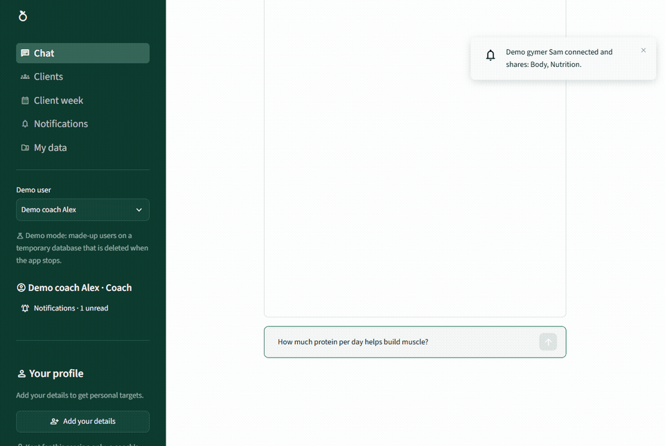
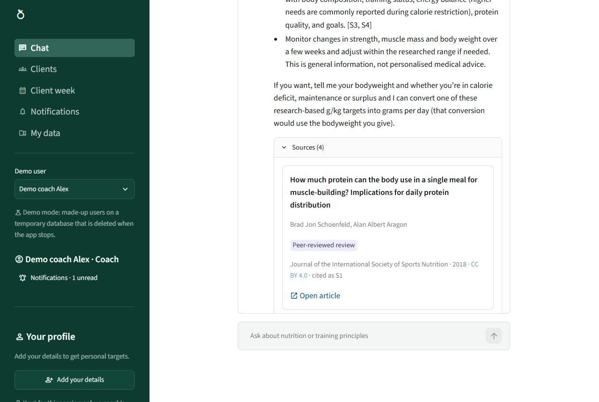
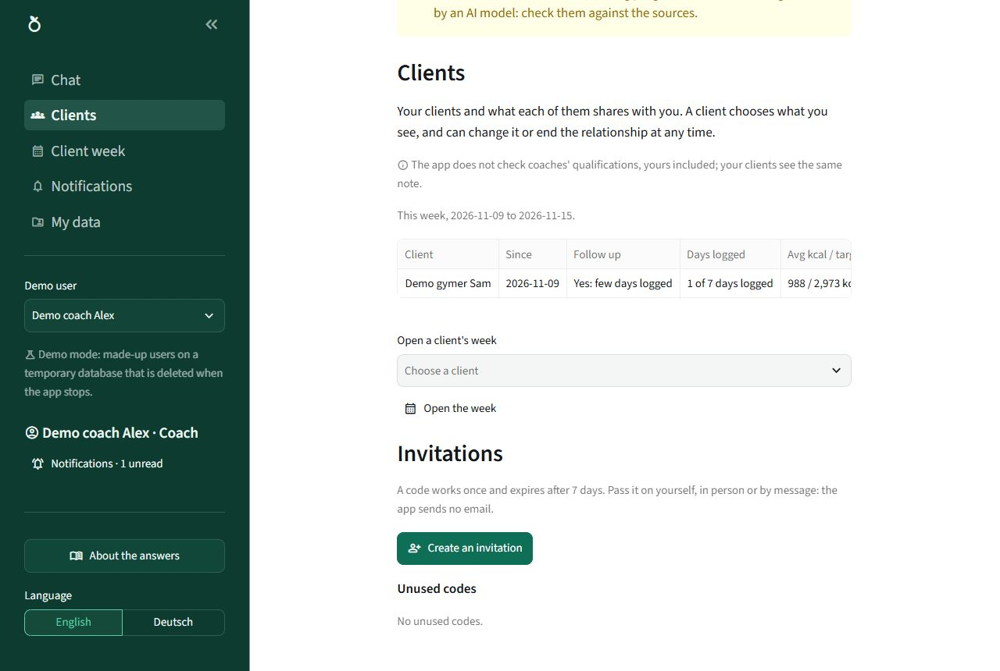
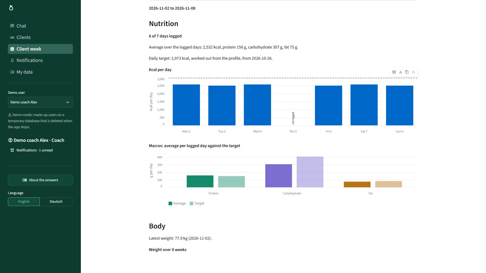
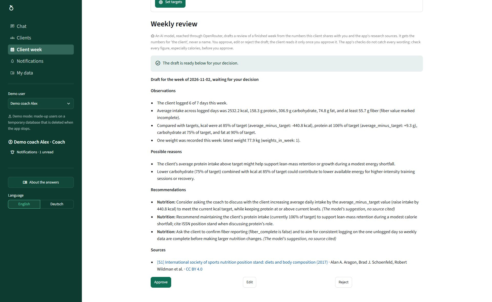
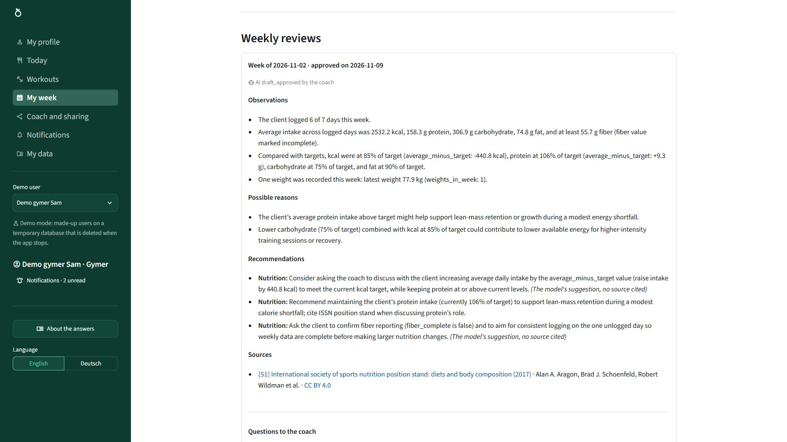
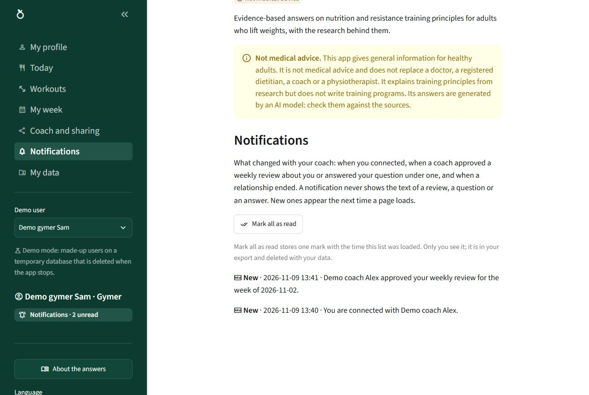

# Fitcoach AI Assistant

A coach-first workspace for gym coaching, with an AI agent that works for the coach. Coaches follow their clients' nutrition and training in one place and get a weekly review of each client drafted by an AI workflow, which they approve, edit or reject before the client reads it. Clients (gymers) log their food, weight and workouts and choose what their coach sees. A research chat answers questions about nutrition and resistance training principles from open-licensed sports science articles, with citations, and calls tools for personal calculations and food lookups.

**Status:** built for two course briefs of the Turing College AI Engineering course. Sprint 2 ([`docs/BRIEF.md`](docs/BRIEF.md)) built the research chat (advanced RAG and tool calling); Sprint 3 ([`docs/BRIEF_SPRINT3.md`](docs/BRIEF_SPRINT3.md), deadline 2026-11-23) turned it into the agent and the coach-first workspace this README describes. Every ticket and its status are in [`docs/IMPLEMENTATION_PLAN.md`](docs/IMPLEMENTATION_PLAN.md); what each change did and why is in [`docs/PROGRESS.md`](docs/PROGRESS.md).



*The demo coach asks a question; the answer cites its sources (demo mode, made-up users; sped up, no sound).*

**Video:** [a three-minute walk-through of the app on YouTube](https://youtu.be/A2SC3zs6ovM): the coach's chat, Clients, a client's week, a weekly review the coach approves, and the gymer's pages (demo mode, made-up users and data; a synthetic narrator voice made offline with Piper, with subtitles; credits in the video's description).

## Who it is for

**The problem:** coaches who follow gym clients' nutrition and training gather the data by hand from messages, spreadsheets and apps, and a weekly review of each client takes time, so clients get feedback late. (This is the owner's working assumption, not yet checked with coaches; [`docs/PRD.md`](docs/PRD.md), "Sprint 3".)

**How the app addresses it:** the client logs meals, workouts and weight in one place and chooses what the coach sees; the coach sees each client's week and gets a weekly review drafted by an AI workflow; the coach decides what the client reads. The AI drafts and answers, the coach decides.

**Users:**

- **Coach:** a nutrition coach or personal trainer (qualifications are not checked). Gets the AI chat, the client list, each client's week, the weekly review drafts, and long-term memory of their own working preferences.
- **Gymer:** the client, a healthy adult (18 or over) doing recreational strength training. Logs their own data, shares it by scope (nutrition, training, body), reads the reviews their coach approved and can ask the coach a question under one. A gymer has no AI chat: the AI serves the coach (only when the data store cannot be opened does a gymer use the app as a guest, with the guest's chat and nothing stored).
- **Guest:** in a copy with no Google sign-in and no demo mode set up, anyone can use the research chat; nothing is stored.
- **Demo users:** a made-up coach and two gymers, so the coach and gymer flows can be tried without a Google account.

**Why an agent:** a research question, a food question and a calculation need different steps, and some need two; the chat's agent chooses them from what its tools return (section 17 of [`docs/ARCHITECTURE.md`](docs/ARCHITECTURE.md)). The weekly review needs the opposite: the same checked steps every week and a person's decision, so it is a fixed workflow with the coach in the loop.

## What it does

The app runs locally; it is not deployed. These screenshots come from its demo mode, with made-up users and data ([`docs/TESTING.md`](docs/TESTING.md), "README images (T9.27)", says how they are captured again).

<table>
<tr>
<td width="50%"><br><sub>The coach's chat: answers cite the research they use, listed under Sources.</sub></td>
<td width="50%"><br><sub>Clients: each client's week at a glance, with a flag for whom to follow up.</sub></td>
</tr>
<tr>
<td><br><sub>Client week: one client's logged days and intake against the target, from what the client shares.</sub></td>
<td><br><sub>A weekly review drafted by an AI model: the coach approves, edits or rejects it; the client sees it only once approved.</sub></td>
</tr>
<tr>
<td><br><sub>The gymer's My week: the review, labelled as an AI draft approved by the coach.</sub></td>
<td><br><sub>Notifications: what changed with the coach, never the text of a review.</sub></td>
</tr>
</table>

**The AI parts:**

- **Research chat with sources** (guests and coaches): ask about nutrition or resistance training principles; the agent searches the research when it needs to and the answer cites what it used (`[S1]`, `[S2]`...), with each cited article listed by title, authors, year, evidence tier, licence and link. When the sources do not cover a question, the app says so instead of guessing. Training answers explain principles with the ranges a source gives and the population it studied; the app writes no workout programs, and a question about pain or an injury gets a pointer to a doctor or physiotherapist, before any model is asked.
- **Personal numbers:** enter your weight, height, age, sex, activity level and goal (in kg and cm, or lb and ft/in); the agent calls tools for your daily energy needs, your calorie and macro targets, the nutrients of a food (from the USDA table, and with an optional key the USDA API) and a check of a whole day's meal plan. Tool results show as tables, and the macro split as a chart. The profile stays in the session; the tools read it from the app, never from the model.
- **Conversation memory:** the chat remembers the session's earlier questions and answers, so a follow-up such as "and for 200 g?" works; "New chat" starts again and deletes the old conversation. It is kept in memory only, never written to disk (T9.4).
- **Long-term memory for coaches:** the assistant may propose saving one of the coach's own working preferences ("keep answers short"); it is saved only when the coach approves it on a card (Save, Edit or Discard), is refused if it names a client or a medical topic, and later chats follow it. A coach sees and deletes their preferences in My data (T9.7).
- **Coach assistant** (T9.17): in a coach's chat the assistant can list the coach's active clients with this week's logging and a follow-up flag, and read one client's week (only what the client shares), so "Who logged fewer than 4 days this week?" is answered from the logs. The client tools never give the model a client's name: it knows each client by a reference for the chat ("client-1"), and the page shows the name in its place (a name the coach types in a question still reaches the model).
- **Weekly review** (T9.16): under a finished week, the coach starts a draft. An AI workflow checks access, computes the week's figures, searches the research sources, drafts observations, possible reasons and recommendations with citations, and checks them in code (the common ways to write an intake below the calorie floor, a diagnosis or a training program, the numbers and the sources). The coach approves, edits or rejects the draft, and the gymer reads it only once approved, labelled as an AI draft the coach approved.

**The workspace (no AI):**

- **Sign-in, roles and My data** (T9.5): sign in with Google, choose Coach or Gymer once and a display name. A user's saved data is listed, exported as JSON and deleted (one entry or everything) on My data; a target the coach set goes only with Delete everything.
- **Invitations and sharing** (T9.12): a coach invites a gymer with a single-use code passed on by hand; the gymer accepts it, chooses what the coach sees (nutrition, training, body) and can change it or end the relationship at any time.
- **The gymer's diary** (T9.13, T9.14): a Today page logs food from the USDA table (grams and meal, with the nutrients kept for that amount) and weight; a Workouts page logs sets of an exercise list we wrote (reps, weight, an optional RPE) and shows the week's totals as facts.
- **Dashboards** (T9.15, T9.17): the coach's Clients page shows each client's week (days logged, average kcal against the target, sessions, latest weight, review) with a follow-up flag, "Not shared" for what the client keeps private; Client week charts one client's week, and there a coach can set the client's daily targets (never below the calorie floor), which the gymer sees as set by the coach. The gymer's My week shows their week and the approved reviews.
- **Questions to the coach** (T9.25): under an approved review the gymer can ask the coach a question and the coach answers it on Client week; the text is never sent to an AI model, and a question about pain, an injury, medication or similar is refused with a pointer to a doctor.
- **Notifications** (T9.29, T9.30): a bell and a list of what changed with the other side (connected, a scope turned on or off, an approved review, a question or an answer, an ended relationship), never the text of a review, a question or an answer.
- **Also:** token use and cost under each answer and in the Details tab, which also shows how the last answer was found; a session summary as PDF, built in memory; English and German (the "Language" control at the end of the sidebar); light and dark mode.
- **Safety:** input validation, prompt injection protection, a per-session rate limit, and domain guardrails: no dosing advice on performance-enhancing drugs, a 1200 kcal/day calorie floor in the tools and the review, and a redirect to a professional for under 18s, pregnancy, medical conditions, pain and injuries, and signs of disordered eating. A "not medical advice" disclaimer is always visible.

A guest's profile is kept in the app's memory for this session only and sent to the model (through OpenRouter) only when a question needs it; it is never logged, written to disk or put in the knowledge base. A signed-in gymer's Save writes it, the Today page their food and weight entries and the Workouts page their workouts, to the local store (`data/store/`, gitignored, not encrypted), and a gymer has no chat (T9.5; except as a guest when the store cannot be opened): their details reach a model only as the week's figures (averages and totals for "the client", never a name or a food) when their coach starts a weekly review (T9.16) or the coach's chat reads that client's week (T9.17, by a reference, never a name), within the scopes they share, through OpenRouter; the data file holds an ID made from the Google account, never its name, e-mail address or picture, and never a chat (Streamlit's sign-in cookie in the browser keeps the Google name, e-mail address and picture link until sign-out, at most 30 days). In a coach's chat, the coach's newest approved preferences and the chat's earlier questions and answers go to the model (through OpenRouter) with each new question, and the coach's own profile only inside tool results, as a guest's; in any chat, with the optional USDA key set, a food's name may go to USDA's FoodData Central API. Use made-up data only ([`docs/PRD.md`](docs/PRD.md), "The privacy change").

## How to use it

Start the app as in "Run locally" below. What you see depends on how the copy is set up:

- **As a guest** (no `[auth]` section and no demo mode): the app opens on the chat. Ask a question, or add your details in the sidebar ("Edit details") so the tools can work out your targets. Nothing is stored.
- **In demo mode** (`DEMO_MODE = true`, no `[auth]` section): the start page offers a "Demo user" picker with a made-up coach and two made-up gymers, on a temporary database deleted when the app stops. Pick the coach to try the chat, Clients, Client week and the weekly review; pick a gymer to try Today, Workouts, My week and Coach and sharing. Switch users with the picker in the sidebar.
- **With Google sign-in** (an `[auth]` section, "Sign-in and demo mode" below): sign in, choose Coach or Gymer once and a display name.
  - **As a coach:** Chat (the research chat with your client tools), Clients (your clients and invitation codes), Client week (one client's week, the weekly review and the questions under it), Notifications and My data.
  - **As a gymer:** My profile (your details and targets; the first Save asks you to agree that they are stored), Today, Workouts, My week, Coach and sharing (accept a code, choose the scopes, end the relationship), Notifications and My data. A gymer has no chat (except as a guest when the data store cannot be opened).

## Use cases

What the user does, and what the app and its AI do in each.

1. **A coach invites a gymer.** On Clients the coach creates an invitation code, shown once and valid for 7 days, and passes it on by hand. The gymer enters it on Coach and sharing and chooses the scopes the coach may see. No AI is involved: the store checks the code (a gymer has 5 tries a day, and one coach at a time), creates the relationship, and from then on checks the active relationship and each scope on every read of the coach. Both sides get a notification.
2. **A gymer logs a day.** On Today the gymer picks foods from the USDA table with their grams and meal, and their weight; on Workouts the exercises with sets, reps, weight and an optional RPE. The app stores each entry with its nutrients for that amount and shows the day's and the week's totals; My week charts the week. No AI is involved; a model sees this data only as the week's figures, when the coach starts a review or asks the chat about this client, and only within the shared scopes.
3. **A coach approves a weekly review and the gymer reads it.** Under a finished week on Client week, the coach presses "Draft weekly review". The workflow checks the coach's access, computes the week's figures in code, searches the research for the topics they raise (protein or calories off the target, training), and has the model draft observations, possible reasons and recommendations with citations; the code checks the draft (sources, numbers, the calorie floor, no diagnosis, no training program) and lets the model try once more if it fails. The coach approves, edits (the same checks run on the edit) or rejects it. Only an approved review reaches the gymer's My week, labelled as an AI draft approved by the coach, with a notification; the gymer can then ask the coach a question under it.
4. **A guest asks a research question.** "How much protein a day helps build muscle?" The input guard checks the question before any API call. The agent decides to search: the search rewrites the query three ways and picks filters, runs vector and keyword search over the articles, and returns the passages close enough to the question. The model answers from them with `[S#]` citations, and the Sources list shows each cited article. A food question ("How much protein is in 150 g of oats?") calls the food tool instead and searches nothing; a question the sources do not cover gets "Our sources do not cover this question".
5. **A guest or a coach asks a training question.** "How many sets per week build the most muscle?" The agent searches the resistance training reviews and answers with the ranges they give, each with the population the study looked at, and cites them. A request for a personal program gets the principles and the sentence "This app does not create personalized workout programs."; a question about pain or an injury gets a pointer to a doctor or physiotherapist from the guard, before any model call.
6. **A coach asks about their clients.** "Who logged fewer than 4 days this week?" The agent calls `list_my_clients`, which returns each active client's logging this week by a reference ("client-1"), and answers from those figures; the page shows the clients' names in place of the references. For one client's week it calls `get_client_week`, which reads only what that client shares.

## How it works

Six parts, two of them AI (the chat agent and the weekly review, both built with LangGraph; [`docs/ARCHITECTURE.md`](docs/ARCHITECTURE.md), sections 1, 2, 16 and 17):

1. **Input guard** (`src/guard.py`, `src/guardrails.py`): cleans the text and rejects empty, too long or prompt-injection input and high-risk requests before any API call.
2. **The chat agent** (`src/agent/`): a ReAct loop. The chat model gets the question, after the conversation's latest earlier questions and answers (T9.4) and, for a coach, the approved preferences, and calls the search, a tool, both, or answers; a food or calculator question searches nothing. A reply with nothing to rest on (no passage found, no tool run) is not shown: the app says the sources do not cover the question. Each call is checked against its schema before it runs, at most 4 rounds and 2 searches a turn.
3. **The search tool:** a small model rewrites the query three ways in English and picks optional filters (topic, year, evidence tier) from a fixed schema (`src/rag/query_translation.py`); vector search in a local Chroma index plus BM25 keyword search, merged with Reciprocal Rank Fusion, at most three passages per article; a distance limit decides whether the sources cover the query at all (`src/rag/`). The passages go back to the agent as delimited data.
4. **The other tools** (`src/tools/`): energy needs, macro targets, food lookup and the meal plan check, plain code with the calorie floor built in; for a coach, the client tools and `remember_preference`, which pauses for the coach's approval.
5. **The weekly review** (`src/agent/review.py`, `src/weekly_review.py`): a fixed workflow (authorise, compute, retrieve, draft, validate, then the coach's decision), with the review's run kept in a local file while it waits.
6. **The store** (`src/store/`): SQLite with parameterised queries; every read of another user's data checks the role, an active relationship and the shared scope, and the coach's reads are audited.

The knowledge base is 20 open-access sports nutrition articles (ISSN position stands and peer-reviewed reviews, all CC BY) and one correction notice, plus 10 open-access resistance training reviews (CC BY; T9.19), split into chunks with their licence and citation data. Food values come from USDA FoodData Central Foundation Foods (CC0), and, with an optional key, from the FoodData Central API for foods the table lacks (CC0; T9.9). Models run through OpenRouter: `openai/gpt-5-mini` for answers and the review, `openai/gpt-5-nano` for query translation, `qwen/qwen3-embedding-8b` for embeddings. Logs are JSON lines with no personal data; tracing to LangSmith is optional and masked (T8.2, T9.8), and the evaluation can run as LangSmith experiments to compare versions side by side (T9.33).

## Course brief coverage

**Sprint 3** ([`docs/BRIEF_SPRINT3.md`](docs/BRIEF_SPRINT3.md); full table in [`docs/ARCHITECTURE.md`](docs/ARCHITECTURE.md) section 15):

| Brief item | Where |
|---|---|
| Core 1: purpose and users | "Who it is for" above; [`docs/PRD.md`](docs/PRD.md), "Sprint 3" |
| Core 2: core functionality | "What it does" and "Use cases" above; [`docs/ARCHITECTURE.md`](docs/ARCHITECTURE.md) sections 2, 16 and 17 |
| Core 3: a UI for every function | pages per role (section 16), [`docs/UI_DESIGN.md`](docs/UI_DESIGN.md) |
| Core 4: tools, error handling, real-world use | section 10 (every error path with the test that shows it), sections 16 and 17 |
| Core 5: documentation | this README, [`docs/ARCHITECTURE.md`](docs/ARCHITECTURE.md), [`docs/TESTING.md`](docs/TESTING.md) |
| Optional tasks | Medium 1 (token cost), 2 (memory), 4 (authentication and personalisation), 8 (guard against misuse); Hard 1 (agentic RAG), 2 (LangSmith observability), 3 (DeepEval report). In part only, not counted for maximum points: Medium 3 (a tool calling an external API) and Hard 5 (an external data source), as the USDA FoodData Central API is a fallback inside the existing food tool, asked only when the table has no match, not a tool of its own, and is checked by mocked tests only until the owner's USDA key allows a live check |
| Agent types, function calling | [`docs/ARCHITECTURE.md`](docs/ARCHITECTURE.md) section 17 |
| Reflection: problems, improvements, prompt engineering vs RAG vs agent | [`docs/TESTING.md`](docs/TESTING.md), "Known problems and suggested improvements (Sprint 3, T9.11)" and "When prompt engineering, RAG or an agent fits (T9.11)" |

**Sprint 2** ([`docs/BRIEF.md`](docs/BRIEF.md)):

| Brief item | Where |
|---|---|
| Core 1 and advanced RAG: knowledge base, chunking, embeddings, similarity search, query translation, structured retrieval | [`docs/ARCHITECTURE.md`](docs/ARCHITECTURE.md) sections 4-5 |
| Core 2: at least 3 tools | four tools, section 6 |
| Core 3: domain, focused knowledge base, domain prompts, security | [`docs/PRD.md`](docs/PRD.md), [`docs/SOURCES.md`](docs/SOURCES.md), [`docs/SECURITY.md`](docs/SECURITY.md), `src/prompts/` |
| Core 4: LangChain with OpenRouter, error handling, input validation | sections 2, 8, 10 |
| Core 5: UI with sources, tool results and progress | section 7, [`docs/UI_DESIGN.md`](docs/UI_DESIGN.md) |
| Optional tasks | Easy 1 and 3, Medium 3, 5, 6 and 7, Hard 1 and 4 (section 15) |
| Reflection: problems and improvements | [`docs/TESTING.md`](docs/TESTING.md), "Known problems and suggested improvements (T6.1)" |

## Run locally

Requires Python 3.14 and an [OpenRouter](https://openrouter.ai/keys) API key.

```bash
python3.14 -m venv .venv      # Windows: py -3.14 -m venv .venv
source .venv/bin/activate     # Windows: .venv\Scripts\Activate.ps1 (PowerShell)
                              # or source .venv/Scripts/activate (Git Bash)
pip install -e ".[dev,eval]"   # eval: DeepEval, for the evaluation scores and their tests
```

If PowerShell says "running scripts is disabled on this system", run `Set-ExecutionPolicy -Scope Process RemoteSigned` first (for this window only), or skip activation and call the venv's programs directly (below). The `# ...` notes in the code blocks are for bash and PowerShell; leave them out in cmd.

Set the key in one of two ways (never commit it):

- copy `.streamlit/secrets.toml.example` to `.streamlit/secrets.toml` (gitignored) and paste your key there, or
- set the `OPENROUTER_API_KEY` environment variable.

Run every command below in a terminal where `.venv` is active: the prompt starts with `(.venv)`. A new terminal does not have it: activate it again (second line above), or call the venv's programs directly:

- Windows (PowerShell or cmd): `.venv\Scripts\streamlit.exe run app.py`, `.venv\Scripts\python.exe scripts/build_index.py`
- Windows (Git Bash): `.venv/Scripts/streamlit.exe run app.py`, `.venv/Scripts/python.exe scripts/build_index.py`
- macOS and Linux: `.venv/bin/streamlit run app.py`, `.venv/bin/python scripts/build_index.py`

If a command fails with a `ModuleNotFoundError`, such as `No module named 'langchain_chroma'` from the app or `No module named 'chromadb'` or `'src'` from a script (whichever import comes first), it was started with another Python (the system one), not the venv's.

Before the first question, build the knowledge base once:

```bash
python scripts/download_sources.py   # fetch the approved articles from the Europe PMC API into data/raw/ (no key needed)
python scripts/build_index.py        # embed them into the local index in chroma/ (needs the key; under one US cent at the 2026-10 price)
```

Stop the app before rebuilding the index and start it again afterwards.

Then:

```bash
streamlit run app.py      # start the app
python -m pytest -q       # run the tests (no key needed; all API calls are mocked)
ruff check .              # lint
ruff format --check .     # format check
```

The app runs locally only for now; a public deployment needs one of the options in [`docs/DEPLOYMENT.md`](docs/DEPLOYMENT.md).

### Sign-in and demo mode (optional)

- **Sign in with Google:** create a Google OAuth client for `http://localhost:8501/oauth2callback` in Testing mode, add the accounts that may sign in as test users, then fill the `[auth]` and `[account]` sections of `.streamlit/secrets.toml` (commented out in the example). Step by step: [`docs/DEPLOYMENT.md`](docs/DEPLOYMENT.md), "Sign-in with Google on localhost". The app then opens on a start page with only "Sign in with Google" (no guest once sign-in is set up; a copy without it opens as a guest). At the first sign-in you choose Coach or Gymer (once) and a display name; a gymer's details are saved when they press Save (the first time after ticking that they understand they are stored), and My data shows, exports or deletes them.
- **Demo mode:** with no `[auth]` section, set `DEMO_MODE = true` in `.streamlit/secrets.toml` (or `DEMO_MODE=1` in the environment). The start page offers a "Demo user" picker with a coach and two gymers, all made up (no guest), on a temporary database that is deleted when the app stops.
- **Neither:** the app runs for guests; nothing is stored.

### Tracing with LangSmith (optional)

Off by default. To see each turn's run tree (the graph's nodes, the tools called, statuses, token counts, timing) in LangSmith, create a LangSmith account in the **EU** region, then set `FITCOACH_TRACING = true` and `LANGSMITH_API_KEY` in `.streamlit/secrets.toml` (or the environment). Every question, answer, profile value, logged value, review text and tool argument or result is replaced by `[masked]` before it is sent, and each trace carries the `turn_id` of the turn's log lines (T9.8; what is sent: [`docs/SECURITY.md`](docs/SECURITY.md)). LangSmith's own `LANGSMITH_TRACING` flag is ignored. A user's traces are masked because the app holds health data: LangSmith gets the shape of a turn, never its content. The evaluation's own runs, on the owner's questions and made-up profiles only, are the exception: `python -m scripts.run_evaluation --langsmith` records them unmasked as a LangSmith experiment, so versions can be compared question by question (T9.33; what each stage of the evaluation covers, and what it cannot: [`docs/TESTING.md`](docs/TESTING.md), "The agent's evaluation lifecycle").

### Food lookup through the USDA API (optional)

The chat's food lookup reads the committed USDA Foundation Foods table. With a free FoodData Central API key (https://fdc.nal.usda.gov/api-key-signup/), it also searches the USDA FoodData Central API for a food the table does not have (olive oil, butter, tofu): set `USDA_FDC_API_KEY` in `.streamlit/secrets.toml` (commented out in the example) or in the environment. Only the food's name is sent; the result names the API as its source. Without the key the app works as before.

### Data and evaluation scripts

These are not needed to run the app:

- **Attribution:** after changing `data/sources.json` or `data/usda_foods.csv`, run `python scripts/generate_attribution.py` to regenerate [`ATTRIBUTION.md`](ATTRIBUTION.md).
- **USDA foods table:** `data/usda_foods.csv` is committed. To rebuild it, download the Foundation Foods CSV zip from https://fdc.nal.usda.gov/download-datasets/ into `data/usda/` (gitignored), then run `python scripts/prepare_usda.py` and `python scripts/generate_attribution.py`.
- **Live checks and evaluation** (need the key, and all but `scripts/live_check_llm.py` the index): `scripts/live_check_llm.py`, `scripts/live_check_retrieval.py`, `scripts/compare_retrieval.py` and `scripts/run_evaluation.py` (with `--score`, the DeepEval scores). How to run each one and their results are in [`docs/TESTING.md`](docs/TESTING.md). `scripts/check_eval_baseline.py` (no key needed) compares an evaluation run's results file with the committed baseline.

## Documentation

| Document | Contents |
|---|---|
| [`docs/BRIEF.md`](docs/BRIEF.md) | Summary of the Sprint 2 course brief |
| [`docs/BRIEF_SPRINT3.md`](docs/BRIEF_SPRINT3.md) | Summary of the Sprint 3 course brief and of the review of Sprint 2 |
| [`docs/PRD.md`](docs/PRD.md) | What we build: features, guardrails, acceptance criteria |
| [`docs/ARCHITECTURE.md`](docs/ARCHITECTURE.md) | Technical design and decisions; how the agents work (section 17) |
| [`docs/UI_DESIGN.md`](docs/UI_DESIGN.md) | Layout, tabs, language and themes |
| [`docs/IMPLEMENTATION_PLAN.md`](docs/IMPLEMENTATION_PLAN.md) | Tickets, order and status: the index, one file per ticket with its acceptance criteria in [`docs/tickets/`](docs/tickets/) |
| [`docs/TESTING.md`](docs/TESTING.md) | Test strategy, evaluation results, known problems and live checks |
| [`docs/SECURITY.md`](docs/SECURITY.md) | Threat model and controls |
| [`docs/SOURCES.md`](docs/SOURCES.md) | Knowledge base sources and their licences |
| [`ATTRIBUTION.md`](ATTRIBUTION.md) | Credits for every source and the food data |
| [`docs/DEPLOYMENT.md`](docs/DEPLOYMENT.md) | Deployment notes and the transfer checklist |
| [`docs/PROGRESS.md`](docs/PROGRESS.md) | What each change did and why: the index, one file per entry in [`docs/progress/`](docs/progress/) |

The app was called "Nutrition AI Assistant" until 2026-10-30 (T9.22), so the history and earlier commit messages use that name. The work started in https://github.com/NMH1988/nutrition-ai-assistant and continues, since 2026-10-26, in https://github.com/NMH1988/fitcoach-ai-assistant, whose issues and pull requests are mostly written with the repository name (e.g. NMH1988/fitcoach-ai-assistant#52). Not always: in text and commit messages written since 2026-10-26, a bare PR or issue number next to work of that repository may be one of its numbers (e.g. "PR #37" for T1.10, "PR #35" for T9.6, and every "Merge pull request #n" from T8.3's #29 on (T8.2's #121, merged the same morning, is the old repository's)); a progress entry's heading (`docs/progress/`) names the repository of its PR.

Otherwise, and always before 2026-10-26, numbers such as `#76` in the docs and commit messages are issues and pull requests in the repository where the work started, https://github.com/NMH1988/nutrition-ai-assistant; a source number such as "#18a" is a row in `docs/SOURCES.md`. Issue and PR numbers in the course repository, if it has any, are unrelated.

Stack: Python, Streamlit, LangChain, LangGraph, OpenRouter, Chroma, rank-bm25, SQLite, reportlab, USDA FoodData Central.

## Copyright and licences

Copyright (c) 2026 Nguyen Mai Hoang. All rights reserved. This covers the project's own code and documentation. You may view the code and run it to evaluate the project, and view and fork it on GitHub as GitHub's Terms of Service allow; any other use, such as copying (beyond the local copy needed to run it), modifying, redistributing or commercial use, needs the author's written permission. No open-source licence is granted. Third-party content is not covered by this notice and keeps its own licence: the knowledge base articles and the USDA data ([`docs/SOURCES.md`](docs/SOURCES.md), [`ATTRIBUTION.md`](ATTRIBUTION.md)) and the bundled DejaVu fonts ([`assets/fonts/LICENSE`](assets/fonts/LICENSE)).

The knowledge base uses only openly licensed material (CC BY articles and the public-domain USDA FoodData Central data), each credited in [`ATTRIBUTION.md`](ATTRIBUTION.md). The article texts are not committed: `scripts/download_sources.py` fetches them. No author, journal, society or USDA endorses this app. The PDF summary uses the bundled DejaVu fonts.

## Disclaimer

This project gives general information for healthy adults. It is not medical advice and does not replace a doctor, a registered dietitian, a coach or a physiotherapist. It explains training principles from research but does not write training programs. Its answers are generated by an AI model: check them against the sources.
