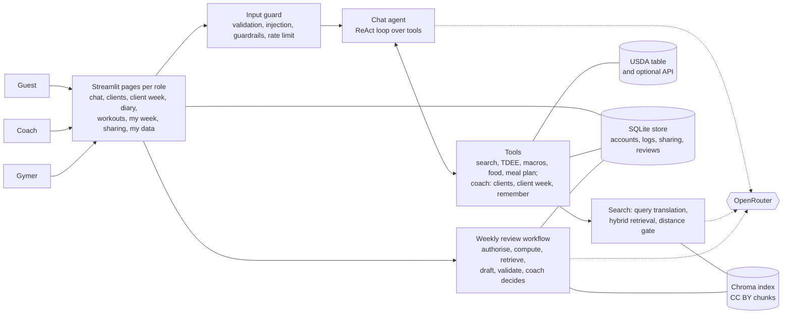
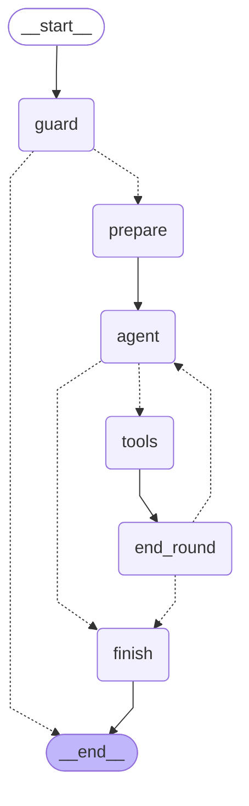
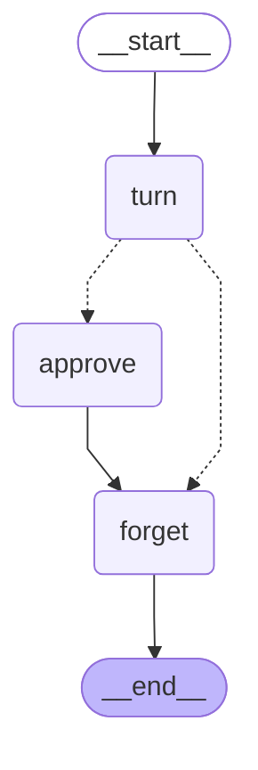
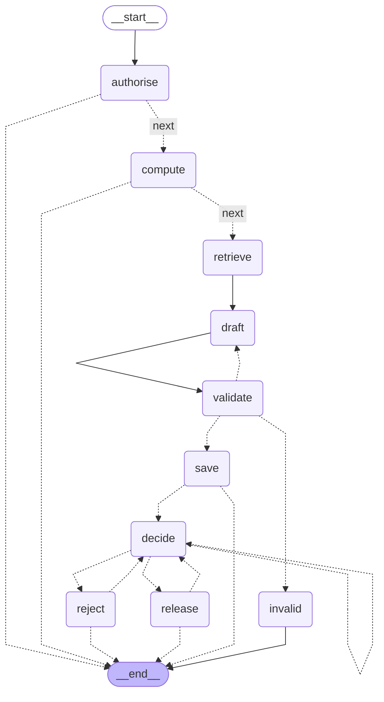

# Architecture

**Status:** approved by the owner on 2026-10-19, including decisions **D1-D8** (section 13); the Sprint 3 decisions **D9-D21** approved on 2026-10-25, **D22** (training principles) on 2026-10-26 and **D23** (notifications) on 2026-11-06 (section 13), built by their tickets. Inputs: `docs/BRIEF.md` and `docs/BRIEF_SPRINT3.md` (course requirements), `docs/PRD.md` (product decisions), `docs/SOURCES.md` (approved sources), `.claude/rules/` (rules). Every section describes the app as it is (T9.11): sections 1-12 the whole app, section 16 the Sprint 3 parts (the role tools, memory, the weekly review, the store, notifications, the pages), and section 17 how the agents work, how function calling is implemented, why this design, and which kind of agent each part is.

**Models** (the Sprint 1 list, reused by choice; the Sprint 2 brief names none): `openai/gpt-5-mini` (default for answers), `openai/gpt-5-nano` (query translation), `openai/gpt-5` (selectable). Embeddings: `qwen/qwen3-embedding-8b`. All through OpenRouter. Checked on OpenRouter's model lists on 2026-10-19: all are listed; the three chat models support tool calling and none supports `temperature`.

## 1. Overview

Since Sprint 3 the app is a coach-first workspace with two AI parts, both built with LangGraph (section 17 explains them side by side):



- **The chat agent** (guests and coaches; D9-D12, sections 2 and 17): each turn passes the input guard, then the model decides in a loop whether to search the knowledge base, call a tool, both, or answer, and stops when it has an answer with a basis or reaches the round limit. The session's earlier turns are its short-term memory; a coach's approved working preferences are its long-term memory. The UI shows the answer with its sources, the tool results, the searches it ran and the token cost.
- **The weekly review** (coaches; D17, section 16): a fixed workflow, not a free agent. It checks access, computes the week's figures in code, searches the evidence for the topics the figures raise, has the model draft the review once (twice if the checks fail), validates the draft in code and pauses until the coach approves, edits or rejects it; only then does the gymer read it.
- **No AI for gymers** (T9.24): a gymer logs food, weight and workouts, chooses what the coach sees, and reads the reviews the coach approved; their data reaches a model only as the week's figures, within the scopes they share (`docs/PRD.md`, "Sprint 3").

Until Sprint 3 one chat turn ran a fixed pipeline: guard, query translation, hybrid retrieval, then an answer step in which the model could call tools (D1, D2). T9.2 rebuilt it as a LangGraph `StateGraph` with the same steps as nodes, and T9.3 made the search one of the agent's tools (D10).

## 2. One chat turn, step by step

1. **UI** receives the message. A `st.status` box shows each step while it runs (the brief's progress indicator).
2. **Input guard** (`src/guard.py`), before any API call: raw input over `MAX_RAW_INPUT_CHARS` is rejected before anything else; then the text is cleaned (Unicode NFC, control and invisible characters dropped, trimmed; this is the text the model gets) and checked for empty or too long input (`MAX_INPUT_CHARS`, after cleaning) and for prompt-injection patterns, which run on NFKC-folded copies (with invisible characters removed and as spaces, and with accents stripped) (English and German, the German since T7.4, written with "ss" for "ß" and matching "ü", "ue" and "u" through `german()` in `src/german.py`; instruction overrides, requests for the hidden prompt, role changes and jailbreak phrases, fake role markers and look-alikes of our `<user_input>`/`<sources>` delimiters, also with attributes, a hyphen or space, or a closing slash, and role lines after Markdown markers such as `**System:**` or `> System:`), then the domain guardrails (`src/guardrails.py`, T5.3, on the same folded copies, in English and German since T7.4: performance-enhancing drug dosing is refused; under 18, pregnancy and breastfeeding, medical conditions and medication, and signs of disordered eating, including a daily intake below `CALORIE_FLOOR_KCAL`, are redirected to a professional with a fixed message; the turn ends as kind `guardrail`), and last the per-session rate limit (`RateLimiter`, kept in `st.session_state`). The rate limit counts accepted questions, one per turn however many model calls the turn makes; rejected input does not count. Rejected input makes no API call and gets a fixed message that never quotes it. A chat turn starts with the graph's `guard` node, which runs these checks and ends the turn on a rejection before any other node runs (T9.2); `run_guarded(text, limiter, call)`, which calls the rest with the cleaned text only when the guard accepts it, stays for other callers.
3. **The agent decides whether to search** (T9.3, D10; `src/agent/search.py`): the answer model (step 5) first gets the question alone with the four tools and `search_knowledge_base`. A research question searches; a food or calculator question calls its tool and searches nothing, so no research passage reaches the model (the Sprint 2 review, point 3); a question about the user's targets may do both, in one round or two. A search takes one argument, the query the model writes (`SearchArgs`: one text of 1 to `SEARCH_QUERY_MAX_CHARS`, 500, characters after stripping, no other field; anything else gets `INVALID_SEARCH_QUERY_MESSAGE` and searches nothing), and runs steps 3a and 4 on that query; at most `MAX_SEARCHES_PER_TURN` (2) searches run in a turn, a later call gets `TOO_MANY_SEARCHES_MESSAGE`. The chunks come back inside a delimited `<sources>` block as the search's tool message (`chat.sources_block()`), escaped like every block. A turn's searches share one `SearchLog` in the run's context: the round's calls run one at a time, so a search numbers its new chunks after the ones before it, even in the same round, and a chunk found again keeps its first label, so the `[S#]` labels stay unique across the turn and the Sources list shows each cited article once. The model's replies stay hidden until the answer has a basis: a search found a relevant chunk or a tool gave a result (`config.BASIS_TOOL_STATUSES`: ok, found, not found, or "profile needed", whose answer points to the "Add your details" button; a refused or failed call does not count; owner's choice of 2026-10-29, after the security review of PR #46). A reply with no tool call before that is never shown, and a round whose searches found nothing with no tool result (`BASIS_TOOL_STATUSES`) ends the turn: both give `NO_SOURCES_MESSAGE` with no further model call (AC-2; owner's choice of 2026-10-29, which replaced T3.5's skip before the answer call: an off-topic question now costs the model's one call that decides, plus a search if it makes one). The profile is never in the messages (owner's choice of 2026-10-29): the energy and meal plan tools read it from the app, so `<profile>`, T3.5's `needs_profile` and the "Profile block sent" badge are gone.
3a. **Query translation** (`src/rag/query_translation.py`, T3.2; since T9.3 inside each search, on the model's query): one call to a small model (`openai/gpt-5-nano`) with structured output (`with_structured_output(QueryPlan, method="json_schema")`, which langchain-openai sends with `strict: true`): 3 rewrites of the question plus optional filters (`topics`, `min_year`, `evidence_tier`). Skipped filters mean "no filter". The same reply carries two required booleans (T3.5): `needs_tool` and `needs_profile` (`StrictBool`, so "yes" or 1 makes the plan unusable); since T9.3 the agent decides on tools and the profile is never sent, so the turn no longer reads them (they stay in the schema and the owner's prompt, O7, until the owner drops them). The owner's prompt (`src/prompts/query_translation_system.md`, O7) is the system message; the query goes only inside `<user_input>` in the user message, escaped with `escape_prompt_data()` like the answer step's, and the messages are built with `SystemMessage` / `HumanMessage`, never a prompt template (T3.4's follow-up criterion); each turn stands alone (no history; owner's choice). `QueryPlan` checks exactly 3 non-blank rewrites of at most `QUERY_REWRITE_MAX_CHARS` (300; checked in Python, so the strict schema keeps to the keywords OpenAI's strict mode lists: no string lengths and no defaults, every field required), topics from `config.TOPICS`, `min_year` within `QUERY_MIN_YEAR_RANGE` and a tier of 1 or 2. A reply that fails the schema, is refused, empty or cut off (`InvalidReplyError`, `ReplyCutOffError`) falls back to the query alone with no filter; any other error (key, credit, rate limit, outage) ends the turn with its message, since the answer would meet it too. The rewrites go only to the search and the "How this answer was found" view, never to the answer model.
4. **Hybrid retrieval** (`src/rag/retriever.py`, `src/rag/hybrid.py`, T3.3; since T9.3 inside each search, where "the question" below is the model's query): for the question and each rewrite (the question is searched too, owner's choice in T3.2; a rewrite that repeats the question or another rewrite, ignoring case, is dropped), a vector search in Chroma and a BM25 keyword search, both with the same metadata filter (keyword search keeps only the IDs Chroma returns for that filter, `filter_ids()`, so the two cannot filter differently). Each search gives a ranked list (top `RETRIEVAL_TOP_K` each); all of them are merged with Reciprocal Rank Fusion (RRF, `1 / (RRF_K + rank)`, `RRF_K` = 60); the top 6 distinct chunks become the context. Vector search decides whether the sources cover the question: keyword search runs only when the question itself has a vector hit within the distance limit below (T3.8; before it, a hit of any rewrite was enough), since a BM25 match has no distance and a shared word alone would let an off-topic question through (owner's choice in T3.3); a chunk found only by keyword then joins the list with no distance. If nothing passes the filter, both searches run again with a looser one (T9.20): a plan whose only topic is `resistance_training` (`config.TRAINING_TOPIC`) runs again with that topic alone (its year and tier dropped; nothing more when it had neither), so the same distance gate holds on training chunks and no nutrition chunk, nor a training chunk found only by keyword, stands in for a missing training source, while a year or tier filter that is too strict still falls back; a plan whose topics are all nutrition runs again over the nutrition topics, so no training chunk joins it; a plan with no topic, with both domains, or no usable plan runs again with no filter; if still nothing, the answer says the sources do not cover the question. A chunk counts only within a cosine distance of `RETRIEVAL_MAX_DISTANCE` (0.62, from live checks on 28 questions: covered questions, short or long, at 0.28-0.54, unrelated ones from 0.70; near-domain ones in between are left to the prompt, which declines or redirects them) of the query that found it, but the question counts as covered only when a chunk is within the limit of the question itself (T3.8): the limit was measured on questions, not rewrites, and T3.5's live checks found that even a short query lands within the limit of some chunks, first boilerplate ones (removed by T3.7), then, after T3.7, others: the rewrite "VAR and offside rule in football" had 6 of 6 chunks within the limit (one article chunk, #6, and five short "Main text" chunks of the correction notice #18a, which T3.7 left in) while the question had none, and the offside question reached the answer model in 2 of 3 runs. Once the question is covered, every rewrite's chunks within the limit join the fused list, so a rewrite still finds passages the question's wording misses; a vague question whose own nearest chunk is further than the limit gets `NO_SOURCES_MESSAGE` even when its rewrites come close (owner's choice in T3.8, option 1 of: the question decides, a stricter limit for rewrites, a chunk close to at least two queries, a prompt rule against acronyms); when none is left the search's `<sources>` says no excerpt is close enough (`NO_SOURCES_BLOCK`), and step 3's rule decides whether the turn goes on (a tool that ran in the same round is a basis) or ends with `NO_SOURCES_MESSAGE` (before T9.3: T4.4's unseen call with the tools when the plan said `needs_tool`, and T3.5's skip of the answer call otherwise); the status never reaches "Writing the answer" then. All the queries are embedded in one call, and the retry without the filter reuses the same vectors. Until T3.3 the vector lists alone were merged by keeping each chunk once at its smallest distance, nearest first; `search()` still does this for vector-only retrieval (`retrieve()` and `scripts/compare_retrieval.py`). The filter is built by `build_filter()`: any of the topics (`$or` of `topics $contains`), `year $gte`, `evidence_tier $eq`, joined with `$and`. "No hits" means nothing within the distance limit, so a filter that keeps fewer but relevant chunks is not dropped. `retrieve()` (one question, no filter) stays for `scripts/live_check_retrieval.py`.
5. **Answer step** (the `agent`, `tools` and `end_round` nodes of `src/agent/graph.py`, with helpers in `src/chat.py`): the chat model (default `openai/gpt-5-mini`) gets the owner's system prompt (`src/prompts/answer_system.md`, read on each turn, followed by the chosen language's part, `src/prompts/answer_language_en.md` or `answer_language_de.md`, T7.2: the language is the app's language control (`en` or `de`; "English | Deutsch" in the sidebar since T9.23), passed to `run_turn(language=...)` as a fixed value, never read from the user's text, and only the owner's fixed text joins the system prompt), one user message holding only the user's message inside `<user_input>`, and, after each search, its tool message with the chunks inside `<sources>` labelled `[S1]`...(T9.3; before it, one user message with `<sources>`, `<profile>` when the plan said `needs_profile`, and `<user_input>`). The energy and meal plan tools read the session's profile from the app, never from the model, and no profile block is sent. Every text and metadata value put in any of these blocks is escaped first (`&`, `<`, `>` as HTML entities, `escape_prompt_data()` in `src/prompt_data.py`), so nothing inside can close or open a block, and the user message is plain content, never a prompt template (T3.4). The four tools and the search are bound with `bind_tools` (only the tools: never the model or `max_tokens`; the answer loop alone, `chat.answer_with_tools()`, has no index and gets no search), and the graph's `agent` node and `ToolNode` run the loop (D9 since T9.2; D2 before it): a reply with tool calls is a round; its calls run (at most `MAX_TOOL_CALLS_PER_ROUND`, 6, of which at most `MAX_MEAL_PLAN_CALLS_PER_ROUND`, 1, is a meal plan check, T4.5; the rest, and arguments that are not JSON, get a fixed refusal), each result goes back as a tool message (its JSON escaped like the blocks), and the model is called again. After `MAX_TOOL_ROUNDS` (4) rounds one last call with `tool_choice="none"` writes the answer, so a turn makes at most 5 model calls; tool calls in that call end the turn with a fixed error. Text the model writes in a tool round is cleared from the screen, and a reply cut off by the token limit is an error whose tool calls never run. Since T9.4 the model also gets the conversation's latest earlier questions and answers, between the system prompt and the question ("The conversation" below); from T3.1 to T9.4 each turn stood alone (owner's choice in T3.1). The `[S#]` labels number a search's chunks in their RRF order, best first (nearest first until T3.3), after the labels of the turn's earlier searches (T9.3); `cited_labels()` reads the labels in brackets (`[S1]`, `[S1, S3]`, `[S1, S2, and S3]`, `[S1 & S2]`, `[S1 und S2]` in a German answer, ranges `[S1-S3]`), ignores any outside 1 to the turn's chunk count, and the Sources list shows one card per cited article with all its labels. An answer cut off by the token limit or empty is an error, not shown half-written. Each reply is streamed (`stream_reply()`): the UI shows the text so far under the status box as it arrives, revealed word by word by `PacedWriter` at most `ANSWER_WORDS_PER_SECOND` (30; 0 turns pacing off), then replaces it with the full result and its sources (owner's request in T3.1). Markdown images are replaced by their alt text before the answer is shown, on every streamed update too, so an injected image cannot send data to another server without a click. A missing or empty prompt file gives `PROMPT_MISSING_MESSAGE` before any API call (`LANGUAGE_PROMPT_MISSING_MESSAGE` for the chosen language's part).
6. **Result** back to the UI: the answer with `[S1]`-style citations, a "Sources" expander (one card per cited article: title, authors, tier, journal, year, licence, link), a "Tool results (n)" expander (one table per tool result, and a stacked bar of the macro split for macro targets), and the token use and cost of the turn. Each search's `SearchDetails` (the model's query, rewrites, filters, whether it fell back or dropped the filters, and the `[S#]` labels it found) is kept in the turn's `TurnResult.searches` (`()` when the model searched nothing, `None` when the turn ended before the model); the Details tab shows each search of the last turn that reached the model, or that it made none ("How this answer was found", AC-3, T9.3), and a sidebar card sums them up (`docs/UI_DESIGN.md`, owner's choice in T3.2).

**The chat graph (T9.2, D9; agentic retrieval T9.3, D10).** `src/agent/graph.py` builds the turn above as a LangGraph `StateGraph`, compiled once; `chat.run_turn()` invokes it with the text (since T9.3 not the profile, which only the tools have; since T9.4 also the conversation's earlier messages as `history`) and gets back only the `TurnResult` (and, since T9.4, the question the guard accepted, which the conversation keeps). Its signature kept its parameters until T9.4, which added `conversation=` ("The conversation" below); since T9.3 the result has `searches` instead of `search`, and no `profile_sent`, so the Details view and `scripts/run_evaluation.py` changed with it. The diagram is generated from the compiled graph (`python -c "from src.agent.graph import mermaid; print(mermaid())"`), and `tests/test_agent_graph.py` fails when this copy differs:



- **State:** a `TypedDict` whose input is the raw text (and, since T9.4, the conversation's earlier messages as `history`) and whose output is the result (and, since T9.4, the question the guard accepted, which the conversation keeps); everything else is private state the caller never gets back: the messages of the request (`add_messages`), the cleaned question, the prompts, whether replies wait for a basis (`tools_only`), the tool runs (`operator.add`), the rounds done and whether a round's searches ended the turn (`stopped`).
- **Context:** what cannot or should not be state is the run's context (`TurnContext`, LangGraph's `context_schema`): the index and model factories (each called at most once a turn, and only after the guard), the tools bound to the session's profile, the rate limiter, the UI's callbacks, the manifest, the language, the turn's `UsageRecorder` and its `SearchLog` (T9.3). The recorder is there, not in state, because a node that raises loses its state update, and an error result keeps the tokens spent before it (T5.1, T1.8; owner's choice of 2026-10-26); the search log, because a round's searches number their chunks one after another, before the round's state updates are applied. Errors are raised out of the graph as before, and `run_turn()` turns them into fixed messages (section 10).
- **Nodes:** `guard` (the checks of step 2; a rejection ends the turn, so a rejected or rate-limited input opens no index and calls no model); `prepare` (reads the three prompt files, four in a coach's chat (T9.7), then opens the index, the translation model and the answer model, in that order, so the same error is reported first as before, and builds the request: the system prompt, the conversation's latest earlier questions and answers that fit `HISTORY_MAX_TOKENS` (T9.4), and the question; never a passage or a profile block); `agent` (one model request: a reply with tool calls goes to the tools, any other reply is the answer, or "not covered" while the answer has no basis; it reports "Searching the research" for a search call and "Using the tools" for the others, on the caller's thread); `tools`, LangGraph's `ToolNode`; `end_round` (ends the turn when the round's searches found no basis, step 3; before T9.3 the fixed `translate` and `retrieve` nodes ran before the agent); `finish` (the result with its source cards from all the turn's searches, the fixed memory line of a coach's turn that proposed or was refused and has no basis (T9.7), or "not covered").
- **The tool loop:** the `ToolNode` hands each call of a reply to `run_checked_call()` (its `wrap_tool_call`), which applies the round's limits (`MAX_TOOL_CALLS_PER_ROUND`, `MAX_MEAL_PLAN_CALLS_PER_ROUND`; a call's place in the round is found by identity, as two calls may share an id) and runs the call through `registry.run_tool_call()`, or a search through `search.run_search()`, so arguments are validated and failures answered with fixed messages as before; LangChain's own `tool.invoke()` is never used, and `handle_tool_errors=False` raises an error of ours to the turn's catch-all. `ToolNode` reads only parsed calls, so `end_round` answers the calls whose arguments are not JSON, after the round's results as before, then counts the round. The edge after `agent` is our own `after_agent()`, not LangGraph's `tools_condition`, because a reply whose only calls are not JSON is a round too (owner's choice of 2026-10-26). The calls of a round run one at a time (`max_concurrency` 1), in order. The longest turn takes `MAX_STEPS` (`3 x MAX_TOOL_ROUNDS + 4` since T9.3) node steps, and the graph's `recursion_limit` is one more (LangGraph counts the input as a step), so a loop past it is a bug the catch-all reports.
- **Threads:** LangGraph runs a step's node on the caller's thread while each step has one node, as every step of this graph does (a later graph with parallel branches loses this), so the progress steps and the streamed answer reach Streamlit from the script's thread; only the tool calls run in a worker thread, and they draw nothing.
- `chat.answer_with_tools()` runs the same `agent`, `tools` and `end_round` nodes as a graph of their own on given messages (the wire tests of the tool loop use it).

**The conversation (T9.4, D12; AC-31).** The app passes `run_turn(conversation=...)` the session's `Conversation` (`src/agent/memory.py`), kept in `st.session_state["conversation"]`, never in `st.cache_resource`, so sessions share nothing and the memory goes with the session. It holds its own `InMemorySaver`, a conversation graph compiled with it, and the current `thread_id`. The conversation graph has three nodes (`approve` since T9.7, reached only when a coach's turn proposed a preference); the diagram is generated (`python -c "from src.agent.memory import mermaid; print(mermaid())"`) and `tests/test_agent_memory.py` fails when this copy differs:



- **`turn`** runs the chat graph above on the text with the thread's messages as `history`; the graph's `prepare` node gives the model the latest of them that fit `HISTORY_MAX_TOKENS` (`chat.trim_history()`: LangChain's `trim_messages`, counted approximately with no network call, starting on a question), between the system prompt and the new question. The chat graph is compiled with `checkpointer=False`, so its state (the raw text, the tool calls and results, some of which hold profile values, and the `<sources>` blocks) never reaches the checkpointer. When the turn is answered, `turn` adds two messages to the thread: the question as the model got it (`<user_input>`, escaped) and the shown answer with its `[S#]` citations removed (`chat.strip_citations()`), as the next turn labels its own chunks from S1 again (owner's choices, 2026-10-30). A rejected, redirected, "not covered" or failed turn adds nothing, so a rejected message never reaches a later model call (AC-39); nor does an answer that was only citations. An error the turn raises is caught in `turn` and raised again by `Conversation.run()` after the run, as LangGraph would otherwise save it, with its text, as the task's pending write (code review, round 1). The result goes back to `run_turn()` through the run's context (`ConversationContext.results`), not through state, as its tool runs hold tool results.
- **`forget`** deletes the oldest messages beyond `HISTORY_MAX_MESSAGES` with `RemoveMessage` (what is stored, against what the model sees above), cutting only before a question (`memory.first_kept()`), so an answer is never kept without its question. The thread's earlier checkpoints keep removed messages until "New chat".
- **Each turn still needs its own basis** (step 3, AC-2): a follow-up such as "and for 200 g?" is answered when the model looks the food up again; a reply that rests on the conversation alone is not shown (owner's choice, 2026-10-30).
- **"New chat"** (`Conversation.new_chat()`, the Ask tab's button) deletes the thread from the checkpointer (`delete_thread()`, so `get_state_history()` of the old thread is empty), starts a new `thread_id` and clears the chat, so the summary PDF and the session cost cover the new chat; the rate limit is kept. A pending proposal (below) goes with the thread, never saved.
- **`approve`** (T9.7) is reached only when a coach's turn proposed a preference (`after_turn()`): it pauses the graph with `interrupt({"text": ...})` before anything is written, so `invoke()` returns with the turn's result and the proposal waits in the thread's checkpoint (`Conversation.pending()`, read by the chat on every run, so it survives a rerun). The coach's answer on the card resumes it with `Command(resume={"choice", "text"})` (`Conversation.decide()`): the node runs again from the start, `interrupt()` returns the answer, Save checks the (edited) text again and writes it through the page's `save` (`preferences.save()`), Discard writes nothing; either way the state's `proposal` becomes `config.ANSWERED_PROPOSAL`, so the latest state holds no proposed text. A store error at Save is kept in the run's context, not the checkpoint, and raised to the page. In the turn's graph the tool is answered by `run_checked_call()` through `preferences.propose()` (no tool run; a fixed message for the model), and a turn whose model, asked again after its proposal, gives no answer with a basis ends with a fixed line (`TurnResult` kind `memory`) instead of "not covered", so a request that also asks something is still answered (owner's choice, 2026-11-03; AC-2 holds). `awaiting` in the state routes `turn` to `approve`.
- `scripts/run_evaluation.py` passes no conversation, so each evaluation question stands alone as before. The default durability is used: the turn's graph would inherit `"sync"` and fail on it with no checkpointer (langgraph 1.2.17), and the run waits for its background saves before `invoke()` returns anyway.

## 3. Folder layout

```
app.py                      composes the page: page config, session defaults, the session's user, the account block, st.navigation, About and the language (at most 150 lines, T8.1, T9.5)
views/                      the Streamlit UI, one module per concern; logic stays in src/ (T8.1)
  text.py                   the session's language and t(), n(), plain(), percent(), label_of() in it
  resources.py              the cached resources (index, keyword index, model clients, manifest), built once per process
  tables.py                 table rows, cells and text lines from results, per language; imports no streamlit
  charts.py                 the macro bar and donut, and the dashboards' week charts (T9.15), as Vega-Lite specs, per language; imports no streamlit
  header.py                 title, disclaimer badge, disclaimer box; main_column(), every page's middle column
  navigation.py             the pages each role may open with st.navigation; a role's home first (T9.5, D20)
  pages.py                  the chat page: the profile and last answer in the sidebar, the four tabs (T9.5; was app.py's)
  account.py                the session's user (resolve()), the start page (sign in, or a demo user), the account block (demo picker, sign-out), the welcome page (T9.5)
  my_data.py                the My data page: stored records, delete one, JSON export, delete everything (T9.5, AC-34)
  today.py                  the Today page: a gymer logs food and weight for a day, the day by meal with totals, edit and delete (T9.13)
  workouts.py               a gymer's Workouts page: a workout drafted set by set and saved, edit and delete, the week's facts (T9.14, AC-24)
  sidebar.py                the profile tiles and goal control, the privacy note (T9.5), the language control (T9.23)
  profile_form.py           the "Your details" dialog and the callbacks that open, close and switch it
  targets.py                My targets tab, sidebar daily target card, the charts' drawing
  food.py                   Food lookup tab
  chat.py                   Ask tab: history, input, one chat turn with its progress steps; a coach's proposal card and the locked input (T9.7)
  sources.py                one cited-article card
  tool_results.py           the tables and charts of tool calls under an answer
  usage_view.py             tokens and cost under an answer and in the Details tab
  details.py                Details tab and the sidebar "Last answer" card
  about.py                  "About the answers" dialog (a fragment)
  export.py                 the summary PDF download button
  clients.py                the coach's Clients page: this week per active client (a table, and cards on phones) with the follow-up flag (T9.17), the former clients, invitations (T9.12, T9.15)
  client_week.py            the coach's Client week page: an active client picked (no query parameter), the week picker, the week's views (T9.15, AC-21)
  client_targets.py         the coach's target form under Client week, while nutrition is shared (T9.17)
  my_week.py                a gymer's My week page: their own week and the reviews a coach approved, read-only (T9.15)
  week_view.py              a week's nutrition, body and training views with their charts, "not shared" per scope; both week pages draw it (T9.15)
  weekly_review.py          the weekly review under Client week (start, the draft, Approve, Edit, Reject) and a review's text on My week, escaped (T9.16)
  sharing.py                the gymer's Coach and sharing page: accept a code, the coach's name, scopes, end (T9.12)
  notifications.py          the sidebar's bell with the unread count, the toasts once a session, the Notifications page with "Mark all as read" (T9.29, D23)
src/
  config.py                 models, limits, calorie floor, k values, paths, get_api_key()
  guard.py                  input validation, injection checks, rate limit
  guardrails.py             domain guardrails: drug-dosing refusals and redirects (T5.3)
  llm.py                    chat and embedding clients for OpenRouter, error mapping
  profile.py                UserProfile model (Pydantic), validation ranges
  sharing.py                accepting an invitation code for the pages, with the `invite_refused` log line (T9.12)
  account.py                signed-in accounts: the keyed user ID, the display name check, open_store() with its one fixed error, a gymer's saved profile and target (T9.5)
  demo.py                   demo mode's synthetic users and records, seeded into a temporary database (T9.5, D18)
  diary.py                  a gymer's food and weight diary: the nutrient snapshot, the day's range, the week read through the store (T9.13)
  dashboard.py              a week as the dashboards show it: a coach's active client, scope by scope through the store's checks, or a gymer's own week; no streamlit (T9.15)
  exercises.py              the workout log's exercise list from data/exercises.json, which we wrote: IDs, names per language, muscle groups (T9.14)
  metrics.py                a week's metrics from the records, Monday to Sunday in Berlin; pure, no streamlit: nutrition (T9.13) and training, the sessions, sets, volume and top weight per exercise (T9.14)
  units.py                  kg/lb and cm/ft-in conversion
  i18n.py                   every UI text in English and German, t(key, lang), number formats (T7.1)
  chat.py                   one chat turn: run_turn() runs the graph and maps errors to a TurnResult; the turn's helpers
  agent/graph.py            the chat turn as a LangGraph StateGraph: state, context, nodes, edges, its Mermaid diagram (T9.2)
  agent/memory.py           the chat's memory: the conversation graph with an InMemorySaver, Conversation, "New chat" (T9.4); the approve node's pause for a coach's proposal (T9.7)
  preferences.py            the coach's long-term memory: remember_preference, the checks (guard, guardrails, clients' names), save(), the <memories> block (T9.7)
  agent/search.py           the agent's search_knowledge_base tool: the query's check, the search, the turn's SearchLog (T9.3)
  agent/review.py           the weekly review as a fixed StateGraph with interrupt() for the coach's decision, start_review(), decide_review(), its Mermaid diagram (T9.16, D17)
  agent/review_threads.py   the review's SqliteSaver file next to the store: open, delete a user's threads (T9.16, D12)
  weekly_review.py          the review's schema (WeeklyReview), the week as aggregates for "the client", the messages, the checks on a draft and on an edit (T9.16)
  prompt_data.py            escaping for text inside prompt blocks (imports nothing from src)
  prompts/answer_system.md  the owner's answer system prompt (O1)
  prompts/answer_language_en.md, answer_language_de.md  its language part per UI language, joined to its end (O1, T7.2)
  prompts/answer_coach.md   the coach's part, joined after the language part in a coach's chat only (O8, T9.7)
  prompts/query_translation_system.md  the owner's query translation prompt (O7)
  prompts/weekly_review_system.md  the owner's weekly review prompt (O15, with the changes of Claude's review the owner approved)
  usage.py                  token counting and cost from OpenRouter prices
  observability.py          the JSON log lines: formatter with an allowlist of fields, configure_logging() (T8.2)
  tracing.py                masked LangSmith tracing: off unless the flag and the key are set, mask() as the anonymizer (T9.8)
  export_pdf.py             session summary PDF, built in memory
  eval_questions.py         the evaluation questions' format and loader (T3.6, T6.1)
  eval_results.py           the evaluation's results file: records with IDs and counts only, found and cited rates, the comparison with the baseline (T8.4); each run's DeepEval scores and their summary (T9.10)
  eval_scoring.py           DeepEval's faithfulness and answer relevancy with the app's own client as the judge, its telemetry and .env reading off (T9.10; the eval extra, scripts only)
  store/                    signed-in users' data in SQLite, with the authorisation inside it (T9.6, D13, D16)
    db.py                   connect() (foreign keys and secure_delete on, temp_store in memory; owner-only folder and file on POSIX; migrated), transaction()
    schema.py               the tables as versioned migrations (STRICT tables, CHECKs, no-update triggers)
    values.py               checks on values before they are written; errors name the field, never the value
    access.py               who may read whose data: authorised_read(), NotFound, the audit row
    users.py                accounts, coach-client relationships (one coach per gymer), the scopes a client shares, the other side's display name (T9.12)
    invitations.py          a coach's single-use codes (hashed, expiring, cancellable) and a gymer accepting one, with the daily limit on tries (T9.12, D15)
    records.py              profile entries, weights, targets, meal items, workouts, a coach's preferences (T9.7); a profile saved with its target in one transaction, a meal edit as a new row (T9.13); sets on the exercise list with ranges from config, a workout edit replaced in one transaction (T9.14)
    reviews.py              weekly reviews: prepare (authorise, one open review a week), save as PENDING_REVIEW with its scopes and thread, decide with an audit row, list; every scope a review used must stay shared (T9.16)
    notifications.py        the in-app notifications worked out from the reader's own rows, and the reader's read mark (T9.29, D23)
    my_data.py              export_user_data() as JSON, delete_user_data()
  rag/
    sources.py              manifest model, licence, DOI and author check on article XML, ATTRIBUTION.md text
    ingest.py               JATS XML -> text sections -> chunks with metadata
    store.py                build and open the Chroma collection
    query_translation.py    rewrites + filters (structured output)
    hybrid.py               BM25 index and Reciprocal Rank Fusion
    retriever.py            the retrieval pipeline used by chat.py
  tools/
    energy.py               calculate_tdee, calculate_macro_targets
    food.py                 lookup_food_nutrition
    food_api.py             the USDA FoodData Central API, asked when the table has no match (T9.9)
    meal_plan.py            evaluate_meal_plan (T4.5)
    coach_clients.py        list_my_clients, get_client_week: a coach's clients by the chat's reference (T9.17)
    registry.py             LangChain tools with explicit argument schemas; runs tool calls
scripts/
  download_sources.py       fetch article XML listed in the manifest, check the licence
  generate_attribution.py   write ATTRIBUTION.md from the manifest and the USDA table
  build_index.py            chunk, embed and write the Chroma index
  prepare_usda.py           turn the USDA Foundation Foods CSV into a small foods table
  live_check_llm.py         owner's live check: one real chat and one real embedding call
  live_check_retrieval.py   owner's live check: distances of the nearest chunks, to set the limit
  compare_retrieval.py      owner's live check: vector-only, keyword-only and hybrid hit rates (T3.3; run in T3.6)
  run_evaluation.py         owner's live check: the evaluation questions through the app's whole chat turn (T6.1); also writes the results file (T8.4)
  check_eval_baseline.py    compares a results file with data/eval_baseline.json (or `--baseline` data/eval_baseline_training.json, T9.20); exit 1 below the baseline minus the tolerance, 2 when it cannot compare (T8.4; needs no key)
data/
  sources.json              manifest of approved sources (committed)
  usda_foods.csv            trimmed USDA table (committed, CC0)
  exercises.json            the workout log's exercise list, which we wrote: IDs, English and German names, muscle groups (committed, T9.14)
  eval_questions.json       the owner's evaluation questions and expected sources (O2; T3.6, T6.1; loaded by src/eval_questions.py)
  eval_runs/                full reports of the evaluation run, each with its results .json beside it (gitignored: the report holds article text, T6.1)
  eval_baseline.json        the results of the owner's baseline run, committed: IDs and counts only (T8.4)
  eval_baseline_training.json  the training questions' baseline, same layout, with its own tolerance (T9.20)
  raw/                      downloaded article XML (gitignored)
  store/                    the SQLite store of signed-in users' data (gitignored, T9.6)
chroma/                     vector index (gitignored, rebuilt by the script)
assets/app.css              the app's own stylesheet: layout rules only, no colour except the app's title, and the page menu's size (T9.5), nothing loaded (T9.23; docs/UI_DESIGN.md)
assets/fonts/               DejaVu Sans for the summary PDF, with its LICENSE and a README (T5.2)
ATTRIBUTION.md              credits for every source and the USDA data, generated
tests/
```

## 4. Knowledge base pipeline

**Manifest** (`data/sources.json`): one entry per approved source with `id`, `title`, `authors`, `year`, `journal`, `doi`, `pmcid`, `url`, `license`, `license_url`, `copyright_notice`, `evidence_tier`, `topics`, and for a correction notice `corrects` (the ID of the article it corrects, e.g. #18a corrects #18) (`src/rag/sources.py` validates them). Title, authors, DOI and copyright notice come from each article's own front matter; `url` is the DOI link. There is no `fetch_url`: the script builds the Europe PMC URL from the checked PMCID, so the manifest cannot point it anywhere else. `ATTRIBUTION.md` is generated from it (`scripts/generate_attribution.py`); a test fails while the committed file is out of date.

**Download** (`scripts/download_sources.py`):
- Articles with a PMCID come from the Europe PMC REST API as JATS XML (`https://www.ebi.ac.uk/europepmc/webservices/rest/<PMCID>/fullTextXML`). Tested on 2026-10-19 for PMC5477153: HTTP 200, XML with a `<license>` element.
- Source #1 (diets for body weight reduction, 2026) had no PMCID at first; by T2.1 (2026-10-19) Europe PMC had it as PMC13665703, so it is downloaded like the others and the hand-saved fallback was dropped. Scripted access to tandfonline.com is never used.
- **Access terms:** the script uses only the Europe PMC REST API (allowed for automated retrieval by Europe PMC's copyright page); it never scrapes the PMC, Europe PMC or publisher websites. It sends a descriptive User-Agent, waits between requests and never follows a redirect (a 3xx is an error), so no request leaves the REST API.
- **Copyright guard in code:** the script reads the `<license>` element of the article's own front matter (a link, an `ali:license_ref` or a URL in the text) and refuses the file if it names any other Creative Commons licence (NC, ND, SA), a machine-readable licence ID (`license/@xlink:href`, `ali:license_ref`) that is not Creative Commons, wording that contradicts CC BY ("NonCommercial", "NoDerivatives", "ShareAlike", "All rights reserved", "BY-NC"/"BY-ND"/"BY-SA", with any hyphen, a space or nothing between the parts; the `license-type` attribute counts too), a ported licence (e.g. `/by/3.0/us/`), no CC BY or CC0 licence, a licence other than the manifest's, a DOI other than the manifest's, or authors other than the manifest's (T9.21: the contributors of the article's front matter in order, editor groups, non-author `contrib-type`s and roles naming an editor left out; names compared without case, dots and repeated spaces). CC BY wins over CC0 when both appear (BioMed Central's CC0 waiver covers the data, not the text). A refused file is never written, an older copy of it is deleted, and the run exits with 1. Raw XML stays in `data/raw/<PMCID>.xml` (gitignored).

**Parsing** (`src/rag/ingest.py`, standard library `xml.etree`): `load_chunks()` reads `data/raw/<PMCID>.xml` for every manifest entry, runs the T2.1 licence and DOI check, and the T9.21 author check (`check_article()`) again, then parses. It keeps the article title, the abstract and the body sections (section titles, paragraphs, list items as "- " lines). It drops figures, tables, display formulas, supplementary material, the reference list, footnotes, labels and anything that carries its own `<permissions>` (third-party content), as the copyright policy requires (text only, rules 5 and 7). Inline formulas keep their plain text so sentences stay whole, with scripts, fences and accents written out (`I^2`, `β_x`, `P(>0)`, `R̂`); other superscripts are written as exponents too (`10^-3`, `kg^-1`), so numbers keep their meaning. The XML's own line breaks and indentation become single spaces. Numeric citation markers (`xref` to the reference list) are removed with the brackets they leave, and only those brackets (text brackets such as `(-)-epicatechin` stay); an author-year citation keeps its words. Passages credited to someone else (`<attrib>`) are dropped like those with their own `<permissions>`. Back matter that many articles put inside `<body>` (acknowledgements, funding, disclosures, author contributions, data availability, ethics, publisher's notes, supplementary, references, appendices) is dropped by `sec-type` or title, and so are an abstract's registration notes ("Clinical trial registration", "Systematic review registration", "Trial registration": a bare registry ID that short queries matched, T3.7; a Methods "Protocol and registration" section stays) (lists in `src/config.py`). `<back>`, `<floats-group>` and sub-articles are never read. A section is the innermost `<sec>` holding text; its title is the path of titles ("Protein timing > Pre-exercise"), abstract sections start with "Abstract", and paragraphs outside any section (the correction #18a) are titled "Main text". A missing, refused or empty article stops the build with an `IngestError` that lists every problem.

**Chunking:** `RecursiveCharacterTextSplitter` (langchain-text-splitters), at most 1,000 characters (`CHUNK_SIZE`, the section title included) with up to 150 overlap (`CHUNK_OVERLAP`), split inside a section so a chunk never mixes two sections. A piece shorter than 300 characters (`CHUNK_MIN_CHARS`, title included) is joined to the piece before it in the same section, or else to the one after it, as one passage of the section's text, as long as the result stays within 1,300 characters (`CHUNK_SIZE + CHUNK_MIN_CHARS`; T3.7): the splitter leaves such pieces where a paragraph or a section ends, they were mostly the overlap repeated, and they sat near short, generic queries. Only a section that is short as a whole (an abstract's objective, a one-line result), or a piece whose join would pass 1,300 characters, stays a short chunk. The pieces are placed in the section's text by the code itself, each after the one before it and the last one at the end of the text (LangChain's `start_index` can point at an earlier copy of a repeated sentence); if they cannot be placed in order with nothing skipped, the section's pieces stay as split. Each chunk text starts with its section title for context. Metadata per chunk: `source_id`, `title`, `authors`, `year`, `section`, `topics`, `evidence_tier`, `license`, `source_url`, `chunk_index` (from 0 across the article); `authors` and `topics` are lists, which chromadb 1.5.9 accepts. A correction's chunks also carry `corrects` and the corrected article's chunks `corrected_by` (a list), so answers can cite both (copyright policy rule 7); the keys are absent otherwise.

**Topics** (set per source in the manifest): `protein`, `carbohydrate`, `fat`, `energy_balance` (weight loss or gain), `nutrient_timing`, `supplements`, and `resistance_training` (only on the training sources #24-#33, D22, T9.19).

**Embeddings and index** (`scripts/build_index.py`, `src/rag/store.py`): `load_chunks()`'s chunks are embedded with `qwen/qwen3-embedding-8b` through OpenRouter in batches of `EMBEDDING_BATCH_SIZE` (64) and written to the persistent Chroma collection `nutrition-sources` (cosine distance) in `chroma/` (gitignored, D7). Each chunk's ID is `<source_id>-<chunk_index>`, so a rebuild keeps the same IDs; a repeated ID stops the build. A build writes into a staging collection first and gives it the index's name only when every chunk is in, so a failed build (e.g. an API error halfway) leaves the previous index as it was. The collection's metadata records the embedding model; the index is refused if the configured model differs, since query vectors from another model would not match. `open_index()` checks the index first (no API key needed, and it never creates an empty `chroma/`), then opens it with our embeddings client: Chroma's own embedding functions are never used (collections are created and opened with `embedding_function=None`). A missing, unreadable, empty or other-model index raises `IndexNotReadyError`, whose message says to run the build script. List metadata (`authors`, `topics`, `corrected_by`) is stored and returned unchanged, and filters such as `{"topics": {"$contains": "protein"}}`, `{"year": {"$gte": 2020}}` and `$and` work on it (tested). A rough estimate for about 20 articles is a few hundred thousand tokens, which is well under one US cent at the listed price ($0.01 per million tokens on 2026-10-19). The index is built once and rebuilt only when the sources or the chunking change.

**BM25 index** (`src/rag/hybrid.py`, T3.3): `build_keyword_index()` reads every chunk's text and metadata from Chroma and builds a `rank_bm25.BM25Okapi` index in memory (about 1,800 chunks), the first time a question needs it; the app keeps it with `st.cache_resource` and clears it together with the Chroma index when the index stops working. Texts are split into lower-case words of letters and digits, single characters and a short list of English filler words (`STOPWORDS`) are dropped, and there is no stemming, so "HMB" and "B12" stay searchable as written. Only ASCII letters count, which suits the English sources: an accented word is split, and the lone letter of "vitamin D" is dropped. T7.2 (German answers) should check this for German questions, which are searched as typed as well as through their English rewrites. Chunks with no shared word (a score of 0 or less) are not returned.

## 5. Query translation and structured retrieval

- **Why:** users ask short or vague questions ("bulk diet?"). Several rewrites ("energy surplus for muscle gain", "protein intake during a bulking phase", ...) find chunks that one phrasing would miss. They widen the search for a question the sources cover, but do not decide whether they cover it: that is the question's own nearest chunk (T3.8), as one rewrite of an off-topic question can drift into the domain.
- **How:** one structured-output call returns `{"queries": [3 strings], "topics": [...], "min_year": int | null, "evidence_tier": 1 | 2 | null}`. The filters are the brief's "structured retrieval": Chroma's `where` filter and the same filter on the BM25 candidate set.
- **Hybrid search (Hard 1):** vectors catch meaning, BM25 catches exact terms (food names, "HMB", "creatine monohydrate"). RRF merges the ranked lists without needing comparable scores: each chunk scores the sum of `1 / (60 + rank)` over the lists it appears in. **Per-source cap (T8.3):** after ranking, a source keeps its best `MAX_CHUNKS_PER_SOURCE` (3) chunks before the cut to `RETRIEVAL_TOP_K` (6), so one article cannot fill every place (the Sprint 2 review's point 4); chunks over the cap fill the list in fused order only when too few other sources are left, after the kept chunks. The candidate lists are not longer than before (`RETRIEVAL_TOP_K` each), so a source that no list ranks in its top six still cannot get in. In the live check of 2026-10-26 q5 and q10 still missed their second source (#12, #8) in the app. The owner's depth measurement the same day (O13: the question searched alone, lists up to 30 long) shows two different causes. For q10, #8 is in neither the 30 nearest vector chunks nor the top 30 by keyword, so no longer list brings it in. For q5, #12 is already in the fused top 6 at the current list length, so its miss in the app comes from what the app adds to the search, the query translation step's rewrites and topic filters, which change from run to run (in the T8.4 baseline run q5 found #12 once in three askings, with the narrower topic filter; no tier filter was set in any of them). Applying the rule the owner approved on 2026-10-26 (lengthen the lists only if both sources reach the top 15-20), the lists stay `RETRIEVAL_TOP_K` long and T8.4's baseline is taken on this retrieval (`docs/TESTING.md`, "Candidate depth (T8.3 follow-up)").

## 6. Tools

| Tool | Input (validated with Pydantic) | Output | Personal data | Where the numbers come from |
|---|---|---|---|---|
| `calculate_tdee` | weight kg, height cm, age, sex, activity level | BMR and TDEE in kcal/day | yes (profile) | Mifflin-St Jeor equation (#22) times an activity factor (#23) |
| `calculate_macro_targets` | weight kg, goal, TDEE | kcal target and the sources' kcal range; protein, carbohydrate and fat in g, % and g/kg; the protein range; notes | yes (profile) | goal adjustments and macro ranges from #1, #9, #11, #12; enforces the calorie floor |
| `lookup_food_nutrition` | food name, amount in g | kcal, protein, carbs, fat, fiber, plus the matched USDA name and close alternatives, and where the values came from (`source`, `origin`, `data_type`, `api_code`, T9.9) | no (the food name goes to USDA's API when the table lacks it, T9.9) | USDA FoodData Central Foundation Foods (CC0), fuzzy name match with rapidfuzz; for a food not in it, the FoodData Central API (Foundation, SR Legacy, Survey (FNDDS); CC0), ranked with the same match (T9.9) |
| `evaluate_meal_plan` (T4.5) | list of 1-20 foods with grams (the targets come from the profile, not the model) | each food's match and values; totals; per nutrient the target and the gap; kcal and protein against the sources' ranges; notes | yes (profile, through the targets) | the food lookup and `calculate_macro_targets` |

- **Energy tools** (`src/tools/energy.py`, T4.2; values and source IDs in `src/config.py`): BMR = 10 x kg + 6.25 x cm - 5 x age, + 5 for men or - 161 for women (#22); TDEE = BMR x 1.2, 1.375, 1.55, 1.725 or 1.9 by activity level (#23). The kcal target is the TDEE for "maintain", 10% above it for "build muscle" (range 10-20%, #11), and the TDEE minus a weekly loss of 0.5% of body weight for "lose fat" (range 0.5-1.0%, #1, #12), counting about 3500 kcal per lb of fat (#12, a rough estimate). The target is never below the calorie floor, 1200 kcal/day (`CALORIE_FLOOR_KCAL`, the top of the low-energy diet range in #1 and #9); when the floor applies, the message says so, and a note says when the target is at or above the estimated needs. Protein is 2.2 g/kg for fat loss and 1.9 g/kg otherwise (range 1.6-2.2, #1, #11), fat 25% of the kcal (#11, #12) and carbohydrate the rest (#11), at 4, 9 and 4 kcal per g; carbohydrate grams round up, so the macros never add up to less than the target. If protein and fat would exceed the target (only a very heavy body with a low target), protein gets what fat leaves, carbohydrate is 0 and a note says so. Results are Pydantic models with `status` "ok" or "invalid"; invalid arguments get a fixed message naming the fields, never an echo of the input.
- **LangChain tools** (`src/tools/registry.py`, T4.4): `build_tools(profile)` makes four `StructuredTool`s, each with an explicit `args_schema` that holds only what the model may send: `FoodLookupArgs` (`food`, `grams`; `extra="forbid"`, so the tests' `table` hook can never be an argument), `MealPlanArgs` (`items`, a list of those, T4.5) and `NoArgs` for the energy tools. The app reads the profile from `st.session_state` and passes it to `run_turn()`, which builds the tools for it, so the model can neither read nor change it through a tool. `calculate_macro_targets` computes the TDEE from the profile and uses the profile's goal. Without a profile the energy tools and the meal plan tool return "profile needed", and the UI shows an "Add your details" button that opens the profile form.
- **Meal plan tool** (`src/tools/meal_plan.py`, T4.5): `evaluate_meal_plan` looks up each food like `lookup_food_nutrition`, adds up the values shown per food (fiber only over the foods with a reported value), and compares the totals with `calculate_macro_targets`' result for the profile: per nutrient the target and the gap (target minus total), and for kcal and protein whether the total is below, within or above `kcal_range` and `protein_g_range`. Carbohydrate and fat get no range, as the sources give none for them; fiber has no target. Foods not found are listed and left out of the totals (`partial`); a total below the calorie floor (with a pointer to a registered dietitian, like the targets' floor notes) and the targets' own notes come back as notes. The registry builds the targets from the profile (`macro_targets()`, shared with `calculate_macro_targets`), so the model sends only the foods.
- `run_tool_call()` validates every call against the tool's schema before it runs: LangChain skips validation for a schema without fields (`_to_args_and_kwargs` in langchain-core 1.6), so an energy tool called with `weight_kg` would otherwise run. A refused call, an unknown tool, a missing foods table (`FoodTableError`) or any other exception becomes a fixed message the model reads as the tool result (`config.*_MESSAGE`), never the exception's text or what the model sent; the turn goes on, and the UI shows the same message. Results go to the model as JSON in tool messages only, so USDA names never enter the system prompt or the user message.
- **USDA data:** the Foundation Foods CSV zip (about 3.8 MB, release 2026-04-30, checked 2026-10-19) is downloaded by hand into `data/usda/` (gitignored) and turned by `scripts/prepare_usda.py` into `data/usda_foods.csv` (FDC ID, description and per-100 g values), with USDA's suggested credit, the CC0 notice and the changes made as `#` lines on top. The credit text lives in `src/config.py` (`USDA_CITATION`, `USDA_LICENSE`, `USDA_CHANGES`); `scripts/generate_attribution.py` reads the release date from the table and adds the same credit to `ATTRIBUTION.md` under "Food data". CC0 allows committing it, which keeps tests and deployment simple. The table needs no data.gov key; the API below does.
  - Only `foundation_food` rows of `food.csv` are kept (the rest are the lab samples behind them). Nutrient IDs, most preferred first: energy 2048 (Atwater specific factors per food), 2047 (general factors: 4, 9 and 4 kcal per g of protein, fat and carbohydrate), 1008 (older energy ID); protein 1003; carbohydrate by difference 1005; fat 1004; fiber 1079, then 2033. In release 2026-04-30, 312 foods have both 2047 and 2048, 35 only 2047 and 31 only 1008 (which matches 2048 within 1 kcal for 70 of the 98 foods that have both). The owner chose specific factors first (T4.3): they are more exact per food, e.g. raw almonds 584 kcal instead of 626 and creamy peanut butter 589 instead of 632.
  - A food without energy or one of the three macronutrients is left out; a missing fiber value stays empty and is shown as "not reported", never 0. Negative values (carbohydrate by difference for some meat and fish) become 0. Names are Unicode-normalised; a name that appears in several releases is kept once, from the latest publication.
  - Release 2026-04-30 gives 328 foods. Coconut oil and white and whole-wheat bread are in it; olive, canola and the other cooking oils, butter, dry pasta, whey, tofu and most cooked dishes are not. For some of these the tool says "not found"; for others it matches a food that contains the name ("pasta" gives pasta sauce, "olive oil" anchovies in olive oil, "oatmeal" oatmeal cookies), so the model must check `matched_name` before using the values (T4.4).
- **The FoodData Central API** (`src/tools/food_api.py`, T9.9; copyright policy rule 10 as changed on 2026-11-06): the chat's food tool (`build_tools(..., food_api=...)`) looks the food up in the table first; only a `not_found` there, with the owner's key set (`USDA_FDC_API_KEY`, `config.get_food_api_key()`), sends one search to `POST https://api.nal.usda.gov/fdc/v1/foods/search` with a JSON body of the food name and fixed fields (`dataType` Foundation, SR Legacy and Survey (FNDDS), as USDA's pages do not confirm CC0 for Branded and Experimental foods; `pageSize` 25); the key goes in the `X-Api-Key` header and redirects are refused. The name is sent only if it is plain English words with at most 10 words and 4 digits (`api_query()`) and, in a coach's chat, holds no client's full display name as whole words (`client_names`, T9.7's list, `preferences.names_in()`; compliance run 1); otherwise the result is the table's "not found" with `api_code` `name_refused` and a fixed reason that names no one. The key is used only if it is printable ASCII. Each attempt has a 5 s timeout; a timeout, a connection error or a 5xx is tried once more after 0.5 s; a 429 (`rate_limited`), 401 or 403 (`key_rejected`), another 4xx, a refused redirect or an answer that is not a search result (`bad_response`) is not. Each food of the answer is checked (data type, integer ID, a name of at most 200 characters without control, format, surrogate, private-use or unassigned characters, energy in kcal (IDs 2048, 2047, then 1008, as in the table, or their nutrient numbers 958, 957, 208), protein, carbohydrate and fat in g, fiber if reported, within per-100 g bounds; negative values become 0), then ranked with the table's own match (`_rank()`), so a score of 80 is a match. A found food carries `origin` `api`, its `data_type` and `source` "USDA FoodData Central API, <data type> (CC0 1.0), https://fdc.nal.usda.gov/"; the line under it in the app and the PDF names the API (`food_source_line()`), and the PDF's credits add the API's credit (USDA's suggested citation from the API guide), as `ATTRIBUTION.md` does, also when the API's names were only offered as suggestions (`no_match`). A failure keeps the table's "not found" with its code and a fixed sentence. One turn makes at most 6 searches (`TurnBudget`, built with the tools once a turn), and none after its first failed search: the turn's later lookups return the same code with no request. The meal plan check, the diary and the Food lookup tab keep to the table (owner's choice, 2026-11-06), and the evaluation run passes no client, so its baseline stays reproducible. Nothing the API returns is stored. `views/chat.py` builds the client on every turn (`build_food_api()`), so a key added to the secrets works without a restart.
- **Food name matching** (`src/tools/food.py`): names are lower-cased, punctuation dropped and simple plurals reduced, then scored with rapidfuzz as the mean of `WRatio` and `token_set_ratio` (either alone gave wrong matches on the real table). A score of 80 or more is a match (`FOOD_MATCH_MIN_SCORE`); 60 or more is offered as an alternative or a "did you mean" suggestion. Among the matches, the plain food beats a processed form the query does not name (flour, oil, juice, dried, powder, milk, butter), then a name whose head (before the first comma) is made of query words ("Rice, white" over "Flour, rice" for "white rice"), then the higher `token_set_ratio` (how fully the query words appear in the name), the higher score and the shorter name. The tool always returns the matched USDA name and up to 3 alternatives, so the model can look up a better one.

## 7. User interface

- **Sidebar:** "Your profile": the goal as a segmented control, the profile as small tiles in the chosen units, and an "Edit details" button that opens the profile form in an `st.dialog` (T4.1, owner's choice). The form has one Metric / Imperial switch (kg and cm, or lb and ft/in); switching converts the values already typed, and Save checks them with `src/profile.py`. Since T9.5 the sidebar starts with the account block (under `st.navigation`'s menu, which shows when a role has more than one page): for a guest a note and a "Sign in" button back to the start page (sign-in itself is on the start page, owner's choice of 2026-11-02), a note when sign-in is off or `secrets.toml` cannot be read, or the demo picker; once signed in, the display name with the role and "Sign out". Under the profile a privacy note says what happens to it (a guest's text is unchanged; a gymer's and a coach's say what is stored, link to My data and ask for made-up data only). Since T9.23 the sidebar is the brand sidebar (deep green, light text, `[theme.light.sidebar]` and `[theme.dark.sidebar]` in `.streamlit/config.toml`) with `st.logo(":material/nutrition:")` at its top and the language control at its end; `app.py` loads the app's own stylesheet, `assets/app.css` (layout rules only, and the start page's title since T9.5), once per run with `st.html(config.APP_CSS_PATH)`. Later tickets may add a collapsed developer section with the model choice, the session token use and cost, and a link to the sources and credits. Where each piece sits is in `docs/UI_DESIGN.md`.
- **Pages (T9.5, D20):** `app.py` works out the session's user (`views/account.resolve()`, from `st.user` or the demo picker), draws the account block and runs `st.navigation(navigation.pages_for(user))`: a new session sees only the start page (sign in with Google, or in demo mode a made-up user; no guest) when sign-in is set up or in demo mode (owner's choices, 2026-11-02; no sidebar there: `app.py` skips the account block, About and the language control, and the page shows its own language link and a one-line disclaimer), a guest (only in a copy with no `[auth]`) has the chat page only (so no menu), a user signed in with Google but with no account yet the welcome page (role and display name), a coach the chat, Clients (T9.12) and My data, a gymer My profile (the profile and the targets), Today (T9.13), Workouts (T9.14), Coach and sharing (T9.12) and My data, no chat (owner's choice, 2026-11-02; T9.24 (NMH1988/fitcoach-ai-assistant#60, PR NMH1988/fitcoach-ai-assistant#62) reworks the gymer's side in the PRD). A page not in the role's list is not registered, so its URL shows the role's home. About and the language control are drawn after the page, last in the sidebar on every other page.
- **Layout in code (T8.1):** `app.py` composes the page and the modules in `views/` draw it (folder layout in section 3; where each piece sits on screen is in `docs/UI_DESIGN.md`). Views import `src/`, never the other way round, and views import each other only downwards (`text`, `tables`, `charts` at the bottom, then `profile_form`, `targets`, `sidebar`, `sources`, `tool_results`, `usage_view`, `details`, `chat`). The cached resources live in `views/resources.py` only, so they are built once.
- **Main area:** the chat. Under each answer: "Sources" and "Tool results (n)" (`st.dataframe` tables, which show cells as plain text, and a stacked bar of the macro split). "How this answer was found" (the searches and the filters of the last answer) is in the Details tab, with a summary card in the sidebar (T3.2, as in `docs/UI_DESIGN.md`). The My targets tab and the sidebar's daily target and card show `registry.macro_targets()` for the session profile, and the Food lookup tab (T4.7) lets the user choose a food from a searchable dropdown of the USDA table and runs `registry.run_chosen_food_lookup()`: the food with exactly that name, with no fuzzy matching and no model call (T4.8; the chat's food tool keeps its free-text, fuzzy lookup). Grams per body weight are computed from the grams and the weight in kg and shown as g/kg or g/lb, rounded once (`units.format_grams_per_body_weight()`, also used by the summary PDF; `units.format_per_body_weight()` for a value per kg such as the protein range).
- **Language (T7.1; in the sidebar since T9.23):** a segmented control at the end of the sidebar, labelled "Language" ("Sprache") with the options "English" and "Deutsch" (`key="language"`, values `en` and `de`, `required=True`; in the header as EN | DE with a collapsed label until T9.23); the session starts in English (`config.DEFAULT_LANGUAGE`, T9.5; the browser's language from T7.1 until then), written once before the control is drawn, then follows the user's choice. Every UI text comes from `src/i18n.py` through `t(key, lang)`; German numbers use German marks (`i18n.number()`, the `lang` parameter of the `units`, `usage` and `meal_plan` formatters, which default to English). Fixed messages from `src/` carry a key: `TurnResult.code` and `params` (from `GuardResult.code`, `LLMError.code`, `IndexNotReadyError.code`, `PromptMissingError.code`, the key errors and "no sources"), and `ProfileError.problems`; the UI shows them in the language chosen now, past turns too, while `TurnResult.text` and the tools' own messages and notes stay English (as did the model's `<profile>` block until T9.3 removed it), except on the Food lookup tab, which calls no model and shows its own messages in German (`views/food.tab_message()`, the `food.tab.*` keys). Since T7.2 the answers follow the language too: the app passes `_lang()` to `chat.run_turn()`, which joins that language's part to the answer prompt; searches stay English (since T9.3 the model writes its query in English and query translation rewrites it), and the model's answers stay in the language they were written in. The summary PDF follows the language as well (`build_summary_pdf(..., lang)`).
- **Progress:** `st.status` with the steps "Checking your question", "Planning the answer", then for each tool round "Searching the research" when the model searches and "Using the tools" when it calls another tool, then "Writing the answer" (T9.3; "Rewriting the question" before it).
- **PDF download (T5.2):** "Download summary (PDF)" in the sidebar, after the theme hint. `src/export_pdf.py` builds the session summary with reportlab in memory, in the UI's language (T7.2: its headings from the `pdf.*` keys of `src/i18n.py`, its tables, labels, numbers, date and fixed messages as the app shows them; the tools' messages, notes and method lines, source titles, licences, USDA names, the credit lines and the font licence stay English; the language is bound when the button is drawn): the profile in the chosen units, the daily targets computed from the profile with no model call (`registry.macro_targets()`), every chat turn as in the chat (the question, then the answer with its sources, their correction notices and its tool results, or the fixed message of a turn without one), the disclaimer on the first page and in every page's footer, and credits for every source the PDF uses (cited articles in full with their copyright notices and their linked correction notices, the articles behind the targets' ranges, the formula sources, USDA when a food was looked up or a meal plan checked (T4.5, which also shows its two tables in the PDF), and the font with its licence word for word, read from `assets/fonts/LICENSE`). The button's `data` is a function, so the PDF is built only on a click; Streamlit keeps the bytes in memory, never on disk. Its slot is filled after the main area, so the turn that just ran is in it. Answers have their Markdown made plain text (`clean_answer()`: no `**`, `#` or backticks; list items as bullets; table rows as cells joined by " · "; a link as its text and URL; code and URLs as written), then entities decoded with `html.unescape` in the inline text only (as CommonMark, so "&gt; 5 g" is not read as a quote, and code keeps them), and every text that is not ours is escaped for reportlab's markup (`xml.sax.saxutils.escape`), so model text cannot add formatting or a link. The PDF holds no link annotations; URLs are printed as text. Fonts: DejaVu Sans 2.37 (`assets/fonts/`), as reportlab's own fonts have no Greek letters; characters outside the BMP (emoji) or missing from the font become U+FFFD, as reportlab 5.0.1 writes a broken text map for the first.

## 8. Security

The threat model and every control are in `docs/SECURITY.md`. In short: the guard runs before any API call; user input and retrieved text are delimited data (Medium 3); tool arguments are validated with Pydantic ranges (e.g. weight 30-300 kg, height 120-230 cm, age 18-100; `config.PROFILE_*_RANGE`); the calorie floor and age limit live in code; output is Markdown without raw HTML; one `get_api_key()`; model allowlist, capped `max_tokens`, at most 4 tool rounds, per-session rate limit.

## 9. Token usage and cost (Medium 5)

Built in T5.1. `run_turn()` gives each turn a `usage.UsageRecorder`, passed down to every call, so a turn that fails keeps what it spent before the error (`TurnResult.usage`, one `CallUsage` per call: step, model, input, cached input, output and reasoning tokens):

- **Query translation:** `with_structured_output(..., include_raw=True)`; the tokens come from the raw reply. The parser's errors (a refusal, an empty reply) come back as `parsing_error` and still fall back to the question alone, with their tokens counted. A reply the SDK itself cannot parse (off the schema, or cut off) raises inside the call, so its tokens are not known: such a turn shows fewer tokens than it used (rare; pinned by a test).
- **Query embedding:** `build_embeddings()` returns `llm.CountingEmbeddings`, whose `embed_with_usage()` sends the same request as `embed_documents()` but also returns the reply's `usage.prompt_tokens` (langchain-openai 1.7.2 drops it). The count is returned with the vectors, never kept on the client, which all sessions share. One batch without a count makes the whole count unknown (no row), never too low.
- **Answer rounds:** `build_chat_model()` sets `stream_usage=True`: langchain asks for the token use of a streamed reply (`stream_options.include_usage`) only on OpenAI's own URL. `stream_reply()` records each round's usage before its cut-off check, so a reply cut off by the token limit is counted too, as is the hidden reply of a question with no relevant source. An error in the middle of a stream loses that round's count (the usage comes in the last chunk).

The app adds the turn to `st.session_state["messages"]` first, then prices its calls once (`views/usage_view.price()`) and stores the priced `usage.TurnUsage` with it, so a rerun makes no network call, and a click during the price read (which reruns the script) cannot drop the answer from the history. Prices come from OpenRouter's public lists, read without the key: `/api/v1/models` for the chat models and `/api/v1/embeddings/models` for `qwen/qwen3-embedding-8b`, which is only in the second. `usage.PRICES` keeps them for a day for the whole app process; a failed read (5 s timeout, no redirects, a 20 MB cap, a body that is not JSON, a list with no usable price for the app's models) is not kept, so the next turn tries again, and that turn's cost shows "price unknown". Prices are read as exact `Decimal`s; a price that is not a finite number from 0 to `PRICE_MAX_PER_TOKEN` ($0.01 a token, far above any allowed model; so no cost can overflow) leaves the model out (OpenRouter gives "-1" for a varying price), so its calls are "price unknown" rather than wrong.

Cost of a call: uncached input x `prompt` + cached input x `input_cache_read` (`prompt` when there is none) + output x `completion`. The reasoning count is shown as the provider reports it and never priced or added (it can be higher than the output count, so it is not taken to be part of it); `scripts/live_check_llm.py` prints this cost next to the one OpenRouter records (`GET /api/v1/generation`) for a plain call and for one streamed through `chat.stream_reply()` as the answer rounds are (so the owner also sees whether OpenRouter's stream reports the usage once), for the owner to confirm it (O5; T1.2 saw 94 reasoning tokens reported against 86 output tokens). The O5 cost check (2026-10-21, `docs/TESTING.md`) confirmed the uncached-input and output terms on one streamed `openai/gpt-5-mini` call (not the cached-input price, gpt-5-nano or the embedding price): for that call the app recorded the same tokens as OpenRouter (16 in, 83 out, 104 reasoning) and its cost, $0.00017, equals the cost OpenRouter recorded; reasoning is not billed on top of the output tokens, even when its reported count is the larger.

Shown under each answer ("3,700 tokens · $0.0074", "<$0.0001" below a hundredth of a cent), in the sidebar's "Last answer" card (that answer and the session, with "+ price unknown" when some turn could not be priced; before any turn has searched, the session line alone) and in the Details tab (one row per call, then the answer and session totals). Dollar signs are escaped in Markdown, so two on one line never read as LaTeX.

## 10. Error handling

| Situation | What the user sees | Shown by (in `tests/`) |
|---|---|---|
| No API key | A setup message, no crash | `test_app_chat.py::test_a_missing_key_shows_the_setup_message`, `test_llm.py::test_clients_without_a_key_raise_missing_key` |
| 401 (bad key) | "The OpenRouter API key was rejected"; not retried by default | `test_llm.py::test_chat_status_maps_to_error`, `test_llm.py::test_key_and_credit_errors_are_not_retried` |
| 402 (no credit) | "The OpenRouter account is out of credit"; not retried by default | `test_llm.py::test_chat_status_maps_to_error`, `test_llm.py::test_key_and_credit_errors_are_not_retried` |
| 429 / timeout (ours or a 408) / 5xx | Retried up to `LLM_MAX_RETRIES` (2) times by the OpenAI SDK, then a message of its own for each: too many requests, took too long, temporarily unavailable | `test_llm.py::test_transient_errors_are_retried_a_bounded_number_of_times`, `test_llm.py::test_timeout_maps_to_timeout_error`, `test_llm.py::test_the_five_named_failures_have_distinct_messages` |
| A 200 reply carrying an error, no result, or an empty or cut-off body (provider failed mid-request) | "Temporarily unavailable", like a 5xx | `test_llm.py::test_malformed_chat_reply_maps_to_unavailable`, `test_llm.py::test_unreadable_200_body_maps_to_unavailable` |
| Structured output stopped by the token limit | "The answer was cut off" | `test_llm.py::test_reply_cut_off_by_the_token_limit_maps_to_its_own_error`, `test_chat.py::test_a_cut_off_answer_says_so` |
| Structured output that fails its schema (wrong or missing field, not JSON), is refused by the model, or comes back empty | "Not in the expected format" (`InvalidReplyError`, separate from an outage so a caller can fall back) | `test_llm.py::test_structured_reply_that_breaks_the_schema_maps_to_invalid_reply`, `test_llm.py::test_refused_or_empty_structured_reply_maps_to_invalid_reply` |
| Service unreachable, other SDK errors (e.g. a content filter) | "Could not reach the model service" / a generic "try again" | `test_llm.py::test_connection_failure_maps_to_connection_error`, `test_llm.py::test_sdk_errors_outside_api_error_are_mapped` |
| Chroma index missing, unreadable, empty or built with another embedding model | What went wrong, then "Run `python scripts/build_index.py` to build it.", e.g. "The knowledge base index is missing. Run ..." (`IndexNotReadyError`, shown in the answer by T3.1) | `test_app_chat.py::test_a_missing_or_unusable_index_shows_the_build_command`, `test_store.py::test_an_empty_index_says_to_run_the_build_script`, `test_store.py::test_an_index_from_another_embedding_model_must_be_rebuilt` |
| No basis for an answer (T9.3): the model's first reply calls no tool, or its searches find no chunk within `RETRIEVAL_MAX_DISTANCE` of their query (T3.8) and no tool gives a result (`BASIS_TOOL_STATUSES`) | `NO_SOURCES_MESSAGE` ("Our sources do not cover this question..."), no citation and no further model call; the model's own text is never shown; the turn's tool runs stay with it, so a failed or refused call shows in Tool results (owner's choice, 2026-10-29). A search that finds nothing beside a tool that gives a result: the answer from the tool results, no citation. In a coach's chat (T9.7), a turn that proposed a preference, or had one refused, and gave no answer with a basis ends with the fixed memory line (`memory.proposed` or `memory.refused.<code>`, kind `memory`) instead, unless a search found nothing; the line ends with a reminder to ask anything else again on its own (`memory.ask_again`, owner's choice, 2026-11-03) | `test_tool_loop.py::test_with_no_source_and_no_tool_the_fixed_message_is_shown`, `test_tool_loop.py::test_an_off_topic_search_that_finds_nothing_makes_no_further_call`, `test_tool_loop.py::test_a_search_that_finds_nothing_beside_a_tool_that_runs_goes_on`, `test_agent_preferences.py::test_the_memory_line_ends_with_the_reminder_to_ask_again` |
| No key, or `.streamlit/secrets.toml` unreadable, when a question is asked | `MISSING_KEY_MESSAGE` or `SECRETS_FILE_MESSAGE` in the answer (where to add the key) | `test_chat.py::test_a_missing_or_unreadable_key_gives_a_setup_message`, `test_app_chat.py::test_a_missing_key_shows_the_setup_message` |
| Index broken after the app opened it (e.g. rebuilt while running) | The "could not be read" `IndexNotReadyError` message; the app drops its cached index, so the next question opens the rebuilt one | `test_app_chat.py::test_a_broken_index_clears_the_cached_keyword_index`, `test_chat.py::test_a_search_on_a_broken_index_reports_it_as_not_ready` |
| Tool error or bad arguments | The tool's fixed message goes to the model as the tool result and shows in "Tool results"; the turn continues. Since T9.3 a failed or refused call is no basis for an answer: if nothing else gave one (a chunk, or a tool result in `BASIS_TOOL_STATUSES`), the turn ends with `NO_SOURCES_MESSAGE`, and the call's fixed message still shows in Tool results (owner's choice, 2026-10-29) | `test_tool_loop.py::test_a_tool_error_returns_to_the_model_as_a_message`, `test_tool_loop.py::test_invalid_arguments_return_to_the_model_as_a_message`, `test_tool_loop.py::test_a_failed_tool_alone_is_no_basis`, `test_app_tools.py::test_a_failed_tool_shows_under_not_covered` |
| A search the model asks for that is refused (T9.3): a query that is not one text of 1 to `SEARCH_QUERY_MAX_CHARS` (500) characters, or a third search in one turn (`MAX_SEARCHES_PER_TURN`, 2) | Nothing is searched: the model gets `INVALID_SEARCH_QUERY_MESSAGE` or `TOO_MANY_SEARCHES_MESSAGE` as the tool result, and Tool results shows "Tool call not run" with the same message; a refused query takes no search place | `test_agent_search.py::test_a_bad_query_is_refused_with_the_fixed_message_and_searches_nothing`, `test_agent_search.py::test_searches_past_the_cap_are_refused`, `test_agent_search.py::test_a_refused_query_takes_no_search_place` |
| More calls in one reply than a round allows (Sprint 2's limits, which the agent keeps): over `MAX_TOOL_CALLS_PER_ROUND` (6) calls, a second meal plan check (`MAX_MEAL_PLAN_CALLS_PER_ROUND`, 1), or arguments that are not JSON | Those calls do not run: `TOO_MANY_TOOL_CALLS_MESSAGE`, `TOO_MANY_MEAL_PLANS_MESSAGE` or `INVALID_TOOL_JSON_MESSAGE` is their result, shown under "Tool call not run" in Tool results; the round's other calls run | `test_tool_loop.py::test_at_most_six_calls_of_one_reply_run`, `test_tool_loop.py::test_one_meal_plan_runs_per_reply_and_the_rest_get_the_fixed_message`, `test_tool_loop.py::test_arguments_that_are_not_json_get_the_fixed_message`, `test_app_tools.py::test_a_refused_call_shows_its_fixed_message` |
| Tool calls after the 4th round, in the call with `tool_choice="none"` | "The answer could not be finished" (`ToolLoopError`) | `test_tool_loop.py::test_tool_calls_after_the_last_round_end_the_turn_with_an_error`, `test_agent_graph.py::test_the_agent_node_asks_for_the_answer_after_the_last_round` |
| Any of the fixed messages above in the German UI (T7.1) | The same message in German: each carries a key into `src/i18n.py` (`TurnResult.code`), so the UI shows it in the language chosen now | `test_app_language.py::test_past_fixed_messages_follow_the_language_chosen_now`, `test_chat.py::test_a_fixed_message_follows_the_language_and_an_answer_stays_as_written`, `test_i18n.py::test_every_model_error_has_a_code_with_its_english_message` |
| Failure mid-answer | Chat history stays intact: `run_turn()` turns every error above into a `TurnResult` of kind `error` (or `rejected` for the guard, `guardrail` for a domain refusal or redirect), which the app shows in the answer bubble | `test_app_chat.py::test_a_model_error_shows_the_mapped_message_and_keeps_the_history`, `test_app_chat.py::test_an_error_mid_stream_shows_the_message_and_no_half_answer` |
| Any other error in a chat turn (a bug in our code or a library), not covered by the rows above | `TURN_ERROR_MESSAGE` ("Something went wrong while answering your question", code `turn.error`, in the chosen language), with the steps run and the tokens spent so far; `run_turn()` catches every `Exception` after the named ones (T1.8) and logs one ERROR record, `turn_error`, with only the error's type and the function that raised it (`llm.error_diagnostic()`), never its message or arguments, which may hold the question, a chunk or a server's reply. `BaseException` (Streamlit's rerun and stop) is not caught, so a turn Streamlit interrupts writes no `turn` record | `test_chat.py::test_an_unexpected_error_gives_the_fixed_turn_error`, `test_chat.py::test_an_unexpected_error_logs_its_type_and_place_only`, `test_chat.py::test_a_base_exception_inside_the_turn_is_not_caught`, `test_app_chat.py::test_an_unexpected_error_shows_the_fixed_message_in_the_chosen_language` |
| A preference the coach's chat proposes that a check refuses (T9.7): not one text of at most `PREFERENCE_MAX_CHARS` characters, an instruction to the assistant, a medical topic, a current or former client's name or a `client-N` reference, or a second proposal in one turn | No card: the model gets the fixed `PREFERENCE_REFUSED_MESSAGES[code]`; a turn with no other answer ends with `memory.refused.<code>` and `memory.ask_again` (e.g. "This cannot be saved as a preference: it names one of your clients..."); nothing stored | `test_agent_preferences.py::test_a_refused_text_is_never_proposed`, `test_agent_preferences.py::test_an_ended_clients_name_is_not_proposed`, `test_agent_preferences.py::test_only_one_proposal_is_made_per_turn`, `test_app_memory.py::test_a_client_name_is_never_proposed` |
| The coach's Edit on the proposal card fails the same checks (T9.7) | The card stays open with `memory.refused.<code>` under the field; nothing saved; the run keeps waiting for Save, Edit or Discard | `test_app_memory.py::test_an_edit_that_adds_a_clients_name_is_refused_and_the_card_stays`, `test_agent_preferences.py::test_an_edit_that_adds_a_name_or_a_medical_topic_is_refused` |
| A proposal waiting when the page reruns, a question is typed, or "New chat" is pressed (T9.4, T9.7) | The card is drawn again from the thread's checkpoint and the chat input is locked (`memory.locked`: "Save, edit or discard the proposed preference first."); a question sent anyway runs no turn; "New chat" discards the proposal with the thread, writing nothing | `test_app_memory.py::test_a_pending_proposal_survives_a_rerun`, `test_app_memory.py::test_the_chat_is_locked_while_the_proposal_waits`, `test_app_memory.py::test_a_question_sent_to_the_locked_input_runs_no_turn`, `test_app_memory.py::test_new_chat_discards_the_proposal` |
| The store fails at Save, or the coach's preferences cannot be read (T9.7) | `memory.failed` ("The preference could not be saved, as the data store is not available right now."), nothing written; when the preferences cannot be read, the turn runs with no `<memories>`, no `remember_preference` and no client tools | `test_app_memory.py::test_a_store_failure_at_save_writes_nothing_and_says_so`, `test_app_coach_clients.py::test_no_client_tools_when_the_coach_part_cannot_be_read` |
| The coach's part of the answer prompt (`src/prompts/answer_coach.md`) missing or empty (T9.7) | `COACH_PROMPT_MISSING_MESSAGE` (`prompt.coach_missing`), before any API call | `test_agent_preferences.py::test_a_missing_or_empty_coach_part_stops_the_turn_before_any_call` |
| The FoodData Central API (T9.9) not used or failing: a name that is not plain English words or holds a client's name, the turn's 6 searches used, a timeout, an outage, a 429, a refused key or an answer that is not a search result (a timeout, a connection error or a 5xx is tried once more first) | The table's "not found" result with a fixed sentence (e.g. "The USDA FoodData Central API could not be searched just now, so only the table was searched."), given to the model and shown in Tool results; after the first failure the turn sends no more requests; no key, name or server text in it | `test_food_api.py::test_a_refused_name_makes_no_request`, `test_food_api.py::test_a_client_error_is_mapped_and_not_retried`, `test_food_api.py::test_after_a_failed_search_the_turn_sends_no_more_requests`, `test_app_tools.py::test_a_food_api_failure_shows_its_fixed_sentence_in_tool_results` |
| A weekly review (T9.16) the coach may not run: not their active client, nutrition not shared, the week not over, or a review of that week pending or approved | A fixed line under the week (`review.outcome.not_found`, `not_finished`, `exists`, in the chosen language); no model or embedding call, nothing saved | `test_agent_review.py::test_authorise_ends_with_not_found_and_calls_no_model`, `test_agent_review.py::test_a_week_that_is_not_over_cannot_be_reviewed`, `test_agent_review.py::test_a_pending_or_approved_week_refuses_a_new_run_and_a_rejected_one_allows_it` |
| A review draft that fails its checks twice (D17) | `review.outcome.invalid`: no review is saved and the run's thread is deleted; the coach may draft again | `test_agent_review.py::test_two_failed_drafts_end_the_run_with_no_review`, `test_app_weekly_review.py::test_two_failed_drafts_save_nothing_and_say_so` |
| A model, embedding, key, index or prompt error during a review | The error's own fixed message in the chosen language (`RunResult.error_code`, AC-30); no review, no thread, the client's records unchanged; one `llm_error` warning with codes only | `test_agent_review.py::test_a_model_error_saves_no_review_and_loses_no_log_entry`, `test_agent_review.py::test_a_missing_key_ends_the_run_with_its_fixed_message`, `test_app_weekly_review.py::test_a_model_timeout_saves_nothing_and_shows_a_fixed_message`, `test_app_weekly_review.py::test_a_missing_prompt_stops_the_run_with_its_message`, `test_agent_review.py::test_an_embedding_or_index_error_saves_no_review_and_names_its_code` |
| A coach's edit that fails a check (calorie floor, diagnosis, training) | `review.outcome.edit_invalid` with each failed check's text; nothing stored, the form stays open, the run waits again (AC-35) | `test_agent_review.py::test_an_edit_that_fails_a_check_waits_for_another_decision`, `test_app_weekly_review.py::test_an_edit_with_a_diagnosis_is_refused_and_the_review_keeps_waiting` |
| A decision after the client turned off a scope the review used, or the relationship ended | `review.outcome.not_found`; the review stays pending and its run waits (AC-22) | `test_agent_review.py::test_a_scope_revoked_while_the_review_waits_blocks_its_resume`, `test_store_reviews.py::test_ending_the_relationship_blocks_a_pending_review` |
| A pending review whose run has no thread any more (lost after a failure), or one decided in another tab | Approve and Edit give `review.outcome.gone` (reject it, then draft the week again); Reject decides it in the store, which checks access itself; a run whose review was decided elsewhere ends and its thread is deleted | `test_agent_review.py::test_a_pending_review_with_no_run_can_be_rejected_but_not_approved`, `test_agent_review.py::test_a_review_decided_in_another_tab_ends_its_run`, `test_app_weekly_review.py::test_edit_on_a_pending_review_with_no_run_says_gone` |
| A decision whose store write failed (the run stuck at release or reject) | `account.store_unavailable`, shown after the page reruns; the next click is the decision that counts: the same one finishes, another replaces it (an edit after the same checks) | `test_agent_review.py::test_a_decision_stuck_after_a_store_failure_is_finished_next_time`, `test_agent_review.py::test_a_stuck_decision_takes_the_coach_s_new_click`, `test_app_weekly_review.py::test_a_store_that_fails_on_a_decision_shows_its_fixed_message` |
| The threads file cannot be prepared, opened or written | `account.store_unavailable`, with the error's class name logged only (`store_unavailable`); a run that fails after its review was saved removes that review, so the week can be drafted again | `test_agent_review.py::test_a_threads_file_that_cannot_be_used_gives_the_store_s_fixed_error`, `test_agent_review.py::test_a_review_saved_by_a_run_that_then_failed_is_discarded` |
| A coach's client tool (T9.17) asked for a client the coach may not read: an unknown reference, a client whose relationship ended, another coach's client | The fixed `CLIENT_NOT_FOUND_MESSAGE` goes to the model as the tool result (status `not_found`), the same for every case (AC-21); bad arguments (a reference over 32 characters, an extra field, a day after today) get `INVALID_CLIENT_WEEK_MESSAGE`; a scope revoked during the chat is left out of the next read (AC-22) | `test_agent_clients.py::test_every_client_the_coach_may_not_read_is_the_same_not_found`, `test_agent_clients.py::test_invalid_arguments_get_the_fixed_message`, `test_agent_clients.py::test_a_scope_revoked_during_the_chat_is_left_out` |
| A coach's target the store refuses (T9.17): the client no longer shares nutrition or ended the relationship after the page was drawn, or a value outside the fields' ranges | `client_targets.refused` or `client_targets.invalid` under the form, the same line whatever the reason; nothing written and no audit row; a share revoked before the click hides the form on the click's run | `test_app_client_targets.py::test_a_write_the_store_refuses_shows_one_fixed_message`, `test_app_client_targets.py::test_a_target_the_store_finds_out_of_range_shows_the_invalid_line`, `test_app_client_targets.py::test_a_share_revoked_after_the_page_was_drawn_writes_nothing` |
| The session's rate limit reached when a review starts | `review.rate_window` or `review.rate_session`; no model or embedding call (a review counts as a question) | `test_app_weekly_review.py::test_the_session_rate_limit_stops_a_new_run`, `test_app_weekly_review.py::test_too_many_starts_in_the_window_are_refused_with_the_wait` |
| A gymer's question to the coach (T9.25) that is empty, too long, or about pain, an injury, medication, pregnancy, drug dosing or eating below the floor | `questions.empty`, `questions.too_long`, or `questions.refused` with the guardrail's fixed message (`guard.check_for_a_person()`, no injection check as no model reads it); nothing stored | `test_app_questions.py::test_a_guardrail_question_is_refused_and_nothing_is_stored`, `test_app_questions.py::test_an_empty_question_is_refused`, `test_guard.py::test_an_empty_or_long_question_to_the_coach_is_refused` |
| A question or an answer the store refuses: the relationship ended, or nutrition or a scope the review used turned off, also while the page was open | One fixed message, the same for both sides and naming no scope (`questions.closed`): in place of the gymer's box, and at the top of the coach's Client week; nothing written, no unhandled error (the send is a callback, so it reaches the store even when the next run no longer shows the box) | `test_app_questions.py::test_the_fixed_message_replaces_the_box`, `test_app_questions.py::test_a_question_refused_after_the_page_was_drawn`, `test_app_questions.py::test_an_answer_refused_while_the_page_is_open`, `test_app_questions.py::test_the_fixed_message_names_no_scope` |
| A question sent from a page drawn before another tab asked or used up the thread, or a second answer | The gymer's box gives way to its line (`questions.waiting` or `questions.used_up`); the coach gets `questions.answered_already`; nothing written (`questions.NotYourTurn`) | `test_app_questions.py::test_a_question_asked_in_another_tab_meanwhile_shows_the_waiting_line`, `test_app_questions.py::test_the_last_question_asked_in_another_tab_shows_the_used_up_line`, `test_app_questions.py::test_a_question_answered_in_another_tab_meanwhile` |
| The store cannot be opened when a question or an answer is sent | `account.store_unavailable`; nothing written | `test_app_questions.py::test_a_store_that_fails_on_send_shows_its_fixed_message` |
| The store cannot be opened for a signed-in user (T9.5) | `account.store_unavailable` ("Your saved data cannot be opened right now, so nothing is read or saved. Try again later, or restart the app.") on every page; the session runs as a guest (for a gymer the guest's chat, an accepted exception, `docs/PRD.md`), a stored profile leaves the session, and Sign out still works; only the error's class name is logged (`store_unavailable`) | `test_app_account.py::test_a_store_that_cannot_be_opened_shows_one_fixed_message`, `test_app_account.py::test_with_the_store_down_a_gymer_runs_as_a_guest`, `test_app_account.py::test_a_signed_in_user_whose_store_fails_can_still_sign_out`, `test_account.py::test_a_store_error_becomes_one_fixed_error_and_a_log_line_without_its_text` |
| Sign-in not set up (T9.5): no `[auth]` section, `.streamlit/secrets.toml` unreadable, or an `[auth]` section with a secret missing, too short or still the example's | `account.sign_in_off` (the app runs for guests), `account.secrets_broken` (names the file), or on the start page `account.not_set_up`: sign-in is not offered (fails closed) | `test_app_account.py::test_without_auth_the_button_is_hidden_and_a_note_says_why`, `test_app_account.py::test_a_broken_secrets_file_is_named`, `test_app_account.py::test_auth_not_ready_fails_closed` |
| The welcome page (T9.5): a display name the checks refuse (length, characters, or the input guard), no role chosen, an account created meanwhile in another tab, or the store failing at Create account | `account.name_length`, `account.name_characters`, `account.name_refused` ("This display name cannot be used. Choose another one."), `account.role_needed`, `account.exists` or `account.store_unavailable`; no account stored | `test_app_account.py::test_a_bad_display_name_is_refused_and_nothing_is_stored`, `test_app_account.py::test_no_role_is_refused`, `test_account.py::test_bad_names_are_refused_with_their_reason`, `test_app_account.py::test_a_store_that_fails_at_create_account_shows_the_fixed_message` |
| A page of the other role, or the chat before signing in, reached by its URL (T9.5) | The page is not registered for the role, so Streamlit opens the role's home (an address no page of the role has shows Streamlit's "Page not found"); no message of the app's own | `test_app_account.py::test_a_page_of_another_role_cannot_be_reached_by_its_url`, `test_app_account.py::test_the_chat_cannot_be_reached_without_signing_in`, `test_app_account.py::test_a_gymer_has_no_chat` |
| Client week for someone who is not the coach's active client (T9.15) | A pick kept in the session or forged is dropped, and the picker offers active clients only; a relationship ended between the pick and the read shows `client_week.gone` ("This client is no longer your active client."); the store gives the same `NotFound` for anyone else (D16) | `test_app_dashboards.py::test_a_forged_pick_in_the_session_is_dropped`, `test_app_dashboards.py::test_a_relationship_ended_between_the_pick_and_the_read_shows_the_gone_line`, `test_dashboard.py::test_anyone_but_an_active_client_is_not_found` |
| A scope the client does not share, or revokes (T9.12, T9.15) | "Not shared" in the Clients table and cards (`clients.not_shared`) and "Not shared with you." on Client week (`week.not_shared`); a revoke while the page reads counts as not shared; the coach's next read, the review and the client tools leave it out (the store's `NotFound`) | `test_dashboard.py::test_a_scope_revoked_while_reading_shows_as_not_shared`, `test_app_sharing.py::test_turning_a_scope_off_blocks_the_coachs_next_read`, `test_store_access.py::test_revoking_the_scope_blocks_the_next_read` |
| An invitation code that is invalid, malformed, used, cancelled or expired; the daily limit on code attempts; a gymer who has a coach already (T9.12) | One line for every bad code, `sharing.refused.not_valid` ("This code cannot be used. Check it with your coach, or ask them for a new one."); `sharing.refused.limit` after `INVITE_MAX_ATTEMPTS` (5) tries in a Berlin day, a valid code included; `sharing.refused.has_coach`; only the reason is logged (`invite_refused`) | `test_app_sharing.py::test_every_bad_code_gets_the_one_fixed_message`, `test_app_sharing.py::test_the_daily_limit_holds_across_a_reload`, `test_store_invitations.py::test_every_try_counts_and_the_limit_refuses_even_a_valid_code`, `test_store_invitations.py::test_a_gymer_with_a_coach_cannot_accept_another_code` |
| Saving the shared scopes after the relationship changed, or with the store down (T9.12) | `sharing.changed` as information, with the relationship shown as it is now; or `account.store_unavailable` with the stored scopes drawn again | `test_app_sharing.py::test_a_relationship_ended_while_saving_is_an_info_not_a_success`, `test_app_sharing.py::test_a_failed_save_shows_the_stored_scopes_again` |
| Form values out of range: the profile (weight, height, age under 18, a missing field; T4.1, T9.5), Today's grams, day and weight (T9.13), a workout's reps, weight and RPE (T9.14); a question or answer to the coach is in its own row above | The profile form lists each problem under "Check these" (`profile.err.*`, e.g. "Weight must be between {low} and {high} {unit}."; under 18 the age guardrail's text); Today shows `diary.grams_range`, `diary.day_range`, `diary.weight_range` or `diary.meal_needed`; the workout fields are bounded and an RPE is put on the nearest step, and a set the store refuses (e.g. an exercise taken off the list) gives `workouts.not_saved`; nothing written | `test_app_profile.py::test_invalid_values_show_a_clear_message_and_nothing_is_saved`, `test_diary.py::test_a_bad_entry_is_refused_with_a_fixed_code_and_writes_nothing`, `test_app_today.py::test_a_weight_out_of_range_is_refused`, `test_app_workouts.py::test_an_rpe_off_the_scale_s_steps_is_put_on_the_nearest_step`, `test_app_workouts.py::test_a_workout_the_store_refuses_shows_the_not_saved_line` |
| The store failing on a gymer's page or My data (T9.5, T9.13, T9.14): a food, weight, workout or profile save, the goal control, an export, a delete of one entry, Delete everything | `account.store_unavailable`; nothing written or deleted; a workout draft and an open profile dialog stay, the goal keeps its old value | `test_app_today.py::test_a_store_that_fails_on_the_page_shows_the_fixed_message`, `test_app_today.py::test_a_store_that_fails_on_a_weight_save_shows_the_fixed_message`, `test_app_workouts.py::test_a_store_error_on_save_shows_one_fixed_message_and_keeps_the_draft`, `test_app_account.py::test_a_failed_save_keeps_the_profile_and_the_dialog`, `test_app_account.py::test_a_failed_goal_change_keeps_the_old_goal`, `test_app_my_data.py::test_my_data_shows_the_fixed_message_when_the_store_fails_later`, `test_app_my_data.py::test_a_store_that_fails_on_deleting_one_entry_shows_the_fixed_message`, `test_app_my_data.py::test_a_store_that_fails_on_delete_everything_shows_the_fixed_message` |
| An entry, workout or account deleted in another tab; no saved profile yet; the food table unreadable (T9.13, T9.14) | `today.gone` (information; the list is read again), `workouts.gone` ("This workout no longer exists (it was deleted). Log it as a new one."), `account.gone` ("Your account no longer exists (it was deleted). Reload the page."), `today.profile_first` or `workouts.profile_first`, `diary.food_table` ("The food table could not be read, so nothing was saved.") | `test_app_today.py::test_an_entry_deleted_in_another_tab_is_reported_and_the_list_read_again`, `test_app_workouts.py::test_editing_a_workout_deleted_in_another_tab_shows_the_gone_line`, `test_app_workouts.py::test_an_account_deleted_in_another_tab_stops_the_save`, `test_app_today.py::test_a_gymer_with_no_saved_profile_is_sent_to_my_profile_first`, `test_diary.py::test_an_unreadable_foods_table_is_a_diary_error` |
| A gymer's delete of a target the coach set (T9.17) | My data lists it with no Delete button and `my_data.coach_target_note`; the store refuses a delete of it (`NotFound`); Delete everything removes it | `test_app_client_targets.py::test_my_data_lists_the_coach_s_target_without_a_delete`, `test_store_records.py::test_the_gymer_cannot_delete_a_target_their_coach_set` |
| Notifications that cannot be read, or a "Mark all as read" that fails (T9.29, T9.30) | No bell, and the sidebar caption `notifications.unavailable` ("Notifications could not be loaded just now."); the same line as an error on the Notifications page, whose other parts work; a failed mark shows `account.store_unavailable` once and the notifications stay unread | `test_app_notifications.py::test_a_store_error_leaves_the_page_working_without_the_bell`, `test_app_notifications.py::test_a_failed_mark_all_as_read_shows_the_fixed_message_once`, `test_store_notifications.py::test_a_failed_second_mark_keeps_the_first` |
| Any other error outside a chat turn (a bug in the page itself) | Streamlit's generic error, with no message, type or traceback in the page (`client.showErrorDetails = "none"` in `.streamlit/config.toml`, T1.7; Streamlit still writes it in full to the server console) | `test_streamlit_config.py::test_error_details_are_hidden` (the setting only: no page test raises an error) |

The mapping lives in `src/llm.py`: callers wrap a model or embedding call in `with mapped_errors():`, which turns any OpenAI SDK error, and a malformed reply the client could not read, into an `LLMError` subclass whose message is fixed text (never the server's response, so never the key) and drops the original from the traceback. The original stays on `__context__` and its request holds the key, so it is never logged or shown; each `LLMError` carries a `diagnostic` instead (the error type and the function that raised it, no message text), which is safe to log. Malformed replies raise plain `ValueError`/`KeyError`/`TypeError`, so those are mapped only when the traceback passes through `openai` or `langchain_openai`; a bug of ours that langchain raises is mapped too, and the diagnostic shows where it came from. Each request has a `LLM_TIMEOUT_SECONDS` (60) timeout. Clients are built only through `src/llm.py`, and `model` and `max_tokens` are never passed at call time or changed on a built client (`.claude/rules/security-privacy.md`), so the allowlist and the cap are not bypassed as long as that rule is followed; `tests/test_client_rules.py` scans `src/`, `views/`, `app.py` and `scripts/` for a call-time setting, a pass-through (`model_kwargs`, `extra_body`), a changed or reconfigured client, or a client built outside `src/llm.py` (T9.2; what an `ast` scan cannot see is listed in its docstring).

**Logging (T8.2, Sprint 2 review point 1).** `src/observability.py` sends the app's log lines to stderr as one JSON object per line (`configure_logging()`, called once at the start of `app.py` and of every script's `main()`, except `scripts/capture_media.py` and `scripts/make_video.py`, which write no log lines and import nothing of `src`, as `configure_logging()` reads the secrets file and would put the key in the environment of the browser, Piper and FFmpeg they start (T9.27, owner's decision, 2026-11-09; T9.28; `docs/TESTING.md`, "README images (T9.27)" and "Presentation video (T9.28)"); it keeps a single handler, so Streamlit's reruns add none, and it has no file handler; the level is `config.LOG_LEVEL`). The formatter writes `ts`, `level`, `logger`, `event` and only the fields on its allowlist (`ALLOWED_FIELDS`): an unknown `extra` key is dropped, the event must be one of `observability.EVENTS` (otherwise `unnamed_event`), every value must be plain (text, a number, a boolean, `null` or a flat list of them; an object such as an exception makes the record a `log_failed` line, never its `str()`), and the message's arguments and any exception are never written, so a stray `logger.error(f"... {text}")`, `logger.error("... %s", text)` or `exc_info=True` cannot put text on a line; a record that cannot be written, or a record that cannot be built, leaves the fixed event `log_failed` and the turn goes on. `run_turn()` gives every turn a `turn_id` (a UUID4, carried in `TurnResult`) and writes exactly one INFO record, `turn`, whatever way it ends: `turn_id`, `kind`, `code`, `language`, `chunks` (the chunks the turn's searches gave the model), `source_ids` (their sources, once each), `tools` and `tool_statuses` (a tool the model made up is `null`), `tokens`, `cost_usd` (text, or `null` when a price is not known yet: the turn uses only the prices already read, `usage.PriceCache.peek()`, because reading them is a network call that `views/chat.py` makes after the answer is shown, so the first turn of a process has `null`), `duration_ms` (the whole turn, the paced display of the answer included) and `searches` (how many knowledge base searches the agent ran, T9.3; `profile_sent` until T9.3). The chunks, tool runs and search count are collected as the turn runs (`_TurnTrace`), not read from the result, so a turn that ends in an error after a tool ran still logs it. WARNING records, each with the `turn_id`: `llm_error` (`code`, `status_code`, `diagnostic`), `guard_rejected` (`reason`, `code`: the rejections, the rate limits and the domain guardrails) and `tool_failed` (`tool`, `status` `error` or `invalid`). The chat's food tool (T9.9) writes `food_api` for each lookup that reaches the API step (the table had no match and a key is set), whether or not a request is sent: `found` or `no_match` after a search, `name_refused` or `turn_limit` with no request, and, after the turn's first failed search, the same failure code for each later lookup with no request (so three missing foods with USDA down give three `unavailable` lines and one search); WARNING for a failure, INFO otherwise (`code`, the tool's `status`), never the food's name. The ERROR record `turn_error` is the catch-all's (T1.8). T9.8 puts the same `turn_id` on the LangSmith trace.

**Tracing (T9.8, D19, Sprint 3 Hard 2).** `src/tracing.py` sends the run tree of every chat turn, conversation, coach's card answer, weekly review run and decision, evaluation turn, and a scored evaluation's judge calls to LangSmith (the EU region), with the data masked. It is off unless the app's flag `FITCOACH_TRACING` and the key `LANGSMITH_API_KEY` are both set (secrets.toml or the environment; the key read only by `config.get_langsmith_api_key()`). `configure_tracing()`, run by `configure_logging()`, sets LangSmith's global state on each run of the page or a script: off, it turns tracing off for every LangChain run, so LangSmith's own `LANGSMITH_TRACING` flag is ignored; on, it installs one `langsmith.Client` whose anonymizer is `tracing.mask()`, so every tracer LangChain makes sends through it and no code passes a tracer of its own (built once per key, reused on Streamlit's reruns). `mask()` runs on each run's inputs, outputs, metadata and error before it leaves the machine: it keeps the shape where something is kept (plain identifier keys, lists, dicts; a record or a list with nothing kept becomes one `[masked]`), token counts, the turn's counters, LangGraph's node fields, the model name, the app's tool names, statuses, turn kinds and codes, and `turn_id`; every other text and number becomes `[masked]`, a tool call's arguments are masked whole, an error keeps its class name. Each run carries the `turn_id` of its log lines as metadata (`graph.run_config(turn_id)`, `Conversation.config(turn_id)`, the review's run config; a review run or decision, and a coach's answer on the card, get an ID of their own; the judge of a scored evaluation, `eval_scoring.Judge.for_turn()`, calls under the `turn_id` of the answer it scores, code review round 8), so a log line and a trace can be matched. What is sent and the limits: `docs/SECURITY.md`, the LangSmith row.

## 11. Testing

Full strategy in `docs/TESTING.md`. In short: unit tests for pure logic; integration tests with `DeterministicFakeEmbedding` (langchain-core) and Chroma in a temp dir, and the tool loop with a scripted fake chat model that returns tool calls; UI tests with `streamlit.testing.v1.AppTest`; no network and no key in CI. Each tool has known-answer tests (e.g. TDEE for a fixed profile), unit conversion is tested both ways, RRF has a hand-computed example. Since T8.5 an offline retrieval regression suite (`tests/test_retrieval_regression.py`) runs the search (`chat.find_chunks()`) on a fixture index of texts written for the tests, with a deterministic concept-count embedder, and fails when its hit rate or no-sources rate drops below the rate recorded in the fixture.

## 12. Dependencies

Checked on PyPI on 2026-10-19. Licences are permissive, as the copyright policy prefers.

| Package | Version | Licence | Use |
|---|---|---|---|
| streamlit | 1.66.1 | Apache-2.0 | UI (1.66.1 since T1.6a, which allows pillow 13; checked 2026-10-22) |
| langchain | 1.4.6 | MIT | framework |
| langchain-openai | 1.7.2 | MIT | chat and embeddings through OpenRouter's OpenAI-compatible API |
| langchain-chroma | 1.1.0 | MIT | vector store integration |
| chromadb | 1.5.9 | Apache-2.0 | vector store, embedded only (pulls in onnxruntime, MIT, which we do not use for embeddings). Four unfixed advisories in its HTTP server are an accepted risk: `docs/SECURITY.md` |
| langchain-text-splitters | 1.1.3 | MIT | chunking |
| langgraph | 1.2.17 | MIT | the chat turn's `StateGraph` (T9.2; installed with langchain 1.4.6 before, now pinned; licence read in the package's own LICENSE file, 2026-10-26) |
| langgraph-checkpoint | 4.3.0 | MIT | `InMemorySaver`, the chat's memory (T9.4; installed with langgraph before, imported directly, so pinned; licence read in the package's own LICENSE file, 2026-10-30; it pulls in nothing new: langchain-core and ormsgpack were already installed) |
| langgraph-checkpoint-sqlite | 3.1.2 | MIT | `SqliteSaver`, the weekly review's threads (T9.16, D12; licence in its metadata, 2026-11-05). It pulls in aiosqlite 0.22.1 (MIT) and sqlite-vec 0.1.9 (MIT or Apache-2.0: its wheel gives the licence as free text and has no licence file, so `tests/test_dependency_licences.py` lists it as checked by hand, from LICENSE-MIT and LICENSE-APACHE in its repository at the v0.1.9 tag); our code loads neither the async saver nor the vector extension |
| langsmith | 0.14.12 | MIT | masked tracing (T9.8; installed with langchain-core before, now used directly, so pinned; licence read in the LICENSE of github.com/langchain-ai/langsmith-sdk and in the wheel's metadata, 2026-11-06; it pulls in nothing new) |
| langgraph-prebuilt | 1.1.1 | MIT | `ToolNode` (T9.2; imported directly, so pinned too; licence checked the same way) |
| openai | 3.46.0 | Apache-2.0 | the SDK under langchain-openai; pinned in T1.2 because `src/llm.py` maps its error classes and relies on its retries (3.46.0 since Dependabot's PR NMH1988/fitcoach-ai-assistant#24; its release notes from 3.36 to 3.46 change neither retries nor logging; licence in its metadata, 2026-11-09, T1.13) |
| rank-bm25 | 0.2.2 | Apache-2.0 | BM25 (small and stable; last release 2022) |
| pillow | 13.0.0 | MIT-CMU | not used by our code (it comes with streamlit, which allows `<14`, and reportlab); pinned so the pillow 12.3.0 advisories stay out, also in an existing venv (T1.6a; checked 2026-10-22) |
| rapidfuzz | 3.14.6 | MIT | fuzzy food-name match |
| reportlab | 5.1.0 | BSD | PDF (5.1.0 since Dependabot's PR NMH1988/fitcoach-ai-assistant#25; licence in its metadata, 2026-11-09, T1.13) |
| DejaVu Sans fonts | 2.37 | Bitstream Vera and Arev font licences (free to use, copy and redistribute with software, notice kept, not sold alone); DejaVu changes public domain | the PDF's text (`assets/fonts/`, committed with `LICENSE` and a README with the source and SHA-256; checked 2026-10-20, T5.2) |
| pydantic | 2.14.1 | MIT | schemas |
| streamlit[auth] (the `auth` extra) | 1.66.1 | Apache-2.0 | `st.login` with Google (T9.5); the extra adds Authlib and httpx (already installed) |
| authlib | 1.9.2 | BSD-3-Clause | OpenID Connect under `st.login` (T9.5; pinned on its own; licence read in its metadata and LICENSE, 2026-11-02). It pulls in joserfc 1.7.7 (BSD-3-Clause), cryptography 50.0.2 (Apache-2.0 OR BSD-3-Clause), cffi 2.1.1 (MIT-0, read by hand: MIT without the attribution condition, added to the licence test's list) and pycparser 3.12 (BSD-3-Clause) |

The table lists the pins; the packages they pull in are checked too. `tests/test_dependency_licences.py` (T1.11) reads the licence of every runtime dependency and of everything it pulls in (130 packages on Windows on 2026-11-02, after T9.5; 132 on 2026-11-06, and 152 with the `eval` extra, T9.10; on Linux, as in CI, uvloop comes in and colorama drops out) from the installed metadata, offline, in every CI run, Dependabot's bumps included. It allows MIT, MIT-0 (since T9.5), MIT-CMU, BSD, 0BSD, ISC, Apache-2.0, PSF-2.0, CNRI-Python, Zlib, CC0-1.0 and MPL-2.0 (certifi, orjson and tqdm, used unchanged), and fails on anything else (GPL, LGPL, AGPL, SSPL, proprietary, unrecognised or missing) unless the owner checked the package by hand and recorded it in the test's `LICENCE_EXCEPTIONS` (empty today). It reads the metadata as published: it cannot tell whether a package bundles code under another licence, and it does not check the dev tools below or the licences of data and fonts (`docs/TESTING.md`).

The Sprint 3 dependencies (section 16) were each pinned and their licence checked in their ticket (copyright policy rule 9): `langgraph-checkpoint-sqlite` (T9.16), `langsmith` (T9.8, in the table above) and DeepEval (T9.10, below). The store uses the standard library's `sqlite3` (D13).

Evaluation (the `eval` extra, T9.10; `pip install -e ".[dev,eval]"`): **deepeval 4.3.3** (Apache-2.0, read in the package's own `LICENSE.md`, "Copyright [2024] [Confident AI Inc.]", and its metadata, 2026-11-06), used only by `scripts/run_evaluation.py --score` through `src/eval_scoring.py`, never by the app. Ragas was the other choice the ticket named; it cannot be installed with our pins (its `instructor` needs `jiter<0.15`, `openai` 3.35.1 needs `jiter>=0.16`, and so does 3.46.0, Dependabot's bump of 2026-11-09). DeepEval pulls in posthog (MIT; its telemetry, switched off), pyfiglet, questionary, backoff, tabulate, wcwidth, execnet and pytest-xdist (MIT), portalocker (BSD-3-Clause), prompt_toolkit and nest-asyncio (BSD), pytest-asyncio (Apache-2.0), pytest-repeat and pytest-rerunfailures (MPL-2.0, used unchanged), setuptools 84.2.1, wheel 0.48.0, pytest 9.1.1, pluggy 1.7.0 and iniconfig 2.3.1 (MIT; pytest is also a dev tool, and through DeepEval it is in the licence-checked set), plus grpcio, opentelemetry-sdk, requests, tenacity and aiohttp, already installed; installed with it, it lowers click to 8.3.3, rich to 14.3.4 and huggingface_hub to 1.16.1 (its `click<8.4` and `rich<15`). `tests/test_dependency_licences.py` walks the extra with the runtime dependencies. Its pytest plugins are switched off in `pyproject.toml` (`-p no:...`), so the suite runs as before.

Media (the `media` extra, T9.27; `pip install -e ".[media]"`): **playwright 1.64.1** (Apache-2.0; its wheel bundles a Node.js runtime, MIT, as `docs/SOURCES.md` records), which pulls in greenlet 3.5.6 (MIT AND PSF-2.0) and pyee 14.0.0 (MIT), used only by `scripts/capture_media.py` on the owner's machine to capture the README images, never by the app or in CI. The browser it drives (an open-source Chromium snapshot, BSD-3-Clause) and FFmpeg (an LGPL-3.0-or-later build) are downloaded by hand outside the repo, not by `playwright install`; their licences, sources and checksums are recorded in `docs/SOURCES.md`, "Tools used to make media". `tests/test_dependency_licences.py` does not walk this extra (a local tool, recorded by hand like the dev tools), and CI's `pip-audit .` does not read it: a PR that changes its pin gets a hand `pip-audit`, as the `eval` extra's does. The presentation video (T9.28) adds no dependency: `scripts/make_video.py` uses the standard library and Pillow (already a runtime dependency) and runs Piper text-to-speech (GPL-3.0-or-later, with espeak-ng built in) and its `en_US-ljspeech` voice from a virtual environment of their own outside the repo, never the project's `.venv`; they and their packages are recorded in `docs/SOURCES.md`, "Tools used to make media". The title cards and subtitles use the app's DejaVu Sans (`assets/fonts/LICENSE`).

Dev (as in Sprint 1, pinned in the `dev` extra): pytest 9.1.1 (MIT), pytest-cov 7.1.0 (MIT), ruff 0.17.4 (MIT), pip-audit 2.10.1 (Apache-2.0), httpx2 2.16.0 (BSD-3-Clause; the OpenAI SDK's HTTP library, whose `MockTransport` the T1.2 tests use), and pypdf 7.0.0 (BSD-3-Clause, no dependencies; reads the summary PDF's text back in the T5.2 tests; checked 2026-10-20). ruff, httpx2 and pypdf moved to these versions through Dependabot's PRs NMH1988/fitcoach-ai-assistant#27, #28 and #26 (pypdf 7.0.0 removes old deprecations and Python 3.9, which the tests do not use; OSV lists ten advisories for 6.21.1 and none for 7.0.0, 2026-11-09); their licences read again in their metadata, unchanged, 2026-11-09 (T1.13). Not chosen: fpdf2 (LGPL-3.0, not permissive). Python **3.14** as in Sprint 1; every package above has a wheel or pure-Python build for it.

## 13. Decisions (D1-D8 approved by the owner on 2026-10-19, D9-D21 on 2026-10-25, D22 on 2026-10-26, D23 on 2026-11-06; D11 changed on 2026-11-02, T9.24)

| # | Decision | Alternative considered | Why |
|---|---|---|---|
| D1 | **Always retrieve** before answering (fixed pipeline). **Superseded by D10** (T9.3) | Retrieval as a tool the model may call | Every answer is grounded and cites sources; matches the brief's flow (retrieval, then reasoning and tools); easier to explain and test |
| D2 | **Own tool loop** with `bind_tools`, max 4 rounds. **Superseded by D9** since T9.2 (the round limits stay) | LangChain v1 `create_agent` | Each step is visible and testable with a fake model; the round limit is explicit |
| D3 | **langchain-openai** (`ChatOpenAI`, `OpenAIEmbeddings`) with OpenRouter's base URL | `langchain-openrouter` (official integration, v0.2.9) | Matches the brief's "OpenAI-compatible SDK" and Sprint 1; one package for chat and embeddings |
| D4 | **Own RRF + rank-bm25** for hybrid search | `EnsembleRetriever` (now in `langchain-classic`) | About 20 lines we can explain in the review; no legacy package |
| D5 | **reportlab** for the PDF | fpdf2 | BSD vs LGPL-3.0 |
| D6 | **gpt-5-nano** for query translation, **gpt-5-mini** for answers | One model for both | The rewrite step is simple; cheaper and faster |
| D7 | Commit the manifest and the trimmed USDA table; do not commit raw XML or the Chroma index | Commit the index | Copyright policy rule 8 (raw documents not committed); the index is cheap to rebuild |
| D8 | Python 3.14 | 3.13 | Same as Sprint 1; all dependencies support it. Check the host's Python options at deploy time |
| D9 | **A hand-built LangGraph `StateGraph`** (`TypedDict` state, `add_messages`, `ToolNode`, `tools_condition`) for the chat (T9.2; as built, the edge after the agent is our own `after_agent()`, as a reply whose only calls are not JSON is a round too, and the `ToolNode` runs each call through the registry with `wrap_tool_call`) | `create_agent` with middleware | The guard must end the run before any paid call, and approvals pause at a node we choose; each node and edge is tested with fake models; the course teaches both, and the docs explain the choice |
| D10 | **Agentic RAG:** `search_knowledge_base` is a tool the agent calls when it needs to (T9.3) | Always retrieve (D1) | A food or calculator question sends no research passages (the Sprint 2 review, point 3); Hard 1 |
| D11 | **One graph builder, a tool set per role.** As of T9.24 (owner's decision, 2026-11-02) the roles with a chat are the guest and the coach; a gymer has no chat and no tool set (the AI serves the coach, and the gymer reads the reviews the coach approved); until then the gymer had a tool set too | A separate agent per role | One guard and one loop to test; a guest is never offered a write tool; every coach tool that reads a client (T9.17) checks access in the store; the one write tool, `remember_preference`, is the coach's and pauses for the coach's approval (T9.7) |
| D12 | **Checkpointers:** an `InMemorySaver` per browser session for chats (T9.4; as built, it checkpoints a conversation graph that keeps only each answered turn's question and answer, and the turn's own graph runs inside it with `checkpointer=False`, section 2); a `SqliteSaver` in a gitignored directory for weekly review threads | A `SqliteSaver` for everything | Chats are never written to disk (the owner's "level 2" rule: a returning user is remembered only through what they saved or approved, never through stored chats; from T9.24 the long-term memory a model reads is the coach's approved working preferences, T9.7); a review waiting for the coach survives a restart and holds metrics, not chat messages |
| D13 | **The store:** the standard library's `sqlite3` behind `src/store/`, parameterised queries only, authorisation inside the store functions (T9.6; as built: every query a module constant, checked by an AST scan; the authorisation in `access.authorised_read()`) | SQLAlchemy with PostgreSQL now | Taught in the course, no server to run, local only; the Capstone moves to PostgreSQL by replacing one module |
| D14 | **Sign-in:** `st.login` with Google (OIDC); the user is a keyed hash of the issuer and `sub`; a display name the user picks; one role per account (T9.5; as built: HMAC-SHA256 under `[account] user_key_secret`, recomputed from `st.user` on every run; sign-in offered only with no example placeholder left; a first-save opt-in for gymers, owner's choice of 2026-11-02) | Email and password; a managed auth service | No passwords to store; free; built into Streamlit; the Google name, email and picture are never stored in the data file (Streamlit's signed sign-in cookie in the browser keeps them, with Google's tokens in a second cookie, until sign-out, at most 30 days; the scopes stay `openid email profile`, owner's choice of 2026-11-02) |
| D15 | **Invitations:** a single-use code with an expiry, stored as a hash and passed on by the coach by hand (T9.12; as built: 12 characters from 32 that are hard to mix up, drawn with `secrets`, SHA-256 in the store, shown to the coach once, valid for `INVITE_TTL_DAYS`, cancelled by deleting the row; a gymer has `INVITE_MAX_ATTEMPTS` tries a day, counted in `invite_attempts`; one coach per gymer at a time, owner's choice, 2026-11-03) | Invitation emails | No mail service and no email address to keep |
| D16 | **Sharing:** three scopes (nutrition, training, body), checked in the store on every read; a missing, foreign or unshared resource gives the same "not found" (T9.6, T9.12) | One all-or-nothing share | The client controls each kind of data, and an answer never reveals whether a client exists |
| D17 | **Weekly review as a fixed workflow:** authorise, compute, retrieve, draft with `with_structured_output(WeeklyReview)`, validate, then `interrupt()` for the coach's decision; it starts as PENDING_REVIEW (T9.16) | A free agent that writes the review | The numbers are deterministic, the citations are checked, a person decides; the course's human-in-the-loop pattern |
| D18 | **Demo mode** with synthetic users, only when `DEMO_MODE` is on and there is no `[auth]` section (T9.5; as built: `src/demo.py`, a temporary database seeded once per process, a picker at the top of the sidebar) | Requiring a Google client for every clone | A reviewer can try the coach and gymer flows without credentials; no real data |
| D19 | **Observability:** local JSON logs (T8.2) plus LangSmith with personal data masked (T9.8) | Logs only | The owner's decision of 2026-10-25; Hard 2. Built in T9.8: off by default, the EU region (owner's choice, 2026-11-06), metadata only (section 10, "Tracing") |
| D20 | **UI:** Streamlit pages per role with `st.navigation`; a guest keeps today's tabs | One page with tabs for every role | Each role sees only its screens; each page maps to a module in `views/` |
| D21 | **Time:** timestamps stored in UTC; a week is Monday to Sunday in `Europe/Berlin` | The browser's time zone | The market is Germany; one rule for every metric (AC-25) |
| D22 | **Training principles from the same knowledge base** (owner's decision, 2026-10-26; T9.19a, T9.19, T9.20): approved training sources indexed in the one Chroma collection with the topic `resistance_training`, found by the same `search_knowledge_base` tool; every training claim cited, no programs; pain and injury caught by a new domain guardrail (`Concern.INJURY` in `src/guardrails.py`, which the input guard runs before any model or embedding call), built first (T9.19a) so no training chunk reaches the model before it; each review recommendation has a `kind` (nutrition or training), and the validation rejects an uncited training recommendation or a program. In the chat (T9.20) the rules are the owner's lines in the answer prompt (O8): training principles only from cited training chunks, a range with the population the source studied, no program, sets and reps per exercise or technique coaching, a search (`search_knowledge_base`, whose description names the training reviews) and no other tool call for a training question, and for a program request the principles plus the fixed sentence `config.NO_PROGRAM_SENTENCE` (English, and German through the language part); the chat has no code check for a program, as a reply cannot be told from a program reliably, so the owner's run of the O17 questions checks it; the disclaimer and the About dialog say the app writes no programs, replaces no coach, doctor or physiotherapist, and that a model writes the answers | Training as facts only (the 2026-10-25 choice); a separate training collection or agent; personal programs (Capstone) | One search path, one coverage gate and one citation check for nutrition and training; the topic filter keeps training and nutrition apart when the question is clear; citing every training claim keeps the agent to what the sources say, and the guard keeps injuries away from the model |
| D23 | **In-app notifications worked out from the store's rows** (owner's request, 2026-11-06; T9.29): each run reads the reader's own relationships, scope history and, for a gymer, approved reviews (from T9.30 also the questions under a coach's reviews and the answers under a gymer's, by the thread's rule), and a `notification_reads` table keeps only the reader's newest "read up to" time; shown on the page's next run (a bell, a list, a toast once a session) | A table that copies each event when it happens; email or push notifications; real time (polling or a WebSocket) | Nothing is copied, so a notification shows no more than its reader may already see and goes with its rows when either side deletes their data; no email address is stored (D15), and no extra server is needed; the Capstone's realtime chat adds its own kind to the same list over its WebSocket |

## 14. Risks and early checks

- **Embeddings through OpenRouter with `OpenAIEmbeddings`:** by default it may send token arrays instead of text, which OpenRouter may not accept; set `check_embedding_ctx_length=False`. Set in T1.2 (`src/llm.py`, and a unit test checks the raw text goes out); confirmed by one live call run by the owner (O5, `scripts/live_check_llm.py`).
- **Source #1 download:** resolved in T2.1 (Europe PMC has it); see section 4.
- **gpt-5 models:** no `temperature`; reasoning tokens add cost, so `max_tokens` and the reasoning effort (`low`, T1.2) are set in config.
- **Long waits:** the OpenAI SDK honours a server's `Retry-After` up to 2 minutes per retry, so in the worst case one call waits about 7 minutes (3 timeouts of 60 s plus 2 waits of 120 s) before the error shows, and a turn makes several calls. The 60 s limit applies to each phase of a request (connect, each read), not the whole request: a server that keeps sending bytes (e.g. keep-alive whitespace) could keep one request open longer, so 7 minutes is not a hard limit. Not observed with OpenRouter so far. Abandoned requests after our timeout may still be billed by the provider. Accepted in T1.2; lower `LLM_MAX_RETRIES` or the timeout if it is a problem in practice.
- **Deadline (2026-11-02, 14 days):** if time runs short, cut in this order: `evaluate_meal_plan`, the PDF (or its styling), token cost, chart polish. The core requirements and the optional tasks for maximum points (Medium 3, 6; Hard 1) come first (`docs/IMPLEMENTATION_PLAN.md`).

## 15. Brief coverage

| Brief item | Where |
|---|---|
| Core 1: RAG, embeddings, chunking, similarity search | sections 4-5 |
| Advanced RAG: query translation, structured retrieval | section 5 |
| Core 2: at least 3 tools | section 6 |
| Core 3: domain, focused KB, domain prompts, security | `docs/PRD.md`, `docs/SOURCES.md`, `docs/SECURITY.md` |
| Core 4: LangChain + OpenRouter, error handling, input validation | sections 2, 8, 10 |
| Core 5: UI with sources, tool results, progress | section 7 |
| Medium 3 prompt injection, Medium 5 tokens and cost, Medium 6 tool result charts | sections 8, 9, 7 |
| Hard 1 hybrid search | section 5 |
| Medium 7 PDF export (extra) | section 7 |
| Easy 3 source citations; Easy 1 conversation export (the session PDF, extra) | sections 2, 7 |
| Hard 4 multi-language support, English and German (extra) | sections 2, 7; `docs/UI_DESIGN.md` |

**Sprint 3** (`docs/BRIEF_SPRINT3.md`; as built, T9.11):

| Brief item | Where |
|---|---|
| Core 1 purpose and users; evaluation: problem definition | `README.md` ("Who it is for"); `docs/PRD.md`, "Sprint 3" |
| Core 2 core functionality and interactions | sections 2, 16 and 17; `README.md` ("Use cases"); `docs/PRD.md` features 14-23, 25 (coach assistant), 26 (training principles, D22), 27 (questions to the coach) and 28 (notifications); feature 24 moved to the Capstone (T9.24) |
| Core 3 a UI for every function | section 7, section 16 (pages per role, D20); `docs/UI_DESIGN.md` |
| Core 4 tools, error handling, real-world use | D9-D23; section 10 (every error path with the test that shows it); logs and tracing (section 10) |
| Core 5 documentation | `README.md` (purpose, how to use it, use cases); this file (sections 1, 16 and 17; D9-D23); `docs/TESTING.md` |
| Medium 1 token use and cost (kept from Sprint 2) | section 9 |
| Medium 2 memory | D12; section 2 ("The conversation"); section 16 (memory) |
| Medium 3 one more tool that calls an external API; Hard 5 knowledge from an external source (extra) | T9.9, the FoodData Central API (section 6) |
| Medium 4 authentication and personalisation | D14, D18; section 16 |
| Medium 8 a guard against misuse, developer settings kept off the user's screen (kept from Sprint 2) | section 8; `docs/SECURITY.md` |
| Hard 1 agentic RAG | D10; section 2 |
| Hard 2 observability | D19; section 10 ("Tracing") |
| Hard 3 evaluation report | T9.10 (DeepEval's faithfulness and answer relevancy, `scripts/run_evaluation.py --score`; the report in `docs/TESTING.md`) |
| Evaluation: how agents work, the kinds of agent, function calling | section 17 |
| Evaluation: error scenarios and edge cases | section 10; `docs/TESTING.md`, "Known problems and suggested improvements (Sprint 3, T9.11)" |
| Reflection: the app's problems, improvements, when prompt engineering, RAG or an agent fits | `docs/TESTING.md`, the same section and "When prompt engineering, RAG or an agent fits (T9.11)" |

## 16. Sprint 3 design (as built)

Planned in T9.1 and built by the Epic 9 tickets; this section describes the Sprint 3 parts as they are (T9.11). How the agents work, side by side, is in section 17.

**The chat graph (D9, D11).** As built: section 2 ("The chat graph" and "The conversation"). One graph builder serves both roles that have a chat; the role decides the tools and the prompt parts (table below). The turn's state is a `TypedDict` with `messages` (`add_messages`) and private fields the caller never gets back; the tools bound to the session's profile, the usage recorder and the search log are in the run's context (`TurnContext`), so the model never reads or changes the profile; a pending preference proposal lives in the conversation graph's checkpointed state, not in the turn's (T9.7). Nodes: `guard`, `prepare`, then `agent` and a `ToolNode` in a loop (our own `after_agent()` edge) with `end_round`, then `finish`; a rejected input ends at `guard` with no model call. The loop keeps `MAX_TOOL_ROUNDS` and `MAX_TOOL_CALLS_PER_ROUND`.

| Role | Tools |
|---|---|
| Guest | the four Sprint 2 tools, `search_knowledge_base` |
| Gymer | no chat (T9.24, owner's decision, 2026-11-02; was the guest's tools, `get_my_week`, `remember_preference` and, P1, `propose_log_entry`, now in the Capstone) |
| Coach | the guest's tools as T9.5 builds them (the four Sprint 2 tools, `search_knowledge_base`; the profile is the coach's session-only one from the sidebar, never stored), `remember_preference` (pauses for the coach's approval, T9.7), `list_my_clients` and `get_client_week` (T9.17, as built: `src/tools/coach_clients.py`, added to the turn's tools by `registry.build_tools(..., clients=...)` only for a coach) (owner's decision, 2026-11-02) |

A tool never trusts an ID the model writes. T9.17's client tools (as built) name a client to the model by an opaque reference for the chat (`client-1`, ...), never the display name or the stored user ID (owner's choice, 2026-11-06): `list_my_clients` gives each active client a reference, kept in the coach's session (`ClientRefs`) with the user ID and name it stands for; `get_client_week` maps a reference back through the session only, and the store still checks the active relationship and each scope (`dashboard.client_week()`); an unknown reference, an ended relationship or anyone else gets the same "not found". The coach's page shows the name in place of a reference (in the streamed and the finished answer, the tool results and the summary PDF), while the conversation's memory keeps the reference; "New chat" forgets the references. The results hold the week's metrics only (`src/metrics.py`), never a review's text, and today's date (`today`, Europe/Berlin), as the chat's model is given no date otherwise (code review round 7). The client tools are offered only with the coach's part of the prompt that explains them: when the store fails and the coach's memory cannot be read, the turn has neither.

**Memory (D12).** Short-term: an `InMemorySaver` per browser session and its `thread_id` in `st.session_state`; `trim_messages` limits what the model sees, and `RemoveMessage` deletes the oldest messages of the stored thread beyond a cap from config (what is stored); "New chat" discards any pending proposal, deletes the old thread from the checkpointer and starts a new `thread_id` (T9.4, owner's choice of 2026-10-25). Built in T9.4 as section 2, "The conversation", describes: the thread keeps each answered turn's question and answer only, never tool results or `<sources>` (owner's choice, 2026-10-30), so a T9.7 proposal paused for the user's answer belongs to the conversation graph, whose state is checkpointed, not to the turn's graph, which is not. Long-term (T9.7, as built; for the coach since T9.24, owner's decision, 2026-11-02): the coach's own working preferences ("keep answers short", "most of my clients are vegetarian"), proposed by `remember_preference`, saved in the store's `preferences` table only after the coach approves them, and given to the model of the coach's chat in a delimited `<memories>` block; not for a client's personal or health data (each proposal is checked against the guardrails and the names of the coach's current and former clients, and the coach approves every save, T9.7); guests and gymers have none.

**The weekly review (D17).** As built by T9.16 (`src/agent/review.py`), drawn from the compiled graph (`tests/test_agent_review.py` fails if it differs); a dotted edge is conditional:



The metrics are computed in Python with no model: logged days, averages over logged days against the active target, the weight trend, sessions and volume, and `data_quality`. As built for nutrition by T9.13: `src/metrics.week_metrics()` takes the records and the week's Monday (never a user ID) and returns each day's totals (None for a day not logged), the averages over the logged days ("3 of 7 days logged"), the target active on the Sunday (the latest started on or before it), the average minus the target, and the weight change (the week's latest weight minus the latest one before its Monday, owner's choice, 2026-11-03); fibre counts only the foods with a value and is marked incomplete otherwise; `src/diary.read_week()` reads the records through the store's access checks for the dashboards (T9.15) and the review (T9.16). The evidence search covers only the topics the metrics raise. The model writes observations, hypotheses and recommendations (each with a `kind`, nutrition or training, D22; a training one also has `direction`, `source_range` and `population`); the stored review adds the period, metrics, data_quality, the evidence references and the model version (as built, below). Validation checks the schema, that every evidence reference is a chunk retrieved in this run, that no intake is below the calorie floor, that there is no diagnosis, that every recommendation of kind training cites a `resistance_training` chunk retrieved in this run, holds no program and gives the source's range with its population, leaving the number for this client to the coach (D22): `source_range` is checked against its cited chunk, `population` must be filled and no field of a training recommendation holds the client's own set count or volume; and that the numbers quoted in observations, hypotheses and nutrition recommendations match the metrics (a number that appears in a cited chunk counts as a source number).

As built by T9.16: `src/weekly_review.py` holds what the model writes (`WeeklyReview`: observations and hypotheses, each a text with the `[S#]` labels it cites, and recommendations with `kind`, `model_suggestion`, `direction`, `source_range` and `population`; period, metrics, data_quality, evidence references and the model version are added by the code, not written by the model), `aggregates()` (the week of `dashboard.client_week()` for the scopes the review uses, as numbers for "the client": no name, ID, food or date of birth), the messages (the owner's prompt as the system message; one user message with `<language>`, `<metrics>` and `<sources>`, and on the retry `<validation_errors>` with the fixed text of each failed check, never the draft's text) and the checks, each a code: `schema`, `unknown_evidence`, `calorie_floor` (a kcal figure in a recommendation counts as an intake unless it is written as a change: after "by" or "um", with an approximate word such as "around" between them, or a sign, or before "deficit", "more" and the like, `config.REVIEW_KCAL_*`; "about 1100 kcal" alone is an intake, "1,200" is read as 1200, never 1.2, a range is checked from its lower end, and no other figure below the floor is allowed in a recommendation, the client's current intake included), `diagnosis` (`config.REVIEW_DIAGNOSIS_PATTERNS`, English and German), `training_uncited`, `training_fields`, `source_range` (compared after `normalise_range()`), `program` (`config.REVIEW_PROGRAM_PATTERNS`), `client_volume` (`config.REVIEW_CLIENT_VOLUME_PATTERNS`), `number` (each number, read with a decimal point or comma, must be a metric, rounded or not, or in a chunk the item cites; dates and labels are skipped) and `suggestion_label`. The coach's edit passes `schema`, `calorie_floor`, `diagnosis` and the training checks (`check_edit()`), not `number`: the coach writes their own figures. The evidence search (`review._search()`) runs only for the topics the metrics raise (`evidence_topics()`: protein or kcal off the target by more than `config.REVIEW_PROTEIN_GAP_SHARE` or `REVIEW_KCAL_GAP_SHARE`, training when a session was logged and training is shared), each with its fixed English query (`config.REVIEW_EVIDENCE_QUERIES`) and its topic as the filter, one embedding call for all, at most `config.REVIEW_MAX_CHUNKS` taken in turns; no client text reaches the embedding API. A stored review text keeps, beside the model's fields, its language and `sources` (what each cited `[S#]` label pointed to, `cited_sources()`), so both pages list the right source beside each label after the run is gone. A review records the scopes it used in `ai_review_scopes` (migration 2; older reviews get nutrition) and its thread in `ai_reviews.thread_id`; `reviews.prepare_review()` refuses a second review of a week that has a pending or approved one. The coach's decision resumes the run (`review.decide_review()`); a refused edit or a store that refuses the decision (a scope revoked, AC-22) pauses the run again, so the review waits, hidden from the coach's lists, until the client shares again or either side deletes their data.

**The store (D13, D16).** Built in T9.6 (`src/store/`): SQLite in a gitignored directory set in config (`data/store/`); UTC timestamps (D21) and ISO dates for the days a user chose, both checked by the tables. The scopes cover: **body** the weights and profile entries, **nutrition** the meal items, targets and the coach's own reviews, **training** the workouts; preferences are never shared; the rule is written once, as the `open_shares` view; a coach's own list and export of their reviews keep only clients who still share nutrition, each audited, and a gymer never gets the model's draft (owner's choices, 2026-10-27). As built, the fields below changed from the plan: `meal_items` stores the day (`consumed_on`), the USDA name and the snapshot `kcal`, `protein_g`, `carbohydrate_g`, `fat_g`, `fiber_g` (as T9.13 needs); `ai_reviews` has `period_start` (the Monday) and `created_at`; `audit_log` has `subject_id` (whose data), so the audit rows about a user can be exported and deleted. **Writes (T9.17, as built):** every write is for the acting user's own records, except one: a coach's target for a client (`records.add_client_target()`), which runs `access.authorise_read()` for nutrition inside its write transaction, writes `set_by = 'coach'` and the audit row `target_set` in the same transaction, and keeps the calorie floor; a coach-set target is read-only for the gymer (`delete_record()` refuses it, only `delete_user_data()` removes it), and a profile Save writes no target while the gymer shares nutrition with a coach and the latest target is a coach's (owner's choices, 2026-11-06). **Audit actions (as built):** `read`, `review_approved`, `review_edited`, `review_rejected`, `review_answered` from migration 4 (T9.25) and `target_set` from migration 5 (T9.17; T9.29's notification read marks are migration 3); each of the two builds `audit_log` again (SQLite cannot change a CHECK), keeping every row, both indexes and the trigger.

| Table | Main fields |
|---|---|
| `users` | id (keyed hash), role, display_name, created_at |
| `invitations` | id, coach_id, code_hash, expires_at, used_at |
| `coach_clients` | id, coach_id, client_id, status (active, ended; created when a code is accepted), accepted_at, ended_at |
| `consents` | id, relationship_id, scope (nutrition, training, body), granted_at, revoked_at |
| `profile_entries` | id, user_id, height_cm, age, sex, activity, goal, recorded_at |
| `body_measurements` | id, user_id, weight_kg, measured_on |
| `nutrition_targets` | id, user_id, kcal, protein_g, carbs_g, fat_g, set_by, calc_version, effective_from |
| `meal_items` | id, user_id, consumed_on, meal, fdc_id, food_name, grams, the nutrient snapshot (kcal, protein_g, carbohydrate_g, fat_g, fiber_g), recorded_at |
| `workout_sessions`, `exercise_sets` | id, user_id, performed_on; session_id, exercise_id, set_no, reps, weight_kg, rpe |
| `preferences` | id, user_id, text, created_at |
| `ai_reviews`, `ai_evidence_refs` | id, client_id, coach_id, period_start, metrics, data_quality, draft, final, status, edited_by_coach, model_version, reviewed_by, reviewed_at; review_id, source_id, chunk_id |
| `audit_log` | id, actor_id, subject_id, action (`read`, `review_approved`, `review_edited`, `review_rejected`, from T9.25 `review_answered` (migration 4) and from T9.17 `target_set` (migration 5)), resource_type, resource_id, created_at (no values) |
| `review_questions` (T9.25, migration 4) | id, review_id, author_id, kind (question, answer), text, created_at |
| `invite_attempts` | user_id, day, count (T9.12's daily limit) |
| `notification_reads` (T9.29, migration 3, D23) | id, user_id, read_up_to (the reader's own "read up to" time; only the newest is kept) |

Snapshots and profile entries are never changed in place, and a new target is a new row; as built, a trigger refuses an UPDATE on every record table and on the audit log, so an edit is a delete and a new row. As built by T9.25 (`src/store/questions.py`): a question to the coach and the coach's answer belong to an approved review and follow its rule, so the gymer asks and the coach answers only while the relationship is active and the client shares nutrition and every scope the review used (anything else is the same `NotFound`, nothing written); the thread takes turns, at most `config.REVIEW_THREAD_MAX_QUESTIONS` questions per review, each up to `config.REVIEW_THREAD_MAX_CHARS` characters; the gymer reads the threads under the approved reviews about them, also after the relationship ends; the coach's reads are audited (`read`, `review_questions`) and each answer writes `review_answered` with the new row's ID; no text is in an audit row, a log line or a model's messages. Migration 4 (after T9.29's migration 3) rebuilt `audit_log` for the new action (SQLite cannot change a CHECK in place: a new table, every row copied, the old one dropped and the new one renamed, its indexes and trigger made again); T9.17's `target_set` is migration 5 (`schema._V5`), which rebuilds it the same way. The notification read marks are the one table whose older rows are deleted: `notifications.mark_all_read()` adds the reader's mark and deletes their earlier ones in one transaction (owner's choice, 2026-11-06), so it is no log of reads. Every read of another user's data takes the acting user and checks the role, an active relationship and the scope.

**Notifications (T9.29, D23).** No table holds them: `src/store/notifications.py` works them out on each run from the reader's own `coach_clients` and `consents` rows and, for a gymer, the approved `ai_reviews` about them, so they show nothing the reader cannot already see and go with those rows when either side deletes their data. Each holds its kind (`connected`, `scope_started`, `scope_stopped`, `ended`, `review_approved`, and from T9.30 `question_asked` and `question_answered`), its time, the other side's display name (`users.display_name_of()`), the scope and the week; never a value, a review's text or a question's or answer's text. A coach is told of the client's scope changes, a gymer of the approved reviews about them; both of "connected" and "ended" (the store does not record who ended it). The store reads the clock separately for `accepted_at` and the first scopes' `granted_at`, so a scope granted within `config.NOTIFICATIONS_SAME_EVENT_SECONDS` of `accepted_at` shows inside "connected"; `end_relationship()` revokes with the end's own time, so a scope revoked at `ended_at` shows inside "ended". A notification is unread when it happened at or after the read mark (`>=`: times are to the second, so one in the mark's own second shows as unread once more rather than being missed). Reading the relationship and review kinds is not audited (owner's choice, 2026-11-06): they are the user's own relationship rows, which both sides see, and the reviews a gymer may read. The question and answer kinds (T9.30) come from `questions.list_question_events()`, which returns IDs, the week and the time, never the text, by the thread's rule (T9.25): a coach's clients' questions while the relationship is active and nutrition and every scope the review used are shared (`access.authorise_read()` and `open_shares`; in the refused-cases matrix), a gymer's coaches' answers under every approved review about them; each row is its own event, keyed by its kind, ID and time, so no same-event window applies. It runs before `list_notifications()`' transaction, as a store read cannot open one inside another. A coach's read of one named client is always audited; the coach's own list writes a `read` audit row of `review_questions` per client whose question it found only with `audited=True`, which only the Notifications page passes, on each run (the middle way, owner's choice, 2026-11-08); the bell and the toasts read it unaudited. The page's rows can over-report (a client past the 50 lines shown, or a page that fails after the read; `docs/SECURITY.md`, known limits). `views/notifications.py` draws the bell (the unread count as text) under the account block, a toast for each unread notification once a session (at most `config.NOTIFICATIONS_MAX_TOASTS` a run, the rest in one summary; kept in `st.session_state`), and the Notifications page (the newest `config.NOTIFICATIONS_MAX_SHOWN`, Berlin time, "Mark all as read", which marks read up to when the page loaded the list, so an event stored after it stays unread). Only a scope's first consent can be shared "at the start": one turned off and on again within the window is told as a change.

**UI (D20).** As built (`views/navigation.PAGES_BY_ROLE`): a guest has the chat page only (its tabs: Ask, My targets, Food lookup, Details); a coach has Chat (the home), Clients, Client week (with the weekly review and the questions under it), Notifications and My data; a gymer, with no chat (T9.24), has My profile (the home), Today (food and weight), Workouts, My week (the approved reviews and the questions to the coach under them, T9.25), Coach and sharing, Notifications and My data. Demo mode adds a user picker (D18). The plan of T9.1 had a separate Reviews page; the history: as built by T9.5 (owner's choices, 2026-11-02): a coach has Chat (today's tabs, the home) and My data, a gymer My profile (the home) and My data, no chat; T9.13 added Today after My profile (owner's choice, 2026-11-03) and T9.14 Workouts after Today; T9.12 adds Clients (the coach's client list and invitations) and Coach and sharing (the gymer's); T9.15 adds the coach's Client week after Clients and the gymer's My week after Workouts (T9.16 puts the weekly review under the week on Client week, with no separate Reviews page, owner's choice, 2026-11-05); T9.29 adds Notifications before My data for both roles, with the bell in the sidebar; later tickets add their pages to `views/navigation.PAGES_BY_ROLE` and may change the home.

## 17. The agents: how they work, function calling, design and kinds (T9.11)

The Sprint 3 brief asks how agents work, how they differ, and how function calling is implemented (`docs/BRIEF_SPRINT3.md`, "Evaluation"). This section answers for this app; sections 2 and 16 hold the details.

### 17.1 How the two AI parts work

The app has two AI parts. The **chat** is an agent: the model chooses its next step from what its tools return. The **weekly review** is a workflow: the code fixes the steps and the model writes one of them.

| | The chat (guests and coaches; D9-D12, T9.2-T9.7, T9.17, T9.20) | The weekly review (coaches; D17, T9.16) |
|---|---|---|
| Started by | A question typed in the chat | The coach pressing "Draft weekly review" under a finished week |
| Who decides the next step | The model, in a loop: search, call a tool, both, propose a preference (coach), read a client's week (coach), or answer | The code: authorise, compute, retrieve, draft, validate, then the coach's decision; the graph's edges are fixed |
| Model calls | One per round, at most `MAX_TOOL_ROUNDS` (4) rounds plus one final call with no tools; each search also makes one query translation call | One draft with structured output (`WeeklyReview`), and one more only when the checks fail |
| Tools | The four Sprint 2 tools and `search_knowledge_base`; for a coach also `remember_preference`, `list_my_clients` and `get_client_week` (section 16, the table of tools) | None: the evidence search runs in code, with fixed queries for the topics the week's figures raise |
| Memory | Short-term: the session's earlier questions and answers (`InMemorySaver`, trimmed to `HISTORY_MAX_TOKENS`); long-term for a coach: the approved preferences in `<memories>` | The run's thread in a `SqliteSaver` (metrics, not chat), so a review waiting for the coach survives a restart |
| Person in the loop | Only for a preference: `interrupt()` pauses before anything is written, and the coach saves, edits or discards it | Always: `interrupt()` after the draft; the coach approves, edits or rejects, and the gymer reads only an approved review |
| Stops when | The answer has a basis (a passage within the distance limit, or a tool result), the round's searches found none (`NO_SOURCES_MESSAGE`), or the round limit is reached | The draft passes the checks and the coach decides, or it fails twice, or access is refused at any step |
| Checked in code | The input guard before any call; every tool argument against its schema; the round and search limits; the profile read from the app, never from the model | Access (role, relationship, scopes), the figures, every citation against the run's chunks, the calorie floor, no diagnosis, no training program, the numbers against the metrics |

The two parts share the session's rate limit (a review start counts as a question; the review runs none of the guard's content checks, as no user text reaches its model), the knowledge base, the model clients (`src/llm.py`), the masked tracing and the logs; neither calls the other.

### 17.2 How function calling is implemented

Function calling is the OpenAI-compatible tool calling that OpenRouter passes on: the request lists the tools with a JSON schema each, and the model's reply may hold tool calls (a name and JSON arguments) instead of, or beside, text. In this app:

1. **Tools are declared with schemas.** Each tool is a LangChain `StructuredTool` with an explicit Pydantic `args_schema` that holds only what the model may send: `registry.build_tools()` (`src/tools/registry.py`) makes the four Sprint 2 tools (`FoodLookupArgs`, `MealPlanArgs`, `NoArgs` for the energy tools) and, for a coach, the client tools (a client reference); `search.search_tool_definition()` adds `search_knowledge_base` (`SearchArgs`) and `preferences.tool_definition()` adds `remember_preference` for a coach, both joined in `graph._tools()`. They are built for each turn and role, so a guest is never offered a coach tool (D11), and the energy tools are bound to the session's profile, which the model can neither read nor change.
2. **The model gets them with `bind_tools`.** The graph's `agent` node binds the turn's tools to the chat model on every call (with `tool_choice="none"` after the last round); only the tools are passed at call time, never the model, `max_tokens` or a base URL (`.claude/rules/security-privacy.md`), so the allowlist and the cap set when the client was built hold.
3. **The graph routes a reply with calls to the tools.** `after_agent()` (our own edge, not `tools_condition`, as a reply whose only calls are not JSON is a round too) sends it to LangGraph's `ToolNode`; any other reply is the answer, or "not covered" while the answer has no basis.
4. **Every call is checked before it runs.** The `ToolNode`'s `wrap_tool_call` is `run_checked_call()`: it applies the round's limits (`MAX_TOOL_CALLS_PER_ROUND`, `MAX_MEAL_PLAN_CALLS_PER_ROUND`), and runs the call with its arguments validated against its schema first: a tool through `registry.run_tool_call()` (LangChain skips that check for a schema without fields), the search through `search.run_search()` (its own `SearchArgs` check and limit, `MAX_SEARCHES_PER_TURN`), the preference proposal through `preferences.propose()` (its own check; it writes nothing). A refused call, an unknown tool or a failing tool gets a fixed message as its result, never the exception's text or the model's arguments (section 10).
5. **The result goes back as a tool message.** The tool's result is JSON, escaped like every block (`escape_prompt_data()`), in a `ToolMessage`; a search returns its chunks in a delimited `<sources>` block. `end_round` answers the calls whose arguments were not JSON and counts the round, and the model is called again with the results.
6. **The loop ends.** After `MAX_TOOL_ROUNDS` rounds one last call with `tool_choice="none"` must answer; tool calls in it end the turn with a fixed error. A turn makes at most five answer-model calls.

The weekly review uses no tool calling: its draft uses structured output (`with_structured_output(WeeklyReview)`), the same JSON-schema mechanism used to force one reply shape, and its checks run in code. Query translation inside each search uses structured output too (`QueryPlan`, section 2, step 3a).

### 17.3 Why this design over others

| Design | What it would give | Why we did not choose it |
|---|---|---|
| **A fixed chain** for the chat (Sprint 2's D1 and D2: guard, query translation, retrieval, then an answer step with tools) | One predictable path, easy to test | Every question paid for a search, and a food or calculator question still sent six unrelated passages to the model (the Sprint 2 review, point 3); the chain could not choose between searching and a tool. Replaced by the agentic search (D10, T9.3). We kept a fixed chain where the steps never change: the weekly review |
| **LangChain's `create_agent`** (the prebuilt ReAct loop, with middleware such as `HumanInTheLoopMiddleware`) | The same loop in fewer lines | The input guard must end a turn before any paid call, an approval must pause at a node we choose, and a reply whose only calls are not JSON must count as a round; we also test each node and edge with fake models (D9). We built the same ReAct loop by hand from the parts `create_agent` uses (`StateGraph`, `add_messages`, `bind_tools`, `ToolNode`), so every step is ours to check |
| **Several agents** (e.g. a supervisor with a nutrition agent, a training agent and a review agent) | Separate prompts per domain | One guard and one loop to test; nutrition and training share one search, one coverage gate and one citation check (D22); a tool set per role keeps the roles apart (D11); more agents would mean more model calls, cost and waiting, and harder traces |
| **A free agent for the weekly review** | It could choose its own steps | The figures must be computed, not guessed, the citations checked and a person must decide before the gymer reads anything (D17); a fixed workflow gives each step its own rule and test |

### 17.4 The kinds of agent, and which kind each part is

The course describes six kinds of agent, from the simplest to the most complex. In our own words:

1. **Simple reflex:** reacts to the current input only, with fixed "if this, then that" rules; it remembers nothing.
2. **Model-based reflex:** still follows rules, but keeps an internal state about what the current input does not show, built from earlier inputs, and its rules read that state.
3. **Goal-based:** chooses its actions by whether they bring it closer to a goal, can take several steps, and decides when the goal is reached.
4. **Learning:** changes its own behaviour over time from feedback on how well it did.
5. **Utility-based:** scores the possible outcomes with a utility measure and picks the best one, trading goals off against each other.
6. **Multi-agent:** several agents with their own roles that work together or hand work to each other.

| Part of the app | Kind | Why |
|---|---|---|
| The input guard's checks (length, cleaning, prompt injection, the domain guardrails, the pain and injury guard; `src/guard.py`, `src/guardrails.py`) | Simple reflex | Fixed rules on the current message only: the same text always gets the same verdict, and nothing earlier is read |
| The input guard with its rate limit (`RateLimiter` in the session) | Model-based reflex, a minimal one | The limiter keeps the times of the session's accepted questions and review starts (a rolling window and a session total), a state the current message does not show, and the rule "refuse when the window or the total is full" reads it. Its model of the world is only those counts, so the guard as a whole is a model-based reflex part, while its content checks alone are a simple reflex |
| The chat (T9.2-T9.4, T9.7, T9.17, T9.20) | Goal-based (a ReAct loop) | Its goal is an answer with a basis. The model picks the next action from what the tools return (search, which tool, both, a second search, or answer) and decides when to stop, within the round and search limits. The session's earlier turns are its model of the conversation (T9.4), and for a coach the approved preferences are standing facts about how the coach works (T9.7) |
| The weekly review (T9.16) | A workflow, not an agent in this sense | The path is fixed in code and the model never chooses a step: it writes one draft. The validate step tests a goal (a draft that passes every check) and allows one redraft, which is the only goal-based trait; the person, not the program, makes the decision. Of the six kinds it is closest to a model-based reflex with one goal check: its state is the week's figures and the evidence found for them |
| Query translation inside each search (T3.2) | Not an agent | One model call with a fixed output shape, run by the search tool; it chooses no action |

**The kinds the app does not use, and why:**

- **Learning:** no part changes its own behaviour from feedback. The coach's saved preferences (T9.7) are memory the coach approves, read as text in each later chat; the model is not trained or tuned on them, and there is no rating of answers (Sprint 3's Medium 5 and Hard 4 were not chosen).
- **Utility-based:** no candidate answers or actions are scored against each other. Retrieval ranks passages (RRF and the distance gate) and DeepEval scores answers offline (T9.10), but neither chooses what the agent does.
- **Multi-agent:** one graph builder with a tool set per role (D11). The chat and the weekly review are separate graphs that never call each other or hand off work, and query translation is a single call inside a tool, not an agent of its own.
