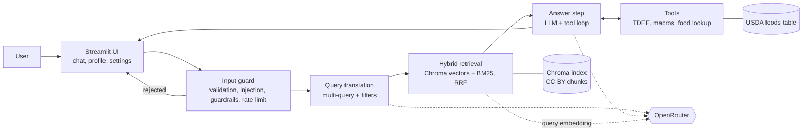

# Architecture

**Status:** approved by the owner on 2026-10-19, including decisions **D1-D8** (section 13). Inputs: `docs/BRIEF.md` (course requirements), `docs/PRD.md` (product decisions), `docs/SOURCES.md` (approved sources), `.claude/rules/` (rules).

**Models** (the Sprint 1 list, reused by choice; the Sprint 2 brief names none): `openai/gpt-5-mini` (default for answers), `openai/gpt-5-nano` (query translation), `openai/gpt-5` (selectable). Embeddings: `qwen/qwen3-embedding-8b`. All through OpenRouter. Checked on OpenRouter's model lists on 2026-10-19: all are listed; the three chat models support tool calling and none supports `temperature`.

## 1. Overview



One chat turn runs a fixed pipeline: guard, query translation, hybrid retrieval, then an answer step in which the model may call tools. The UI shows the answer with its sources, the tool results, the retrieval steps and the token cost.

## 2. One chat turn, step by step

1. **UI** receives the message. A `st.status` box shows each step while it runs (the brief's progress indicator).
2. **Input guard** (`src/guard.py`), before any API call: raw input over `MAX_RAW_INPUT_CHARS` is rejected before anything else; then the text is cleaned (Unicode NFC, control and invisible characters dropped, trimmed; this is the text the model gets) and checked for empty or too long input (`MAX_INPUT_CHARS`, after cleaning) and for prompt-injection patterns, which run on NFKC-folded copies (with invisible characters removed and as spaces, and with accents stripped) (English; instruction overrides, requests for the hidden prompt, role changes and jailbreak phrases, fake role markers and look-alikes of our `<user_input>`/`<sources>` delimiters, also with attributes, a hyphen or space, or a closing slash, and role lines after Markdown markers such as `**System:**` or `> System:`), then the domain guardrails (`src/guardrails.py`, T5.3, on the same folded copies: performance-enhancing drug dosing is refused; under 18, pregnancy and breastfeeding, medical conditions and medication, and signs of disordered eating, including a daily intake below `CALORIE_FLOOR_KCAL`, are redirected to a professional with a fixed message; the turn ends as kind `guardrail`), and last the per-session rate limit (`RateLimiter`, kept in `st.session_state`). The rate limit counts accepted questions, one per turn however many model calls the turn makes; rejected input does not count. Rejected input makes no API call and gets a fixed message that never quotes it. The turn runs through `run_guarded(text, limiter, call)`, which calls the rest of the turn with the cleaned text only when the guard accepts it.
3. **Query translation** (`src/rag/query_translation.py`, T3.2): one call to a small model (`openai/gpt-5-nano`) with structured output (`with_structured_output(QueryPlan, method="json_schema")`, which langchain-openai sends with `strict: true`): 3 rewrites of the question plus optional filters (`topics`, `min_year`, `evidence_tier`). Skipped filters mean "no filter". The same reply carries two required booleans (T3.5, owner's choice of 2026-10-20 to reuse this call, already paid for): `needs_tool`, true when a profile calculation (energy needs, daily targets, a check of one day's meal plan) or a food lookup could answer the question, and `needs_profile`, true when the answer needs the user's own numbers (`StrictBool`, so "yes" or 1 makes the plan unusable). The owner's prompt (`src/prompts/query_translation_system.md`, O7) is the system message; the question goes only inside `<user_input>` in the user message, escaped with `escape_prompt_data()` like the answer step's, and the messages are built with `SystemMessage` / `HumanMessage`, never a prompt template (T3.4's follow-up criterion); each turn stands alone (no history; owner's choice). `QueryPlan` checks exactly 3 non-blank rewrites of at most `QUERY_REWRITE_MAX_CHARS` (300; checked in Python, so the strict schema keeps to the keywords OpenAI's strict mode lists: no string lengths and no defaults, every field required), topics from `config.TOPICS`, `min_year` within `QUERY_MIN_YEAR_RANGE` and a tier of 1 or 2. A reply that fails the schema, is refused, empty or cut off (`InvalidReplyError`, `ReplyCutOffError`) falls back to the question alone with no filter; any other error (key, credit, rate limit, outage) ends the turn with its message, since the answer would meet it too. The rewrites go only to the search and the "How this answer was found" view, never to the answer model.
4. **Hybrid retrieval** (`src/rag/retriever.py`, `src/rag/hybrid.py`, T3.3): for the question and each rewrite (the question is searched too, owner's choice in T3.2; a rewrite that repeats the question or another rewrite, ignoring case, is dropped), a vector search in Chroma and a BM25 keyword search, both with the same metadata filter (keyword search keeps only the IDs Chroma returns for that filter, `filter_ids()`, so the two cannot filter differently). Each search gives a ranked list (top `RETRIEVAL_TOP_K` each); all of them are merged with Reciprocal Rank Fusion (RRF, `1 / (RRF_K + rank)`, `RRF_K` = 60); the top 6 distinct chunks become the context. Vector search decides whether the sources cover the question: keyword search runs only when at least one vector hit is within the distance limit below, since a BM25 match has no distance and a shared word alone would let an off-topic question through (owner's choice in T3.3); a chunk found only by keyword then joins the list with no distance. If nothing passes the filter, both searches run again without it; if still nothing, the answer says the sources do not cover the question. A chunk counts only within a cosine distance of `RETRIEVAL_MAX_DISTANCE` (0.62, from live checks on 28 questions: covered questions, short or long, at 0.28-0.54, unrelated ones from 0.70; near-domain ones in between are left to the prompt, which declines or redirects them) of the question or of any rewrite (so a rewrite that drifts towards the domain can bring an off-topic question to the answer model, whose prompt then declines it; the limit was measured on questions, not rewrites, and the O5 live check looks at this; T3.5's live check found that even a short or generic query, a single letter included, lands within the limit of boilerplate chunks such as a 64-character trial registration line, so a short rewrite of an off-topic question can do the same; a separate ticket deals with those chunks); when none is left and the plan says `needs_tool`, the answer model is still called with the tools and `<sources>` saying no excerpt is close enough (`NO_SOURCES_BLOCK`), since a food or energy question may match no research passage (owner's choice in T4.4, after a live check: "How many kcal are in 150 g of rolled oats?" had its nearest chunk at 0.652). That first reply is never shown: if it calls a tool, the loop goes on and the answer comes from the tool results, citing nothing; if not, the app shows `NO_SOURCES_MESSAGE` (AC-2). When the plan does not say `needs_tool`, or there is no usable plan, the app shows `NO_SOURCES_MESSAGE` at once and makes no answer model call (T3.5): an off-topic question costs the query translation call and the query embedding only, as before T4.4, and the status never reaches "Writing the answer". All the queries are embedded in one call, and the retry without the filter reuses the same vectors. Until T3.3 the vector lists alone were merged by keeping each chunk once at its smallest distance, nearest first; `search()` still does this for vector-only retrieval (`retrieve()` and `scripts/compare_retrieval.py`). The filter is built by `build_filter()`: any of the topics (`$or` of `topics $contains`), `year $gte`, `evidence_tier $eq`, joined with `$and`. "No hits" means nothing within the distance limit, so a filter that keeps fewer but relevant chunks is not dropped. `retrieve()` (one question, no filter) stays for `scripts/live_check_retrieval.py`.
5. **Answer step** (`src/chat.py`): the chat model (default `openai/gpt-5-mini`) gets the owner's system prompt (`src/prompts/answer_system.md`, read on each turn), one user message holding the retrieved chunks inside a delimited `<sources>` block labelled `[S1]`...`[S6]`, the profile inside `<profile>` (fixed labels and validated values in kg and cm; "Not given" without a profile; owner's choice in T4.4) only when the plan says `needs_profile` (with or without sources; with no usable plan the block is left out; T3.5, so the profile goes only to a call that needs it), and the user's message inside `<user_input>`. Without the block the energy and meal plan tools still read the session's profile from the app, never from the model. Every text and metadata value put in any of these blocks is escaped first (`&`, `<`, `>` as HTML entities, `escape_prompt_data()` in `src/prompt_data.py`), so nothing inside can close or open a block, and the user message is plain content, never a prompt template (T3.4). The four tools are bound with `bind_tools` (only the tools: never the model or `max_tokens`), and `answer_with_tools()` runs the loop (D2): a reply with tool calls is a round; its calls run (at most `MAX_TOOL_CALLS_PER_ROUND`, 6, of which at most `MAX_MEAL_PLAN_CALLS_PER_ROUND`, 1, is a meal plan check, T4.5; the rest, and arguments that are not JSON, get a fixed refusal), each result goes back as a tool message (its JSON escaped like the blocks), and the model is called again. After `MAX_TOOL_ROUNDS` (4) rounds one last call with `tool_choice="none"` writes the answer, so a turn makes at most 5 model calls; tool calls in that call end the turn with a fixed error. Text the model writes in a tool round is cleared from the screen, and a reply cut off by the token limit is an error whose tool calls never run. Each turn stands alone: earlier turns are shown in the UI but not sent to the model (owner's choice in T3.1). The `[S#]` labels number the chunks in their RRF order, best first (nearest first until T3.3); `cited_labels()` reads the labels in brackets (`[S1]`, `[S1, S3]`, `[S1, S2, and S3]`, `[S1 & S2]`, ranges `[S1-S3]`), ignores any outside 1-6, and the Sources list shows one card per cited article with all its labels. An answer cut off by the token limit or empty is an error, not shown half-written. Each reply is streamed (`stream_reply()`): the UI shows the text so far under the status box as it arrives, revealed word by word by `PacedWriter` at most `ANSWER_WORDS_PER_SECOND` (30; 0 turns pacing off), then replaces it with the full result and its sources (owner's request in T3.1). Markdown images are replaced by their alt text before the answer is shown, on every streamed update too, so an injected image cannot send data to another server without a click. A missing or empty prompt file gives `PROMPT_MISSING_MESSAGE` before any API call.
6. **Result** back to the UI: the answer with `[S1]`-style citations, a "Sources" expander (one card per cited article: title, authors, tier, journal, year, licence, link), a "Tool results (n)" expander (one table per tool result, and a stacked bar of the macro split for macro targets), and the token use and cost of the turn. The turn's `SearchDetails` (question, rewrites, filters, whether it fell back or dropped the filters, and the plan's `needs_tool` and `needs_profile`, or None with no usable plan, T3.5) is kept in its `TurnResult`; the Details tab shows them for the last turn that searched ("How this answer was found", AC-3) and a sidebar card sums them up (`docs/UI_DESIGN.md`, owner's choice in T3.2).

## 3. Folder layout

```
app.py                      Streamlit UI only (thin)
src/
  config.py                 models, limits, calorie floor, k values, paths, get_api_key()
  guard.py                  input validation, injection checks, rate limit
  guardrails.py             domain guardrails: drug-dosing refusals and redirects (T5.3)
  llm.py                    chat and embedding clients for OpenRouter, error mapping
  profile.py                UserProfile model (Pydantic), validation ranges
  units.py                  kg/lb and cm/ft-in conversion
  chat.py                   one chat turn: guard -> query translation -> retrieve -> answer loop -> TurnResult
  prompt_data.py            escaping for text inside prompt blocks (imports nothing from src)
  prompts/answer_system.md  the owner's answer system prompt (O1)
  prompts/query_translation_system.md  the owner's query translation prompt (O7)
  usage.py                  token counting and cost from OpenRouter prices
  export_pdf.py             session summary PDF, built in memory
  rag/
    sources.py              manifest model, licence and DOI check on article XML, ATTRIBUTION.md text
    ingest.py               JATS XML -> text sections -> chunks with metadata
    store.py                build and open the Chroma collection
    query_translation.py    rewrites + filters (structured output)
    hybrid.py               BM25 index and Reciprocal Rank Fusion
    retriever.py            the retrieval pipeline used by chat.py
  tools/
    energy.py               calculate_tdee, calculate_macro_targets
    food.py                 lookup_food_nutrition
    meal_plan.py            evaluate_meal_plan (T4.5)
    registry.py             LangChain tools with explicit argument schemas; runs tool calls
scripts/
  download_sources.py       fetch article XML listed in the manifest, check the licence
  generate_attribution.py   write ATTRIBUTION.md from the manifest and the USDA table
  build_index.py            chunk, embed and write the Chroma index
  prepare_usda.py           turn the USDA Foundation Foods CSV into a small foods table
  live_check_llm.py         owner's live check: one real chat and one real embedding call
  live_check_retrieval.py   owner's live check: distances of the nearest chunks, to set the limit
  compare_retrieval.py      owner's live check: vector-only, keyword-only and hybrid hit rates (T3.3; run in T3.6)
data/
  sources.json              manifest of approved sources (committed)
  usda_foods.csv            trimmed USDA table (committed, CC0)
  eval_questions.json       the owner's evaluation questions and expected sources (O2; T3.6, T6.1)
  raw/                      downloaded article XML (gitignored)
chroma/                     vector index (gitignored, rebuilt by the script)
assets/fonts/               DejaVu Sans for the summary PDF, with its LICENSE and a README (T5.2)
ATTRIBUTION.md              credits for every source and the USDA data, generated
tests/
```

## 4. Knowledge base pipeline

**Manifest** (`data/sources.json`): one entry per approved source with `id`, `title`, `authors`, `year`, `journal`, `doi`, `pmcid`, `url`, `license`, `license_url`, `copyright_notice`, `evidence_tier`, `topics`, and for a correction notice `corrects` (the ID of the article it corrects, e.g. #18a corrects #18) (`src/rag/sources.py` validates them). Title, authors, DOI and copyright notice come from each article's own front matter; `url` is the DOI link. There is no `fetch_url`: the script builds the Europe PMC URL from the checked PMCID, so the manifest cannot point it anywhere else. `ATTRIBUTION.md` is generated from it (`scripts/generate_attribution.py`); a test fails while the committed file is out of date.

**Download** (`scripts/download_sources.py`):
- Articles with a PMCID come from the Europe PMC REST API as JATS XML (`https://www.ebi.ac.uk/europepmc/webservices/rest/<PMCID>/fullTextXML`). Tested on 2026-10-19 for PMC5477153: HTTP 200, XML with a `<license>` element.
- Source #1 (diets for body weight reduction, 2026) had no PMCID at first; by T2.1 (2026-10-19) Europe PMC had it as PMC13665703, so it is downloaded like the others and the hand-saved fallback was dropped. Scripted access to tandfonline.com is never used.
- **Access terms:** the script uses only the Europe PMC REST API (allowed for automated retrieval by Europe PMC's copyright page); it never scrapes the PMC, Europe PMC or publisher websites. It sends a descriptive User-Agent, waits between requests and never follows a redirect (a 3xx is an error), so no request leaves the REST API.
- **Copyright guard in code:** the script reads the `<license>` element of the article's own front matter (a link, an `ali:license_ref` or a URL in the text) and refuses the file if it names any other Creative Commons licence (NC, ND, SA), a machine-readable licence ID (`license/@xlink:href`, `ali:license_ref`) that is not Creative Commons, wording that contradicts CC BY ("NonCommercial", "NoDerivatives", "ShareAlike", "All rights reserved", "BY-NC"/"BY-ND"/"BY-SA", with any hyphen, a space or nothing between the parts; the `license-type` attribute counts too), a ported licence (e.g. `/by/3.0/us/`), no CC BY or CC0 licence, a licence other than the manifest's, or a DOI other than the manifest's. CC BY wins over CC0 when both appear (BioMed Central's CC0 waiver covers the data, not the text). A refused file is never written, an older copy of it is deleted, and the run exits with 1. Raw XML stays in `data/raw/<PMCID>.xml` (gitignored).

**Parsing** (`src/rag/ingest.py`, standard library `xml.etree`): `load_chunks()` reads `data/raw/<PMCID>.xml` for every manifest entry, runs the T2.1 licence and DOI check (`check_article()`) again, then parses. It keeps the article title, the abstract and the body sections (section titles, paragraphs, list items as "- " lines). It drops figures, tables, display formulas, supplementary material, the reference list, footnotes, labels and anything that carries its own `<permissions>` (third-party content), as the copyright policy requires (text only, rules 5 and 7). Inline formulas keep their plain text so sentences stay whole, with scripts, fences and accents written out (`I^2`, `β_x`, `P(>0)`, `R̂`); other superscripts are written as exponents too (`10^-3`, `kg^-1`), so numbers keep their meaning. The XML's own line breaks and indentation become single spaces. Numeric citation markers (`xref` to the reference list) are removed with the brackets they leave, and only those brackets (text brackets such as `(-)-epicatechin` stay); an author-year citation keeps its words. Passages credited to someone else (`<attrib>`) are dropped like those with their own `<permissions>`. Back matter that many articles put inside `<body>` (acknowledgements, funding, disclosures, author contributions, data availability, ethics, publisher's notes, supplementary, references, appendices) is dropped by `sec-type` or title, and so are an abstract's registration notes ("Clinical trial registration", "Systematic review registration", "Trial registration": a bare registry ID that short queries matched, T3.7; a Methods "Protocol and registration" section stays) (lists in `src/config.py`). `<back>`, `<floats-group>` and sub-articles are never read. A section is the innermost `<sec>` holding text; its title is the path of titles ("Protein timing > Pre-exercise"), abstract sections start with "Abstract", and paragraphs outside any section (the correction #18a) are titled "Main text". A missing, refused or empty article stops the build with an `IngestError` that lists every problem.

**Chunking:** `RecursiveCharacterTextSplitter` (langchain-text-splitters), at most 1,000 characters (`CHUNK_SIZE`, the section title included) with up to 150 overlap (`CHUNK_OVERLAP`), split inside a section so a chunk never mixes two sections. A piece shorter than 300 characters (`CHUNK_MIN_CHARS`, title included) is joined to the piece before it in the same section, or else to the one after it, as one passage of the section's text, as long as the result stays within 1,300 characters (`CHUNK_SIZE + CHUNK_MIN_CHARS`; T3.7): the splitter leaves such pieces where a paragraph or a section ends, they were mostly the overlap repeated, and they sat near short, generic queries. Only a section that is short as a whole (an abstract's objective, a one-line result), or a piece whose join would pass 1,300 characters, stays a short chunk. The pieces are placed in the section's text by the code itself, each after the one before it and the last one at the end of the text (LangChain's `start_index` can point at an earlier copy of a repeated sentence); if they cannot be placed in order with nothing skipped, the section's pieces stay as split. Each chunk text starts with its section title for context. Metadata per chunk: `source_id`, `title`, `authors`, `year`, `section`, `topics`, `evidence_tier`, `license`, `source_url`, `chunk_index` (from 0 across the article); `authors` and `topics` are lists, which chromadb 1.5.9 accepts. A correction's chunks also carry `corrects` and the corrected article's chunks `corrected_by` (a list), so answers can cite both (copyright policy rule 7); the keys are absent otherwise.

**Topics** (set per source in the manifest): `protein`, `carbohydrate`, `fat`, `energy_balance` (weight loss or gain), `nutrient_timing`, `supplements`.

**Embeddings and index** (`scripts/build_index.py`, `src/rag/store.py`): `load_chunks()`'s chunks are embedded with `qwen/qwen3-embedding-8b` through OpenRouter in batches of `EMBEDDING_BATCH_SIZE` (64) and written to the persistent Chroma collection `nutrition-sources` (cosine distance) in `chroma/` (gitignored, D7). Each chunk's ID is `<source_id>-<chunk_index>`, so a rebuild keeps the same IDs; a repeated ID stops the build. A build writes into a staging collection first and gives it the index's name only when every chunk is in, so a failed build (e.g. an API error halfway) leaves the previous index as it was. The collection's metadata records the embedding model; the index is refused if the configured model differs, since query vectors from another model would not match. `open_index()` checks the index first (no API key needed, and it never creates an empty `chroma/`), then opens it with our embeddings client: Chroma's own embedding functions are never used (collections are created and opened with `embedding_function=None`). A missing, unreadable, empty or other-model index raises `IndexNotReadyError`, whose message says to run the build script. List metadata (`authors`, `topics`, `corrected_by`) is stored and returned unchanged, and filters such as `{"topics": {"$contains": "protein"}}`, `{"year": {"$gte": 2020}}` and `$and` work on it (tested). A rough estimate for about 20 articles is a few hundred thousand tokens, which is well under one US cent at the listed price ($0.01 per million tokens on 2026-10-19). The index is built once and rebuilt only when the sources or the chunking change.

**BM25 index** (`src/rag/hybrid.py`, T3.3): `build_keyword_index()` reads every chunk's text and metadata from Chroma and builds a `rank_bm25.BM25Okapi` index in memory (about 1,800 chunks), the first time a question needs it; the app keeps it with `st.cache_resource` and clears it together with the Chroma index when the index stops working. Texts are split into lower-case words of letters and digits, single characters and a short list of English filler words (`STOPWORDS`) are dropped, and there is no stemming, so "HMB" and "B12" stay searchable as written. Only ASCII letters count, which suits the English sources: an accented word is split, and the lone letter of "vitamin D" is dropped. T7.2 (German answers) should check this for German questions, which are searched as typed as well as through their English rewrites. Chunks with no shared word (a score of 0 or less) are not returned.

## 5. Query translation and structured retrieval

- **Why:** users ask short or vague questions ("bulk diet?"). Several rewrites ("energy surplus for muscle gain", "protein intake during a bulking phase", ...) find chunks that one phrasing would miss.
- **How:** one structured-output call returns `{"queries": [3 strings], "topics": [...], "min_year": int | null, "evidence_tier": 1 | 2 | null}`. The filters are the brief's "structured retrieval": Chroma's `where` filter and the same filter on the BM25 candidate set.
- **Hybrid search (Hard 1):** vectors catch meaning, BM25 catches exact terms (food names, "HMB", "creatine monohydrate"). RRF merges the ranked lists without needing comparable scores: each chunk scores the sum of `1 / (60 + rank)` over the lists it appears in.

## 6. Tools

| Tool | Input (validated with Pydantic) | Output | Personal data | Where the numbers come from |
|---|---|---|---|---|
| `calculate_tdee` | weight kg, height cm, age, sex, activity level | BMR and TDEE in kcal/day | yes (profile) | Mifflin-St Jeor equation (#22) times an activity factor (#23) |
| `calculate_macro_targets` | weight kg, goal, TDEE | kcal target and the sources' kcal range; protein, carbohydrate and fat in g, % and g/kg; the protein range; notes | yes (profile) | goal adjustments and macro ranges from #1, #9, #11, #12; enforces the calorie floor |
| `lookup_food_nutrition` | food name, amount in g | kcal, protein, carbs, fat, fiber, plus the matched USDA name and close alternatives | no | USDA FoodData Central Foundation Foods (CC0), fuzzy name match with rapidfuzz |
| `evaluate_meal_plan` (T4.5) | list of 1-20 foods with grams (the targets come from the profile, not the model) | each food's match and values; totals; per nutrient the target and the gap; kcal and protein against the sources' ranges; notes | yes (profile, through the targets) | the food lookup and `calculate_macro_targets` |

- **Energy tools** (`src/tools/energy.py`, T4.2; values and source IDs in `src/config.py`): BMR = 10 x kg + 6.25 x cm - 5 x age, + 5 for men or - 161 for women (#22); TDEE = BMR x 1.2, 1.375, 1.55, 1.725 or 1.9 by activity level (#23). The kcal target is the TDEE for "maintain", 10% above it for "build muscle" (range 10-20%, #11), and the TDEE minus a weekly loss of 0.5% of body weight for "lose fat" (range 0.5-1.0%, #1, #12), counting about 3500 kcal per lb of fat (#12, a rough estimate). The target is never below the calorie floor, 1200 kcal/day (`CALORIE_FLOOR_KCAL`, the top of the low-energy diet range in #1 and #9); when the floor applies, the message says so, and a note says when the target is at or above the estimated needs. Protein is 2.2 g/kg for fat loss and 1.9 g/kg otherwise (range 1.6-2.2, #1, #11), fat 25% of the kcal (#11, #12) and carbohydrate the rest (#11), at 4, 9 and 4 kcal per g; carbohydrate grams round up, so the macros never add up to less than the target. If protein and fat would exceed the target (only a very heavy body with a low target), protein gets what fat leaves, carbohydrate is 0 and a note says so. Results are Pydantic models with `status` "ok" or "invalid"; invalid arguments get a fixed message naming the fields, never an echo of the input.
- **LangChain tools** (`src/tools/registry.py`, T4.4): `build_tools(profile)` makes four `StructuredTool`s, each with an explicit `args_schema` that holds only what the model may send: `FoodLookupArgs` (`food`, `grams`; `extra="forbid"`, so the tests' `table` hook can never be an argument), `MealPlanArgs` (`items`, a list of those, T4.5) and `NoArgs` for the energy tools. The app reads the profile from `st.session_state` and passes it to `run_turn()`, which builds the tools for it, so the model can neither read nor change it through a tool. `calculate_macro_targets` computes the TDEE from the profile and uses the profile's goal. Without a profile the energy tools and the meal plan tool return "profile needed", and the UI shows an "Add your details" button that opens the profile form.
- **Meal plan tool** (`src/tools/meal_plan.py`, T4.5): `evaluate_meal_plan` looks up each food like `lookup_food_nutrition`, adds up the values shown per food (fiber only over the foods with a reported value), and compares the totals with `calculate_macro_targets`' result for the profile: per nutrient the target and the gap (target minus total), and for kcal and protein whether the total is below, within or above `kcal_range` and `protein_g_range`. Carbohydrate and fat get no range, as the sources give none for them; fiber has no target. Foods not found are listed and left out of the totals (`partial`); a total below the calorie floor (with a pointer to a registered dietitian, like the targets' floor notes) and the targets' own notes come back as notes. The registry builds the targets from the profile (`macro_targets()`, shared with `calculate_macro_targets`), so the model sends only the foods.
- `run_tool_call()` validates every call against the tool's schema before it runs: LangChain skips validation for a schema without fields (`_to_args_and_kwargs` in langchain-core 1.6), so an energy tool called with `weight_kg` would otherwise run. A refused call, an unknown tool, a missing foods table (`FoodTableError`) or any other exception becomes a fixed message the model reads as the tool result (`config.*_MESSAGE`), never the exception's text or what the model sent; the turn goes on, and the UI shows the same message. Results go to the model as JSON in tool messages only, so USDA names never enter the system prompt or the user message.
- **USDA data:** the Foundation Foods CSV zip (about 3.8 MB, release 2026-04-30, checked 2026-10-19) is downloaded by hand into `data/usda/` (gitignored) and turned by `scripts/prepare_usda.py` into `data/usda_foods.csv` (FDC ID, description and per-100 g values), with USDA's suggested credit, the CC0 notice and the changes made as `#` lines on top. The credit text lives in `src/config.py` (`USDA_CITATION`, `USDA_LICENSE`, `USDA_CHANGES`); `scripts/generate_attribution.py` reads the release date from the table and adds the same credit to `ATTRIBUTION.md` under "Food data". CC0 allows committing it, which keeps tests and deployment simple. No data.gov key is needed.
  - Only `foundation_food` rows of `food.csv` are kept (the rest are the lab samples behind them). Nutrient IDs, most preferred first: energy 2048 (Atwater specific factors per food), 2047 (general factors: 4, 9 and 4 kcal per g of protein, fat and carbohydrate), 1008 (older energy ID); protein 1003; carbohydrate by difference 1005; fat 1004; fiber 1079, then 2033. In release 2026-04-30, 312 foods have both 2047 and 2048, 35 only 2047 and 31 only 1008 (which matches 2048 within 1 kcal for 70 of the 98 foods that have both). The owner chose specific factors first (T4.3): they are more exact per food, e.g. raw almonds 584 kcal instead of 626 and creamy peanut butter 589 instead of 632.
  - A food without energy or one of the three macronutrients is left out; a missing fiber value stays empty and is shown as "not reported", never 0. Negative values (carbohydrate by difference for some meat and fish) become 0. Names are Unicode-normalised; a name that appears in several releases is kept once, from the latest publication.
  - Release 2026-04-30 gives 328 foods. Coconut oil and white and whole-wheat bread are in it; olive, canola and the other cooking oils, butter, dry pasta, whey, tofu and most cooked dishes are not. For some of these the tool says "not found"; for others it matches a food that contains the name ("pasta" gives pasta sauce, "olive oil" anchovies in olive oil, "oatmeal" oatmeal cookies), so the model must check `matched_name` before using the values (T4.4).
- **Food name matching** (`src/tools/food.py`): names are lower-cased, punctuation dropped and simple plurals reduced, then scored with rapidfuzz as the mean of `WRatio` and `token_set_ratio` (either alone gave wrong matches on the real table). A score of 80 or more is a match (`FOOD_MATCH_MIN_SCORE`); 60 or more is offered as an alternative or a "did you mean" suggestion. Among the matches, the plain food beats a processed form the query does not name (flour, oil, juice, dried, powder, milk, butter), then a name whose head (before the first comma) is made of query words ("Rice, white" over "Flour, rice" for "white rice"), then the higher `token_set_ratio` (how fully the query words appear in the name), the higher score and the shorter name. The tool always returns the matched USDA name and up to 3 alternatives, so the model can look up a better one.

## 7. User interface

- **Sidebar:** "Your profile": the goal as a segmented control, the profile as small tiles in the chosen units, and an "Edit details" button that opens the profile form in an `st.dialog` (T4.1, owner's choice). The form has one Metric / Imperial switch (kg and cm, or lb and ft/in); switching converts the values already typed, and Save checks them with `src/profile.py`. Later tickets may add a collapsed developer section with the model choice, the session token use and cost, and a link to the sources and credits. Where each piece sits is in `docs/UI_DESIGN.md`.
- **Main area:** the chat. Under each answer: "Sources" and "Tool results (n)" (`st.dataframe` tables, which show cells as plain text, and a stacked bar of the macro split). "How this answer was found" (the searches and the filters of the last answer) is in the Details tab, with a summary card in the sidebar (T3.2, as in `docs/UI_DESIGN.md`). The My targets tab and the sidebar's daily target and card show `registry.macro_targets()` for the session profile, and the Food lookup tab runs `registry.run_food_lookup()`: the same code as the tools, with no model call (T4.7). Grams per body weight are computed from the grams and the weight in kg and shown as g/kg or g/lb, rounded once (`units.format_grams_per_body_weight()`, also used by the summary PDF; `units.format_per_body_weight()` for a value per kg such as the protein range).
- **Progress:** `st.status` with the steps "Checking your question", "Rewriting the question", "Searching the research", "Writing the answer", "Using the tools" (once per tool round, then "Writing the answer" again).
- **PDF download (T5.2):** "Download summary (PDF)" in the sidebar, after the theme hint. `src/export_pdf.py` builds the session summary with reportlab in memory: the profile in the chosen units, the daily targets computed from the profile with no model call (`registry.macro_targets()`), every chat turn as in the chat (the question, then the answer with its sources, their correction notices and its tool results, or the fixed message of a turn without one), the disclaimer on the first page and in every page's footer, and credits for every source the PDF uses (cited articles in full with their copyright notices and their linked correction notices, the articles behind the targets' ranges, the formula sources, USDA when a food was looked up or a meal plan checked (T4.5, which also shows its two tables in the PDF), and the font with its licence word for word, read from `assets/fonts/LICENSE`). The button's `data` is a function, so the PDF is built only on a click; Streamlit keeps the bytes in memory, never on disk. Its slot is filled after the main area, so the turn that just ran is in it. Answers have their Markdown made plain text (`clean_answer()`: no `**`, `#` or backticks; list items as bullets; table rows as cells joined by " · "; a link as its text and URL; code and URLs as written), then entities decoded with `html.unescape` in the inline text only (as CommonMark, so "&gt; 5 g" is not read as a quote, and code keeps them), and every text that is not ours is escaped for reportlab's markup (`xml.sax.saxutils.escape`), so model text cannot add formatting or a link. The PDF holds no link annotations; URLs are printed as text. Fonts: DejaVu Sans 2.37 (`assets/fonts/`), as reportlab's own fonts have no Greek letters; characters outside the BMP (emoji) or missing from the font become U+FFFD, as reportlab 5.0.1 writes a broken text map for the first.

## 8. Security

The threat model and every control are in `docs/SECURITY.md`. In short: the guard runs before any API call; user input and retrieved text are delimited data (Medium 3); tool arguments are validated with Pydantic ranges (e.g. weight 30-300 kg, height 120-230 cm, age 18-100; `config.PROFILE_*_RANGE`); the calorie floor and age limit live in code; output is Markdown without raw HTML; one `get_api_key()`; model allowlist, capped `max_tokens`, at most 4 tool rounds, per-session rate limit.

## 9. Token usage and cost (Medium 5)

Built in T5.1. `run_turn()` gives each turn a `usage.UsageRecorder`, passed down to every call, so a turn that fails keeps what it spent before the error (`TurnResult.usage`, one `CallUsage` per call: step, model, input, cached input, output and reasoning tokens):

- **Query translation:** `with_structured_output(..., include_raw=True)`; the tokens come from the raw reply. The parser's errors (a refusal, an empty reply) come back as `parsing_error` and still fall back to the question alone, with their tokens counted. A reply the SDK itself cannot parse (off the schema, or cut off) raises inside the call, so its tokens are not known: such a turn shows fewer tokens than it used (rare; pinned by a test).
- **Query embedding:** `build_embeddings()` returns `llm.CountingEmbeddings`, whose `embed_with_usage()` sends the same request as `embed_documents()` but also returns the reply's `usage.prompt_tokens` (langchain-openai 1.7.2 drops it). The count is returned with the vectors, never kept on the client, which all sessions share. One batch without a count makes the whole count unknown (no row), never too low.
- **Answer rounds:** `build_chat_model()` sets `stream_usage=True`: langchain asks for the token use of a streamed reply (`stream_options.include_usage`) only on OpenAI's own URL. `stream_reply()` records each round's usage before its cut-off check, so a reply cut off by the token limit is counted too, as is the hidden reply of a question with no relevant source. An error in the middle of a stream loses that round's count (the usage comes in the last chunk).

The app adds the turn to `st.session_state["messages"]` first, then prices its calls once (`app._price()`) and stores the priced `usage.TurnUsage` with it, so a rerun makes no network call, and a click during the price read (which reruns the script) cannot drop the answer from the history. Prices come from OpenRouter's public lists, read without the key: `/api/v1/models` for the chat models and `/api/v1/embeddings/models` for `qwen/qwen3-embedding-8b`, which is only in the second. `usage.PRICES` keeps them for a day for the whole app process; a failed read (5 s timeout, no redirects, a 20 MB cap, a body that is not JSON, a list with no usable price for the app's models) is not kept, so the next turn tries again, and that turn's cost shows "price unknown". Prices are read as exact `Decimal`s; a price that is not a finite number from 0 to `PRICE_MAX_PER_TOKEN` ($0.01 a token, far above any allowed model; so no cost can overflow) leaves the model out (OpenRouter gives "-1" for a varying price), so its calls are "price unknown" rather than wrong.

Cost of a call: uncached input x `prompt` + cached input x `input_cache_read` (`prompt` when there is none) + output x `completion`. The reasoning count is shown as the provider reports it and never priced or added (it can be higher than the output count, so it is not taken to be part of it); `scripts/live_check_llm.py` prints this cost next to the one OpenRouter records (`GET /api/v1/generation`) for a plain call and for one streamed through `chat.stream_reply()` as the answer rounds are (so the owner also sees whether OpenRouter's stream reports the usage once), for the owner to confirm it (O5; T1.2 saw 94 reasoning tokens reported against 86 output tokens). The O5 cost check (2026-10-21, `docs/TESTING.md`) confirmed the uncached-input and output terms on one streamed `openai/gpt-5-mini` call (not the cached-input price, gpt-5-nano or the embedding price): for that call the app recorded the same tokens as OpenRouter (16 in, 83 out, 104 reasoning) and its cost, $0.00017, equals the cost OpenRouter recorded; reasoning is not billed on top of the output tokens, even when its reported count is the larger.

Shown under each answer ("3,700 tokens · $0.0074", "<$0.0001" below a hundredth of a cent), in the sidebar's "Last answer" card (that answer and the session, with "+ price unknown" when some turn could not be priced; before any turn has searched, the session line alone) and in the Details tab (one row per call, then the answer and session totals). Dollar signs are escaped in Markdown, so two on one line never read as LaTeX.

## 10. Error handling

| Situation | What the user sees |
|---|---|
| No API key | A setup message, no crash |
| 401 (bad key) | "The OpenRouter API key was rejected"; not retried by default |
| 402 (no credit) | "The OpenRouter account is out of credit"; not retried by default |
| 429 / timeout (ours or a 408) / 5xx | Retried up to `LLM_MAX_RETRIES` (2) times by the OpenAI SDK, then a message of its own for each: too many requests, took too long, temporarily unavailable |
| A 200 reply carrying an error, no result, or an empty or cut-off body (provider failed mid-request) | "Temporarily unavailable", like a 5xx |
| Structured output stopped by the token limit | "The answer was cut off" |
| Structured output that fails its schema (wrong or missing field, not JSON), is refused by the model, or comes back empty | "Not in the expected format" (`InvalidReplyError`, separate from an outage so a caller can fall back) |
| Service unreachable, other SDK errors (e.g. a content filter) | "Could not reach the model service" / a generic "try again" |
| Chroma index missing, unreadable, empty or built with another embedding model | What went wrong, then "Run `python scripts/build_index.py` to build it.", e.g. "The knowledge base index is missing. Run ..." (`IndexNotReadyError`, shown in the answer by T3.1) |
| No relevant chunks (none within `RETRIEVAL_MAX_DISTANCE`) | `NO_SOURCES_MESSAGE` ("Our sources do not cover this question..."), no citation and no answer model call, unless the query plan says `needs_tool` (T3.5); then one model call with the tools, its text never shown: if it calls no tool, `NO_SOURCES_MESSAGE`; if it does, the answer from the tool results, no citation |
| No key, or `.streamlit/secrets.toml` unreadable, when a question is asked | `MISSING_KEY_MESSAGE` or `SECRETS_FILE_MESSAGE` in the answer (where to add the key) |
| Index broken after the app opened it (e.g. rebuilt while running) | The "could not be read" `IndexNotReadyError` message; the app drops its cached index, so the next question opens the rebuilt one |
| Tool error or bad arguments | The tool's fixed message goes to the model as the tool result and shows in "Tool results"; the turn continues |
| Tool calls after the 4th round, in the call with `tool_choice="none"` | "The answer could not be finished" (`ToolLoopError`) |
| Failure mid-answer | Chat history stays intact: `run_turn()` turns every error above into a `TurnResult` of kind `error` (or `rejected` for the guard, `guardrail` for a domain refusal or redirect), which the app shows in the answer bubble |

The mapping lives in `src/llm.py`: callers wrap a model or embedding call in `with mapped_errors():`, which turns any OpenAI SDK error, and a malformed reply the client could not read, into an `LLMError` subclass whose message is fixed text (never the server's response, so never the key) and drops the original from the traceback. The original stays on `__context__` and its request holds the key, so it is never logged or shown; each `LLMError` carries a `diagnostic` instead (the error type and the function that raised it, no message text), which is safe to log. Malformed replies raise plain `ValueError`/`KeyError`/`TypeError`, so those are mapped only when the traceback passes through `openai` or `langchain_openai`; a bug of ours that langchain raises is mapped too, and the diagnostic shows where it came from. Each request has a `LLM_TIMEOUT_SECONDS` (60) timeout. Clients are built only through `src/llm.py`, and `model` and `max_tokens` are never passed at call time or changed on a built client (`.claude/rules/security-privacy.md`), so the allowlist and the cap are not bypassed as long as that rule is followed; no code or test enforces it.

## 11. Testing

Full strategy in `docs/TESTING.md`. In short: unit tests for pure logic; integration tests with `DeterministicFakeEmbedding` (langchain-core) and Chroma in a temp dir, and the tool loop with a scripted fake chat model that returns tool calls; UI tests with `streamlit.testing.v1.AppTest`; no network and no key in CI. Each tool has known-answer tests (e.g. TDEE for a fixed profile), unit conversion is tested both ways, RRF has a hand-computed example.

## 12. Dependencies

Checked on PyPI on 2026-10-19. Licences are permissive, as the copyright policy prefers.

| Package | Version | Licence | Use |
|---|---|---|---|
| streamlit | 1.66.0 | Apache-2.0 | UI |
| langchain | 1.4.6 | MIT | framework |
| langchain-openai | 1.7.2 | MIT | chat and embeddings through OpenRouter's OpenAI-compatible API |
| langchain-chroma | 1.1.0 | MIT | vector store integration |
| chromadb | 1.5.9 | Apache-2.0 | vector store, embedded only (pulls in onnxruntime, MIT, which we do not use for embeddings). Four unfixed advisories in its HTTP server are an accepted risk: `docs/SECURITY.md` |
| langchain-text-splitters | 1.1.3 | MIT | chunking |
| openai | 3.35.1 | Apache-2.0 | the SDK under langchain-openai; pinned in T1.2 because `src/llm.py` maps its error classes and relies on its retries |
| rank-bm25 | 0.2.2 | Apache-2.0 | BM25 (small and stable; last release 2022) |
| rapidfuzz | 3.14.6 | MIT | fuzzy food-name match |
| reportlab | 5.0.1 | BSD | PDF |
| DejaVu Sans fonts | 2.37 | Bitstream Vera and Arev font licences (free to use, copy and redistribute with software, notice kept, not sold alone); DejaVu changes public domain | the PDF's text (`assets/fonts/`, committed with `LICENSE` and a README with the source and SHA-256; checked 2026-10-20, T5.2) |
| pydantic | 2.14.1 | MIT | schemas |

Dev (as in Sprint 1, pinned in the `dev` extra): pytest 9.1.1 (MIT), pytest-cov 7.1.0 (MIT), ruff 0.17.1 (MIT), pip-audit 2.10.1 (Apache-2.0), httpx2 2.14.0 (BSD-3-Clause; the OpenAI SDK's HTTP library, whose `MockTransport` the T1.2 tests use), and pypdf 6.21.1 (BSD-3-Clause, no dependencies; reads the summary PDF's text back in the T5.2 tests; checked 2026-10-20). Not chosen: fpdf2 (LGPL-3.0, not permissive). Python **3.14** as in Sprint 1; every package above has a wheel or pure-Python build for it.

## 13. Decisions (approved by the owner on 2026-10-19)

| # | Decision | Alternative considered | Why |
|---|---|---|---|
| D1 | **Always retrieve** before answering (fixed pipeline) | Retrieval as a tool the model may call | Every answer is grounded and cites sources; matches the brief's flow (retrieval, then reasoning and tools); easier to explain and test |
| D2 | **Own tool loop** with `bind_tools`, max 4 rounds | LangChain v1 `create_agent` | Each step is visible and testable with a fake model; the round limit is explicit |
| D3 | **langchain-openai** (`ChatOpenAI`, `OpenAIEmbeddings`) with OpenRouter's base URL | `langchain-openrouter` (official integration, v0.2.9) | Matches the brief's "OpenAI-compatible SDK" and Sprint 1; one package for chat and embeddings |
| D4 | **Own RRF + rank-bm25** for hybrid search | `EnsembleRetriever` (now in `langchain-classic`) | About 20 lines we can explain in the review; no legacy package |
| D5 | **reportlab** for the PDF | fpdf2 | BSD vs LGPL-3.0 |
| D6 | **gpt-5-nano** for query translation, **gpt-5-mini** for answers | One model for both | The rewrite step is simple; cheaper and faster |
| D7 | Commit the manifest and the trimmed USDA table; do not commit raw XML or the Chroma index | Commit the index | Copyright policy rule 8 (raw documents not committed); the index is cheap to rebuild |
| D8 | Python 3.14 | 3.13 | Same as Sprint 1; all dependencies support it. Check the host's Python options at deploy time |

## 14. Risks and early checks

- **Embeddings through OpenRouter with `OpenAIEmbeddings`:** by default it may send token arrays instead of text, which OpenRouter may not accept; set `check_embedding_ctx_length=False`. Set in T1.2 (`src/llm.py`, and a unit test checks the raw text goes out); confirmed by one live call run by the owner (O5, `scripts/live_check_llm.py`).
- **Source #1 download:** resolved in T2.1 (Europe PMC has it); see section 4.
- **gpt-5 models:** no `temperature`; reasoning tokens add cost, so `max_tokens` and the reasoning effort (`low`, T1.2) are set in config.
- **Long waits:** the OpenAI SDK honours a server's `Retry-After` up to 2 minutes per retry, so in the worst case one call waits about 7 minutes (3 timeouts of 60 s plus 2 waits of 120 s) before the error shows, and a turn makes several calls. The 60 s limit applies to each phase of a request (connect, each read), not the whole request: a server that keeps sending bytes (e.g. keep-alive whitespace) could keep one request open longer, so 7 minutes is not a hard limit. Not observed with OpenRouter so far. Abandoned requests after our timeout may still be billed by the provider. Accepted in T1.2; lower `LLM_MAX_RETRIES` or the timeout if it is a problem in practice.
- **Deadline (2026-11-02, 14 days):** if time runs short, cut in this order: `evaluate_meal_plan`, the PDF (or its styling), token cost, chart polish. The core requirements and the optional tasks for maximum points (Medium 3, 6; Hard 1) come first (`docs/IMPLEMENTATION_PLAN.md`).

## 15. Brief coverage

| Brief item | Where |
|---|---|
| Core 1: RAG, embeddings, chunking, similarity search | sections 4-5 |
| Advanced RAG: query translation, structured retrieval | section 5 |
| Core 2: at least 3 tools | section 6 |
| Core 3: domain, focused KB, domain prompts, security | `docs/PRD.md`, `docs/SOURCES.md`, `docs/SECURITY.md` |
| Core 4: LangChain + OpenRouter, error handling, input validation | sections 2, 8, 10 |
| Core 5: UI with sources, tool results, progress | section 7 |
| Medium 3 prompt injection, Medium 5 tokens and cost, Medium 6 tool result charts | sections 8, 9, 7 |
| Hard 1 hybrid search | section 5 |
| Medium 7 PDF export (extra) | section 7 |
