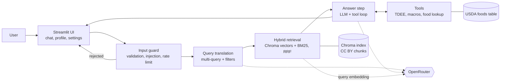

# Architecture

**Status:** approved by the owner on 2026-10-19, including decisions **D1-D8** (section 13). Inputs: `docs/BRIEF.md` (course requirements), `docs/PRD.md` (product decisions), `docs/SOURCES.md` (approved sources), `.claude/rules/` (rules).

**Models** (the Sprint 1 list, reused by choice; the Sprint 2 brief names none): `openai/gpt-5-mini` (default for answers), `openai/gpt-5-nano` (query translation), `openai/gpt-5` (selectable). Embeddings: `qwen/qwen3-embedding-8b`. All through OpenRouter. Checked on OpenRouter's model lists on 2026-10-19: all are listed; the three chat models support tool calling and none supports `temperature`.

## 1. Overview



One chat turn runs a fixed pipeline: guard, query translation, hybrid retrieval, then an answer step in which the model may call tools. The UI shows the answer with its sources, the tool results, the retrieval steps and the token cost.

## 2. One chat turn, step by step

1. **UI** receives the message. A `st.status` box shows each step while it runs (the brief's progress indicator).
2. **Input guard** (`src/guard.py`), before any API call: raw input over `MAX_RAW_INPUT_CHARS` is rejected before anything else; then the text is cleaned (Unicode NFC, control and invisible characters dropped, trimmed; this is the text the model gets) and checked for empty or too long input (`MAX_INPUT_CHARS`, after cleaning) and for prompt-injection patterns, which run on NFKC-folded copies (with invisible characters removed and as spaces, and with accents stripped) (English; instruction overrides, requests for the hidden prompt, role changes and jailbreak phrases, fake role markers and look-alikes of our `<user_input>`/`<sources>` delimiters), and last the per-session rate limit (`RateLimiter`, kept in `st.session_state`). The rate limit counts accepted questions, one per turn however many model calls the turn makes; rejected input does not count. Rejected input makes no API call and gets a fixed message that never quotes it. The turn runs through `run_guarded(text, limiter, call)`, which calls the rest of the turn with the cleaned text only when the guard accepts it.
3. **Query translation** (`src/rag/query_translation.py`, T3.2): one call to a small model (`openai/gpt-5-nano`) with structured output (`with_structured_output(QueryPlan, method="json_schema")`, which langchain-openai sends with `strict: true`): 3 rewrites of the question plus optional filters (`topics`, `min_year`, `evidence_tier`). Skipped filters mean "no filter". The owner's prompt (`src/prompts/query_translation_system.md`, O7) is the system message; the question goes only inside `<user_input>`, and each turn stands alone (no history; owner's choice). `QueryPlan` checks exactly 3 non-blank rewrites of at most `QUERY_REWRITE_MAX_CHARS` (300; checked in Python, so the strict schema keeps to the keywords OpenAI's strict mode lists: no string lengths and no defaults, every field required), topics from `config.TOPICS`, `min_year` within `QUERY_MIN_YEAR_RANGE` and a tier of 1 or 2. A reply that fails the schema, is refused, empty or cut off (`InvalidReplyError`, `ReplyCutOffError`) falls back to the question alone with no filter; any other error (key, credit, rate limit, outage) ends the turn with its message, since the answer would meet it too. The rewrites go only to the search and the "How this answer was found" view, never to the answer model.
4. **Hybrid retrieval** (`src/rag/retriever.py`): for the question and each rewrite (the question is searched too, owner's choice in T3.2; a rewrite that repeats the question or another rewrite, ignoring case, is dropped), a vector search in Chroma and a BM25 keyword search, both with the same metadata filter. All ranked lists are merged with Reciprocal Rank Fusion (RRF); the top 6 distinct chunks become the context. If nothing passes the filter, the search runs again without it; if still nothing, the answer says the sources do not cover the question. A chunk counts only within a cosine distance of `RETRIEVAL_MAX_DISTANCE` (0.62, from live checks on 28 questions: covered questions, short or long, at 0.28-0.54, unrelated ones from 0.70; near-domain ones in between are left to the prompt, which declines or redirects them) of the question or of any rewrite (so a rewrite that drifts towards the domain can bring an off-topic question to the answer model, whose prompt then declines it; the limit was measured on questions, not rewrites, and the O5 live check looks at this); when none is left, the app shows `NO_SOURCES_MESSAGE` and the answer model is not called (AC-2). Until T3.3, `search()` embeds all the queries in one call, runs one vector search per query with the filter (top `RETRIEVAL_TOP_K` each, with that distance limit) and merges the lists by keeping each chunk once at its smallest distance, nearest first, top 6; the retry without the filter reuses the same vectors. The filter is built by `build_filter()`: any of the topics (`$or` of `topics $contains`), `year $gte`, `evidence_tier $eq`, joined with `$and`. "No hits" means nothing within the distance limit, so a filter that keeps fewer but relevant chunks is not dropped. `retrieve()` (one question, no filter) stays for `scripts/live_check_retrieval.py`.
5. **Answer step** (`src/chat.py`): the chat model (default `openai/gpt-5-mini`) gets the owner's system prompt (`src/prompts/answer_system.md`, read on each turn), the profile summary (if the user filled it in), the retrieved chunks inside a delimited `<sources>` block labelled `[S1]`...`[S6]`, and the user's message inside `<user_input>`. It can call tools; the loop stops after at most 4 tool rounds. Each turn stands alone: earlier turns are shown in the UI but not sent to the model (owner's choice in T3.1). The `[S#]` labels number the chunks nearest first; `cited_labels()` reads the labels in brackets (`[S1]`, `[S1, S3]`, `[S1, S2, and S3]`, `[S1 & S2]`, ranges `[S1-S3]`), ignores any outside 1-6, and the Sources list shows one card per cited article with all its labels. An answer cut off by the token limit or empty is an error, not shown half-written. The answer is streamed (`stream_answer()`): the UI shows the text so far under the status box as it arrives, revealed word by word by `PacedWriter` at most `ANSWER_WORDS_PER_SECOND` (30; 0 turns pacing off), then replaces it with the full result and its sources (owner's request in T3.1). Markdown images are replaced by their alt text before the answer is shown, on every streamed update too, so an injected image cannot send data to another server without a click. A missing or empty prompt file gives `PROMPT_MISSING_MESSAGE` before any API call.
6. **Result** back to the UI: the answer with `[S1]`-style citations, a "Sources" expander (one card per cited article: title, authors, tier, journal, year, licence, link), a "Tool results" expander (table and chart), and the token use and cost of the turn. The turn's `SearchDetails` (question, rewrites, filters, whether it fell back or dropped the filters) is kept in its `TurnResult`; the Details tab shows them for the last turn that searched ("How this answer was found", AC-3) and a sidebar card sums them up (`docs/UI_DESIGN.md`, owner's choice in T3.2).

## 3. Folder layout

```
app.py                      Streamlit UI only (thin)
src/
  config.py                 models, limits, calorie floor, k values, paths, get_api_key()
  guard.py                  input validation, injection checks, rate limit
  llm.py                    chat and embedding clients for OpenRouter, error mapping
  profile.py                UserProfile model (Pydantic), validation ranges
  units.py                  kg/lb and cm/ft-in conversion
  chat.py                   one chat turn: guard -> query translation -> retrieve -> answer loop -> TurnResult
  prompts/answer_system.md  the owner's answer system prompt (O1)
  prompts/query_translation_system.md  the owner's query translation prompt (O7)
  usage.py                  token counting and cost from OpenRouter prices
  export_pdf.py             session summary PDF, built in memory
  rag/
    sources.py              manifest model, licence and DOI check on article XML, ATTRIBUTION.md text
    ingest.py               JATS XML -> text sections -> chunks with metadata
    store.py                build and open the Chroma collection
    query_translation.py    rewrites + filters (structured output)
    hybrid.py               BM25 index and Reciprocal Rank Fusion
    retriever.py            the retrieval pipeline used by chat.py
  tools/
    energy.py               calculate_tdee, calculate_macro_targets
    food.py                 lookup_food_nutrition
    meal_plan.py            evaluate_meal_plan (optional)
    registry.py             LangChain tool wrappers and argument schemas
scripts/
  download_sources.py       fetch article XML listed in the manifest, check the licence
  generate_attribution.py   write ATTRIBUTION.md from the manifest and the USDA table
  build_index.py            chunk, embed and write the Chroma index
  prepare_usda.py           turn the USDA Foundation Foods CSV into a small foods table
  live_check_llm.py         owner's live check: one real chat and one real embedding call
  live_check_retrieval.py   owner's live check: distances of the nearest chunks, to set the limit
data/
  sources.json              manifest of approved sources (committed)
  usda_foods.csv            trimmed USDA table (committed, CC0)
  raw/                      downloaded article XML (gitignored)
chroma/                     vector index (gitignored, rebuilt by the script)
ATTRIBUTION.md              credits for every source and the USDA data, generated
tests/
```

## 4. Knowledge base pipeline

**Manifest** (`data/sources.json`): one entry per approved source with `id`, `title`, `authors`, `year`, `journal`, `doi`, `pmcid`, `url`, `license`, `license_url`, `copyright_notice`, `evidence_tier`, `topics`, and for a correction notice `corrects` (the ID of the article it corrects, e.g. #18a corrects #18) (`src/rag/sources.py` validates them). Title, authors, DOI and copyright notice come from each article's own front matter; `url` is the DOI link. There is no `fetch_url`: the script builds the Europe PMC URL from the checked PMCID, so the manifest cannot point it anywhere else. `ATTRIBUTION.md` is generated from it (`scripts/generate_attribution.py`); a test fails while the committed file is out of date.

**Download** (`scripts/download_sources.py`):
- Articles with a PMCID come from the Europe PMC REST API as JATS XML (`https://www.ebi.ac.uk/europepmc/webservices/rest/<PMCID>/fullTextXML`). Tested on 2026-10-19 for PMC5477153: HTTP 200, XML with a `<license>` element.
- Source #1 (diets for body weight reduction, 2026) had no PMCID at first; by T2.1 (2026-10-19) Europe PMC had it as PMC13665703, so it is downloaded like the others and the hand-saved fallback was dropped. Scripted access to tandfonline.com is never used.
- **Access terms:** the script uses only the Europe PMC REST API (allowed for automated retrieval by Europe PMC's copyright page); it never scrapes the PMC, Europe PMC or publisher websites. It sends a descriptive User-Agent, waits between requests and never follows a redirect (a 3xx is an error), so no request leaves the REST API.
- **Copyright guard in code:** the script reads the `<license>` element of the article's own front matter (a link, an `ali:license_ref` or a URL in the text) and refuses the file if it names any other Creative Commons licence (NC, ND, SA), a machine-readable licence ID (`license/@xlink:href`, `ali:license_ref`) that is not Creative Commons, wording that contradicts CC BY ("NonCommercial", "NoDerivatives", "ShareAlike", "All rights reserved", "BY-NC"/"BY-ND"/"BY-SA", with any hyphen, a space or nothing between the parts; the `license-type` attribute counts too), a ported licence (e.g. `/by/3.0/us/`), no CC BY or CC0 licence, a licence other than the manifest's, or a DOI other than the manifest's. CC BY wins over CC0 when both appear (BioMed Central's CC0 waiver covers the data, not the text). A refused file is never written, an older copy of it is deleted, and the run exits with 1. Raw XML stays in `data/raw/<PMCID>.xml` (gitignored).

**Parsing** (`src/rag/ingest.py`, standard library `xml.etree`): `load_chunks()` reads `data/raw/<PMCID>.xml` for every manifest entry, runs the T2.1 licence and DOI check (`check_article()`) again, then parses. It keeps the article title, the abstract and the body sections (section titles, paragraphs, list items as "- " lines). It drops figures, tables, display formulas, supplementary material, the reference list, footnotes, labels and anything that carries its own `<permissions>` (third-party content), as the copyright policy requires (text only, rules 5 and 7). Inline formulas keep their plain text so sentences stay whole, with scripts, fences and accents written out (`I^2`, `β_x`, `P(>0)`, `R̂`); other superscripts are written as exponents too (`10^-3`, `kg^-1`), so numbers keep their meaning. The XML's own line breaks and indentation become single spaces. Numeric citation markers (`xref` to the reference list) are removed with the brackets they leave, and only those brackets (text brackets such as `(-)-epicatechin` stay); an author-year citation keeps its words. Passages credited to someone else (`<attrib>`) are dropped like those with their own `<permissions>`. Back matter that many articles put inside `<body>` (acknowledgements, funding, disclosures, author contributions, data availability, ethics, publisher's notes, supplementary, references, appendices) is dropped by `sec-type` or title (lists in `src/config.py`). `<back>`, `<floats-group>` and sub-articles are never read. A section is the innermost `<sec>` holding text; its title is the path of titles ("Protein timing > Pre-exercise"), abstract sections start with "Abstract", and paragraphs outside any section (the correction #18a) are titled "Main text". A missing, refused or empty article stops the build with an `IngestError` that lists every problem.

**Chunking:** `RecursiveCharacterTextSplitter` (langchain-text-splitters), at most 1,000 characters (`CHUNK_SIZE`, the section title included) with up to 150 overlap (`CHUNK_OVERLAP`), split inside a section so a chunk never mixes two sections. Each chunk text starts with its section title for context. Metadata per chunk: `source_id`, `title`, `authors`, `year`, `section`, `topics`, `evidence_tier`, `license`, `source_url`, `chunk_index` (from 0 across the article); `authors` and `topics` are lists, which chromadb 1.5.9 accepts. A correction's chunks also carry `corrects` and the corrected article's chunks `corrected_by` (a list), so answers can cite both (copyright policy rule 7); the keys are absent otherwise.

**Topics** (set per source in the manifest): `protein`, `carbohydrate`, `fat`, `energy_balance` (weight loss or gain), `nutrient_timing`, `supplements`.

**Embeddings and index** (`scripts/build_index.py`, `src/rag/store.py`): `load_chunks()`'s chunks are embedded with `qwen/qwen3-embedding-8b` through OpenRouter in batches of `EMBEDDING_BATCH_SIZE` (64) and written to the persistent Chroma collection `nutrition-sources` (cosine distance) in `chroma/` (gitignored, D7). Each chunk's ID is `<source_id>-<chunk_index>`, so a rebuild keeps the same IDs; a repeated ID stops the build. A build writes into a staging collection first and gives it the index's name only when every chunk is in, so a failed build (e.g. an API error halfway) leaves the previous index as it was. The collection's metadata records the embedding model; the index is refused if the configured model differs, since query vectors from another model would not match. `open_index()` checks the index first (no API key needed, and it never creates an empty `chroma/`), then opens it with our embeddings client: Chroma's own embedding functions are never used (collections are created and opened with `embedding_function=None`). A missing, unreadable, empty or other-model index raises `IndexNotReadyError`, whose message says to run the build script. List metadata (`authors`, `topics`, `corrected_by`) is stored and returned unchanged, and filters such as `{"topics": {"$contains": "protein"}}`, `{"year": {"$gte": 2020}}` and `$and` work on it (tested). A rough estimate for about 20 articles is a few hundred thousand tokens, which is well under one US cent at the listed price ($0.01 per million tokens on 2026-10-19). The index is built once and rebuilt only when the sources or the chunking change.

**BM25 index:** built in memory at app start from the chunk texts stored in Chroma, cached with `st.cache_resource`.

## 5. Query translation and structured retrieval

- **Why:** users ask short or vague questions ("bulk diet?"). Several rewrites ("energy surplus for muscle gain", "protein intake during a bulking phase", ...) find chunks that one phrasing would miss.
- **How:** one structured-output call returns `{"queries": [3 strings], "topics": [...], "min_year": int | null, "evidence_tier": 1 | 2 | null}`. The filters are the brief's "structured retrieval": Chroma's `where` filter and the same filter on the BM25 candidate set.
- **Hybrid search (Hard 1):** vectors catch meaning, BM25 catches exact terms (food names, "HMB", "creatine monohydrate"). RRF merges the ranked lists without needing comparable scores: each chunk scores the sum of `1 / (60 + rank)` over the lists it appears in.

## 6. Tools

| Tool | Input (validated with Pydantic) | Output | Personal data | Where the numbers come from |
|---|---|---|---|---|
| `calculate_tdee` | weight kg, height cm, age, sex, activity level | BMR and TDEE in kcal/day | yes (profile) | Mifflin-St Jeor equation (#22) times an activity factor (#23) |
| `calculate_macro_targets` | weight kg, goal, TDEE | kcal target and the sources' kcal range; protein, carbohydrate and fat in g, % and g/kg; the protein range; notes | yes (profile) | goal adjustments and macro ranges from #1, #9, #11, #12; enforces the calorie floor |
| `lookup_food_nutrition` | food name, amount in g | kcal, protein, carbs, fat, fiber, plus the matched USDA name and close alternatives | no | USDA FoodData Central Foundation Foods (CC0), fuzzy name match with rapidfuzz |
| `evaluate_meal_plan` (optional) | list of food + amount, targets | totals vs targets, gaps | uses the targets | the two tools above |

- **Energy tools** (`src/tools/energy.py`, T4.2; values and source IDs in `src/config.py`): BMR = 10 x kg + 6.25 x cm - 5 x age, + 5 for men or - 161 for women (#22); TDEE = BMR x 1.2, 1.375, 1.55, 1.725 or 1.9 by activity level (#23). The kcal target is the TDEE for "maintain", 10% above it for "build muscle" (range 10-20%, #11), and the TDEE minus a weekly loss of 0.5% of body weight for "lose fat" (range 0.5-1.0%, #1, #12), counting about 3500 kcal per lb of fat (#12, a rough estimate). The target is never below the calorie floor, 1200 kcal/day (`CALORIE_FLOOR_KCAL`, the top of the low-energy diet range in #1 and #9); when the floor applies, the message says so, and a note says when the target is at or above the estimated needs. Protein is 2.2 g/kg for fat loss and 1.9 g/kg otherwise (range 1.6-2.2, #1, #11), fat 25% of the kcal (#11, #12) and carbohydrate the rest (#11), at 4, 9 and 4 kcal per g; carbohydrate grams round up, so the macros never add up to less than the target. If protein and fat would exceed the target (only a very heavy body with a low target), protein gets what fat leaves, carbohydrate is 0 and a note says so. Results are Pydantic models with `status` "ok" or "invalid"; invalid arguments get a fixed message naming the fields, never an echo of the input.
- The profile is read from `st.session_state` by the app and passed to the tools; the model may not change it. If the profile is missing, the tool returns "profile needed" and the UI points to the profile form.
- Tool errors come back to the model as a short message (not a crash), and the UI shows them.
- **USDA data:** the Foundation Foods CSV zip (about 3.8 MB, release 2026-04-30, checked 2026-10-19) is downloaded by hand into `data/usda/` (gitignored) and turned by `scripts/prepare_usda.py` into `data/usda_foods.csv` (FDC ID, description and per-100 g values), with USDA's suggested credit, the CC0 notice and the changes made as `#` lines on top. The credit text lives in `src/config.py` (`USDA_CITATION`, `USDA_LICENSE`, `USDA_CHANGES`); `scripts/generate_attribution.py` reads the release date from the table and adds the same credit to `ATTRIBUTION.md` under "Food data". CC0 allows committing it, which keeps tests and deployment simple. No data.gov key is needed.
  - Only `foundation_food` rows of `food.csv` are kept (the rest are the lab samples behind them). Nutrient IDs, most preferred first: energy 2048 (Atwater specific factors per food), 2047 (general factors: 4, 9 and 4 kcal per g of protein, fat and carbohydrate), 1008 (older energy ID); protein 1003; carbohydrate by difference 1005; fat 1004; fiber 1079, then 2033. In release 2026-04-30, 312 foods have both 2047 and 2048, 35 only 2047 and 31 only 1008 (which matches 2048 within 1 kcal for 70 of the 98 foods that have both). The owner chose specific factors first (T4.3): they are more exact per food, e.g. raw almonds 584 kcal instead of 626 and creamy peanut butter 589 instead of 632.
  - A food without energy or one of the three macronutrients is left out; a missing fiber value stays empty and is shown as "not reported", never 0. Negative values (carbohydrate by difference for some meat and fish) become 0. Names are Unicode-normalised; a name that appears in several releases is kept once, from the latest publication.
  - Release 2026-04-30 gives 328 foods. Coconut oil and white and whole-wheat bread are in it; olive, canola and the other cooking oils, butter, dry pasta, whey, tofu and most cooked dishes are not. For some of these the tool says "not found"; for others it matches a food that contains the name ("pasta" gives pasta sauce, "olive oil" anchovies in olive oil, "oatmeal" oatmeal cookies), so the model must check `matched_name` before using the values (T4.4).
- **Food name matching** (`src/tools/food.py`): names are lower-cased, punctuation dropped and simple plurals reduced, then scored with rapidfuzz as the mean of `WRatio` and `token_set_ratio` (either alone gave wrong matches on the real table). A score of 80 or more is a match (`FOOD_MATCH_MIN_SCORE`); 60 or more is offered as an alternative or a "did you mean" suggestion. Among the matches, the plain food beats a processed form the query does not name (flour, oil, juice, dried, powder, milk, butter), then a name whose head (before the first comma) is made of query words ("Rice, white" over "Flour, rice" for "white rice"), then the higher `token_set_ratio` (how fully the query words appear in the name), the higher score and the shorter name. The tool always returns the matched USDA name and up to 3 alternatives, so the model can look up a better one.

## 7. User interface

- **Sidebar:** "Your profile": the goal as a segmented control, the profile as small tiles in the chosen units, and an "Edit details" button that opens the profile form in an `st.dialog` (T4.1, owner's choice). The form has one Metric / Imperial switch (kg and cm, or lb and ft/in); switching converts the values already typed, and Save checks them with `src/profile.py`. Later tickets may add a collapsed developer section with the model choice, the session token use and cost, and a link to the sources and credits. Where each piece sits is in `docs/UI_DESIGN.md`.
- **Main area:** the chat. Under each answer: "Sources" and "Tool results" (table and a bar chart of the macro split). "How this answer was found" (the searches and the filters of the last answer) is in the Details tab, with a summary card in the sidebar (T3.2, as in `docs/UI_DESIGN.md`).
- **Progress:** `st.status` with the steps "Checking your question", "Rewriting the question", "Searching the research", "Writing the answer", "Running tool: ...".
- **PDF download:** a button builds the session summary (profile in the chosen units, computed targets, the questions and answers with their sources, the disclaimer, the credits) with reportlab in memory and hands it to `st.download_button`.

## 8. Security

The threat model and every control are in `docs/SECURITY.md`. In short: the guard runs before any API call; user input and retrieved text are delimited data (Medium 3); tool arguments are validated with Pydantic ranges (e.g. weight 30-300 kg, height 120-230 cm, age 18-100; `config.PROFILE_*_RANGE`); the calorie floor and age limit live in code; output is Markdown without raw HTML; one `get_api_key()`; model allowlist, capped `max_tokens`, at most 4 tool rounds, per-session rate limit.

## 9. Token usage and cost (Medium 5)

Each LLM call (query translation, every answer round) reports its token use (`usage_metadata`); the query embedding is counted too. `src/usage.py` multiplies by the prices from OpenRouter's models endpoint (cached for a day; "price unknown" if the call fails) and keeps per-turn and per-session totals in `st.session_state`.

## 10. Error handling

| Situation | What the user sees |
|---|---|
| No API key | A setup message, no crash |
| 401 (bad key) | "The OpenRouter API key was rejected"; not retried by default |
| 402 (no credit) | "The OpenRouter account is out of credit"; not retried by default |
| 429 / timeout (ours or a 408) / 5xx | Retried up to `LLM_MAX_RETRIES` (2) times by the OpenAI SDK, then a message of its own for each: too many requests, took too long, temporarily unavailable |
| A 200 reply carrying an error, no result, or an empty or cut-off body (provider failed mid-request) | "Temporarily unavailable", like a 5xx |
| Structured output stopped by the token limit | "The answer was cut off" |
| Structured output that fails its schema (wrong or missing field, not JSON), is refused by the model, or comes back empty | "Not in the expected format" (`InvalidReplyError`, separate from an outage so a caller can fall back) |
| Service unreachable, other SDK errors (e.g. a content filter) | "Could not reach the model service" / a generic "try again" |
| Chroma index missing, unreadable, empty or built with another embedding model | What went wrong, then "Run `python scripts/build_index.py` to build it.", e.g. "The knowledge base index is missing. Run ..." (`IndexNotReadyError`, shown in the answer by T3.1) |
| No relevant chunks (none within `RETRIEVAL_MAX_DISTANCE`) | `NO_SOURCES_MESSAGE` ("Our sources do not cover this question..."); no model call, no citation |
| No key, or `.streamlit/secrets.toml` unreadable, when a question is asked | `MISSING_KEY_MESSAGE` or `SECRETS_FILE_MESSAGE` in the answer (where to add the key) |
| Index broken after the app opened it (e.g. rebuilt while running) | The "could not be read" `IndexNotReadyError` message; the app drops its cached index, so the next question opens the rebuilt one |
| Tool error or bad arguments | The tool's message, the turn continues |
| Failure mid-answer | Chat history stays intact: `run_turn()` turns every error above into a `TurnResult` of kind `error` (or `rejected` for the guard), which the app shows in the answer bubble |

The mapping lives in `src/llm.py`: callers wrap a model or embedding call in `with mapped_errors():`, which turns any OpenAI SDK error, and a malformed reply the client could not read, into an `LLMError` subclass whose message is fixed text (never the server's response, so never the key) and drops the original from the traceback. The original stays on `__context__` and its request holds the key, so it is never logged or shown; each `LLMError` carries a `diagnostic` instead (the error type and the function that raised it, no message text), which is safe to log. Malformed replies raise plain `ValueError`/`KeyError`/`TypeError`, so those are mapped only when the traceback passes through `openai` or `langchain_openai`; a bug of ours that langchain raises is mapped too, and the diagnostic shows where it came from. Each request has a `LLM_TIMEOUT_SECONDS` (60) timeout. Clients are built only through `src/llm.py`, and `model` and `max_tokens` are never passed at call time or changed on a built client (`.claude/rules/security-privacy.md`), so the allowlist and the cap are not bypassed as long as that rule is followed; no code or test enforces it.

## 11. Testing

Full strategy in `docs/TESTING.md`. In short: unit tests for pure logic; integration tests with `DeterministicFakeEmbedding` (langchain-core) and Chroma in a temp dir, and the tool loop with a scripted fake chat model that returns tool calls; UI tests with `streamlit.testing.v1.AppTest`; no network and no key in CI. Each tool has known-answer tests (e.g. TDEE for a fixed profile), unit conversion is tested both ways, RRF has a hand-computed example.

## 12. Dependencies

Checked on PyPI on 2026-10-19. Licences are permissive, as the copyright policy prefers.

| Package | Version | Licence | Use |
|---|---|---|---|
| streamlit | 1.66.0 | Apache-2.0 | UI |
| langchain | 1.4.6 | MIT | framework |
| langchain-openai | 1.7.2 | MIT | chat and embeddings through OpenRouter's OpenAI-compatible API |
| langchain-chroma | 1.1.0 | MIT | vector store integration |
| chromadb | 1.5.9 | Apache-2.0 | vector store, embedded only (pulls in onnxruntime, MIT, which we do not use for embeddings). Four unfixed advisories in its HTTP server are an accepted risk: `docs/SECURITY.md` |
| langchain-text-splitters | 1.1.3 | MIT | chunking |
| openai | 3.35.1 | Apache-2.0 | the SDK under langchain-openai; pinned in T1.2 because `src/llm.py` maps its error classes and relies on its retries |
| rank-bm25 | 0.2.2 | Apache-2.0 | BM25 (small and stable; last release 2022) |
| rapidfuzz | 3.14.6 | MIT | fuzzy food-name match |
| reportlab | 5.0.1 | BSD | PDF |
| pydantic | 2.14.1 | MIT | schemas |

Dev (as in Sprint 1, pinned in the `dev` extra): pytest 9.1.1 (MIT), pytest-cov 7.1.0 (MIT), ruff 0.17.1 (MIT), pip-audit 2.10.1 (Apache-2.0), and httpx2 2.14.0 (BSD-3-Clause; the OpenAI SDK's HTTP library, whose `MockTransport` the T1.2 tests use). Not chosen: fpdf2 (LGPL-3.0, not permissive). Python **3.14** as in Sprint 1; every package above has a wheel or pure-Python build for it.

## 13. Decisions (approved by the owner on 2026-10-19)

| # | Decision | Alternative considered | Why |
|---|---|---|---|
| D1 | **Always retrieve** before answering (fixed pipeline) | Retrieval as a tool the model may call | Every answer is grounded and cites sources; matches the brief's flow (retrieval, then reasoning and tools); easier to explain and test |
| D2 | **Own tool loop** with `bind_tools`, max 4 rounds | LangChain v1 `create_agent` | Each step is visible and testable with a fake model; the round limit is explicit |
| D3 | **langchain-openai** (`ChatOpenAI`, `OpenAIEmbeddings`) with OpenRouter's base URL | `langchain-openrouter` (official integration, v0.2.9) | Matches the brief's "OpenAI-compatible SDK" and Sprint 1; one package for chat and embeddings |
| D4 | **Own RRF + rank-bm25** for hybrid search | `EnsembleRetriever` (now in `langchain-classic`) | About 20 lines we can explain in the review; no legacy package |
| D5 | **reportlab** for the PDF | fpdf2 | BSD vs LGPL-3.0 |
| D6 | **gpt-5-nano** for query translation, **gpt-5-mini** for answers | One model for both | The rewrite step is simple; cheaper and faster |
| D7 | Commit the manifest and the trimmed USDA table; do not commit raw XML or the Chroma index | Commit the index | Copyright policy rule 8 (raw documents not committed); the index is cheap to rebuild |
| D8 | Python 3.14 | 3.13 | Same as Sprint 1; all dependencies support it. Check the host's Python options at deploy time |

## 14. Risks and early checks

- **Embeddings through OpenRouter with `OpenAIEmbeddings`:** by default it may send token arrays instead of text, which OpenRouter may not accept; set `check_embedding_ctx_length=False`. Set in T1.2 (`src/llm.py`, and a unit test checks the raw text goes out); confirmed by one live call run by the owner (O5, `scripts/live_check_llm.py`).
- **Source #1 download:** resolved in T2.1 (Europe PMC has it); see section 4.
- **gpt-5 models:** no `temperature`; reasoning tokens add cost, so `max_tokens` and the reasoning effort (`low`, T1.2) are set in config.
- **Long waits:** the OpenAI SDK honours a server's `Retry-After` up to 2 minutes per retry, so in the worst case one call waits about 7 minutes (3 timeouts of 60 s plus 2 waits of 120 s) before the error shows, and a turn makes several calls. The 60 s limit applies to each phase of a request (connect, each read), not the whole request: a server that keeps sending bytes (e.g. keep-alive whitespace) could keep one request open longer, so 7 minutes is not a hard limit. Not observed with OpenRouter so far. Abandoned requests after our timeout may still be billed by the provider. Accepted in T1.2; lower `LLM_MAX_RETRIES` or the timeout if it is a problem in practice.
- **Deadline (2026-11-02, 14 days):** if time runs short, cut in this order: `evaluate_meal_plan`, the PDF (or its styling), token cost, chart polish. The core requirements and the optional tasks for maximum points (Medium 3, 6; Hard 1) come first (`docs/IMPLEMENTATION_PLAN.md`).

## 15. Brief coverage

| Brief item | Where |
|---|---|
| Core 1: RAG, embeddings, chunking, similarity search | sections 4-5 |
| Advanced RAG: query translation, structured retrieval | section 5 |
| Core 2: at least 3 tools | section 6 |
| Core 3: domain, focused KB, domain prompts, security | `docs/PRD.md`, `docs/SOURCES.md`, `docs/SECURITY.md` |
| Core 4: LangChain + OpenRouter, error handling, input validation | sections 2, 8, 10 |
| Core 5: UI with sources, tool results, progress | section 7 |
| Medium 3 prompt injection, Medium 5 tokens and cost, Medium 6 tool result charts | sections 8, 9, 7 |
| Hard 1 hybrid search | section 5 |
| Medium 7 PDF export (extra) | section 7 |
