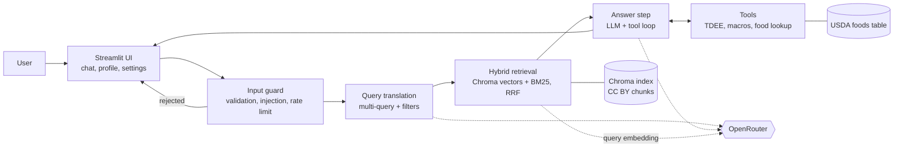

# Architecture

**Status:** approved by the owner on 2026-10-19, including decisions **D1-D8** (section 13). Inputs: `docs/BRIEF.md` (course requirements), `docs/PRD.md` (product decisions), `docs/SOURCES.md` (approved sources), `.claude/rules/` (rules).

**Models** (the Sprint 1 list, reused by choice; the Sprint 2 brief names none): `openai/gpt-5-mini` (default for answers), `openai/gpt-5-nano` (query translation), `openai/gpt-5` (selectable). Embeddings: `qwen/qwen3-embedding-8b`. All through OpenRouter. Checked on OpenRouter's model lists on 2026-10-19: all are listed; the three chat models support tool calling and none supports `temperature`.

## 1. Overview



One chat turn runs a fixed pipeline: guard, query translation, hybrid retrieval, then an answer step in which the model may call tools. The UI shows the answer with its sources, the tool results, the retrieval steps and the token cost.

## 2. One chat turn, step by step

1. **UI** receives the message. A `st.status` box shows each step while it runs (the brief's progress indicator).
2. **Input guard** (`src/guard.py`), before any API call: empty or too long input, prompt-injection patterns, the per-session rate limit. Rejected input makes no API call and gets a clear message.
3. **Query translation** (`src/rag/query_translation.py`): one call to a small model (`openai/gpt-5-nano`) with structured output: 3 rewrites of the question plus optional filters (`topics`, `min_year`, `evidence_tier`). Skipped filters mean "no filter".
4. **Hybrid retrieval** (`src/rag/retriever.py`): for each rewrite, a vector search in Chroma and a BM25 keyword search, both with the same metadata filter. All ranked lists are merged with Reciprocal Rank Fusion (RRF); the top 6 distinct chunks become the context. If nothing passes the filter, the search runs again without it; if still nothing, the answer says the sources do not cover the question.
5. **Answer step** (`src/chat.py`): the chat model (default `openai/gpt-5-mini`) gets the owner's system prompt, the profile summary (if the user filled it in), the retrieved chunks inside a delimited `<sources>` block labelled `[S1]`...`[S6]`, and the user's message inside `<user_input>`. It can call tools; the loop stops after at most 4 tool rounds.
6. **Result** back to the UI: the answer with `[S1]`-style citations, a "Sources" expander (title, year, tier, licence, link, the chunk), a "Tool results" expander (table and chart), a "How this answer was found" expander (rewrites and filters), and the token use and cost of the turn.

## 3. Folder layout

```
app.py                      Streamlit UI only (thin)
src/
  config.py                 models, limits, calorie floor, k values, paths, get_api_key()
  guard.py                  input validation, injection checks, rate limit
  llm.py                    chat and embedding clients for OpenRouter, error mapping
  profile.py                UserProfile model (Pydantic), validation ranges
  units.py                  kg/lb and cm/ft-in conversion
  chat.py                   one chat turn: guard -> retrieve -> answer loop -> TurnResult
  usage.py                  token counting and cost from OpenRouter prices
  export_pdf.py             session summary PDF, built in memory
  rag/
    ingest.py               JATS XML -> text sections -> chunks with metadata
    store.py                build and open the Chroma collection
    query_translation.py    rewrites + filters (structured output)
    hybrid.py               BM25 index and Reciprocal Rank Fusion
    retriever.py            the retrieval pipeline used by chat.py
  tools/
    energy.py               calculate_tdee, calculate_macro_targets
    food.py                 lookup_food_nutrition
    meal_plan.py            evaluate_meal_plan (optional)
    registry.py             LangChain tool wrappers and argument schemas
scripts/
  download_sources.py       fetch article XML listed in the manifest, check the licence
  build_index.py            chunk, embed and write the Chroma index
  prepare_usda.py           turn the USDA Foundation Foods CSV into a small foods table
data/
  sources.json              manifest of approved sources (committed)
  usda_foods.csv            trimmed USDA table (committed, CC0)
  raw/                      downloaded article XML (gitignored)
chroma/                     vector index (gitignored, rebuilt by the script)
ATTRIBUTION.md              credits for every source, generated from the manifest
tests/
```

## 4. Knowledge base pipeline

**Manifest** (`data/sources.json`): one entry per approved source with `id`, `title`, `authors`, `year`, `journal`, `doi`, `pmcid`, `url`, `license`, `license_url`, `evidence_tier`, `topics`, `fetch_url`. `ATTRIBUTION.md` is generated from it.

**Download** (`scripts/download_sources.py`):
- Articles with a PMCID come from the Europe PMC REST API as JATS XML (`https://www.ebi.ac.uk/europepmc/webservices/rest/<PMCID>/fullTextXML`). Tested on 2026-10-19 for PMC5477153: HTTP 200, XML with a `<license>` element.
- Source #1 (diets for body weight reduction, 2026) has no PMCID yet. Scripted access to tandfonline.com is not used. Fallback: retry Europe PMC later, or the owner saves the article from the browser into `data/raw/` once, by hand.
- **Access terms:** the script uses only the Europe PMC REST API (allowed for automated retrieval by Europe PMC's copyright page); it never scrapes the PMC, Europe PMC or publisher websites. It sends a descriptive User-Agent and waits between requests.
- **Copyright guard in code:** the script reads the `<license>` element of each file and refuses any file whose licence is not a CC BY or CC0 URL. Raw XML stays in `data/raw/` (gitignored).

**Parsing** (`src/rag/ingest.py`, standard library `xml.etree`): keep the title, abstract and body sections (section titles and paragraphs). Drop figures, tables, formulas, supplementary material and the reference list, as the copyright policy requires (text only).

**Chunking:** `RecursiveCharacterTextSplitter` (langchain-text-splitters), about 1,000 characters with 150 overlap, split inside a section so a chunk never mixes two sections. Each chunk text starts with its section title for context. Metadata per chunk: `source_id`, `title`, `authors`, `year`, `section`, `topics`, `evidence_tier`, `license`, `source_url`, `chunk_index`.

**Topics** (set per source in the manifest): `protein`, `carbohydrate`, `fat`, `energy_balance` (weight loss or gain), `nutrient_timing`, `supplements`.

**Embeddings and index** (`scripts/build_index.py`): `qwen/qwen3-embedding-8b` through OpenRouter, batched, written to a persistent Chroma collection in `chroma/`. A rough estimate for about 20 articles is a few hundred thousand tokens, which is well under one US cent at the listed price ($0.01 per million tokens on 2026-10-19). The index is built once and rebuilt only when the sources change.

**BM25 index:** built in memory at app start from the chunk texts stored in Chroma, cached with `st.cache_resource`.

## 5. Query translation and structured retrieval

- **Why:** users ask short or vague questions ("bulk diet?"). Several rewrites ("energy surplus for muscle gain", "protein intake during a bulking phase", ...) find chunks that one phrasing would miss.
- **How:** one structured-output call returns `{"queries": [3 strings], "topics": [...], "min_year": int | null, "evidence_tier": 1 | 2 | null}`. The filters are the brief's "structured retrieval": Chroma's `where` filter and the same filter on the BM25 candidate set.
- **Hybrid search (Hard 1):** vectors catch meaning, BM25 catches exact terms (food names, "HMB", "creatine monohydrate"). RRF merges the ranked lists without needing comparable scores: each chunk scores the sum of `1 / (60 + rank)` over the lists it appears in.

## 6. Tools

| Tool | Input (validated with Pydantic) | Output | Personal data | Where the numbers come from |
|---|---|---|---|---|
| `calculate_tdee` | weight kg, height cm, age, sex, activity level | BMR and TDEE in kcal | yes (profile) | Mifflin-St Jeor equation and standard activity factors (equations are facts, not copyrighted text); the ticket confirms the factors |
| `calculate_macro_targets` | weight kg, goal, TDEE | kcal target, protein/carb/fat in g and % | yes (profile) | ranges from approved sources (e.g. #7 protein, #1 and #9 energy balance), read when the ticket starts; enforces the calorie floor |
| `lookup_food_nutrition` | food name, amount in g | kcal, protein, carbs, fat, fiber, plus the matched USDA name and close alternatives | no | USDA FoodData Central Foundation Foods (CC0), fuzzy name match with rapidfuzz |
| `evaluate_meal_plan` (optional) | list of food + amount, targets | totals vs targets, gaps | uses the targets | the two tools above |

- The profile is read from `st.session_state` by the app and passed to the tools; the model may not change it. If the profile is missing, the tool returns "profile needed" and the UI points to the profile form.
- Tool errors come back to the model as a short message (not a crash), and the UI shows them.
- **USDA data:** the Foundation Foods CSV zip (about 3.8 MB, release 2026-04-30, checked 2026-10-19) is turned by `scripts/prepare_usda.py` into `data/usda_foods.csv` (description and per-100 g values). CC0 allows committing it, which keeps tests and deployment simple. No data.gov key is needed.

## 7. User interface

- **Sidebar:** "Your profile" form (weight, height, age, sex, activity, goal; with unit-aware inputs), "Settings" (units: kg or lb, cm or ft/in; a collapsed developer section with the model choice), session token use and cost, the disclaimer, a link to the sources and credits.
- **Main area:** the chat. Under each answer: "Sources", "Tool results" (table and a bar chart of the macro split), "How this answer was found".
- **Progress:** `st.status` with the steps "Checking your question", "Rewriting the question", "Searching the research", "Writing the answer", "Running tool: ...".
- **PDF download:** a button builds the session summary (profile in the chosen units, computed targets, the questions and answers with their sources, the disclaimer, the credits) with reportlab in memory and hands it to `st.download_button`.

## 8. Security

The threat model and every control are in `docs/SECURITY.md`. In short: the guard runs before any API call; user input and retrieved text are delimited data (Medium 3); tool arguments are validated with Pydantic ranges (e.g. weight 30-300 kg, age 18-100); the calorie floor and age limit live in code; output is Markdown without raw HTML; one `get_api_key()`; model allowlist, capped `max_tokens`, at most 4 tool rounds, per-session rate limit.

## 9. Token usage and cost (Medium 5)

Each LLM call (query translation, every answer round) reports its token use (`usage_metadata`); the query embedding is counted too. `src/usage.py` multiplies by the prices from OpenRouter's models endpoint (cached for a day; "price unknown" if the call fails) and keeps per-turn and per-session totals in `st.session_state`.

## 10. Error handling

| Situation | What the user sees |
|---|---|
| No API key | A setup message, no crash |
| 401 / 402 (bad key, no credit) | "The API key is invalid or out of credit" |
| 429 / timeout / 5xx | Retry a bounded number of times, then "the service is busy, try again" |
| Chroma index missing | "Run `python scripts/build_index.py` first" |
| No relevant chunks | "Our sources do not cover this"; no invented citation |
| Tool error or bad arguments | The tool's message, the turn continues |
| Failure mid-answer | Chat history stays intact |

## 11. Testing

Full strategy in `docs/TESTING.md`. In short: unit tests for pure logic; integration tests with `DeterministicFakeEmbedding` (langchain-core) and Chroma in a temp dir, and the tool loop with a scripted fake chat model that returns tool calls; UI tests with `streamlit.testing.v1.AppTest`; no network and no key in CI. Each tool has known-answer tests (e.g. TDEE for a fixed profile), unit conversion is tested both ways, RRF has a hand-computed example.

## 12. Dependencies

Checked on PyPI on 2026-10-19. Licences are permissive, as the copyright policy prefers.

| Package | Version | Licence | Use |
|---|---|---|---|
| streamlit | 1.66.0 | Apache-2.0 | UI |
| langchain | 1.4.6 | MIT | framework |
| langchain-openai | 1.7.2 | MIT | chat and embeddings through OpenRouter's OpenAI-compatible API |
| langchain-chroma | 1.1.0 | MIT | vector store integration |
| chromadb | 1.5.9 | Apache-2.0 | vector store, embedded only (pulls in onnxruntime, MIT, which we do not use for embeddings). Four unfixed advisories in its HTTP server are an accepted risk: `docs/SECURITY.md` |
| langchain-text-splitters | 1.1.3 | MIT | chunking |
| rank-bm25 | 0.2.2 | Apache-2.0 | BM25 (small and stable; last release 2022) |
| rapidfuzz | 3.14.6 | MIT | fuzzy food-name match |
| reportlab | 5.0.1 | BSD | PDF |
| pydantic | 2.14.1 | MIT | schemas |

Dev: pytest, pytest-cov, ruff, pip-audit (as in Sprint 1). Not chosen: fpdf2 (LGPL-3.0, not permissive). Python **3.14** as in Sprint 1; every package above has a wheel or pure-Python build for it.

## 13. Decisions (approved by the owner on 2026-10-19)

| # | Decision | Alternative considered | Why |
|---|---|---|---|
| D1 | **Always retrieve** before answering (fixed pipeline) | Retrieval as a tool the model may call | Every answer is grounded and cites sources; matches the brief's flow (retrieval, then reasoning and tools); easier to explain and test |
| D2 | **Own tool loop** with `bind_tools`, max 4 rounds | LangChain v1 `create_agent` | Each step is visible and testable with a fake model; the round limit is explicit |
| D3 | **langchain-openai** (`ChatOpenAI`, `OpenAIEmbeddings`) with OpenRouter's base URL | `langchain-openrouter` (official integration, v0.2.9) | Matches the brief's "OpenAI-compatible SDK" and Sprint 1; one package for chat and embeddings |
| D4 | **Own RRF + rank-bm25** for hybrid search | `EnsembleRetriever` (now in `langchain-classic`) | About 20 lines we can explain in the review; no legacy package |
| D5 | **reportlab** for the PDF | fpdf2 | BSD vs LGPL-3.0 |
| D6 | **gpt-5-nano** for query translation, **gpt-5-mini** for answers | One model for both | The rewrite step is simple; cheaper and faster |
| D7 | Commit the manifest and the trimmed USDA table; do not commit raw XML or the Chroma index | Commit the index | Copyright policy rule 8 (raw documents not committed); the index is cheap to rebuild |
| D8 | Python 3.14 | 3.13 | Same as Sprint 1; all dependencies support it. Check the host's Python options at deploy time |

## 14. Risks and early checks

- **Embeddings through OpenRouter with `OpenAIEmbeddings`:** by default it may send token arrays instead of text, which OpenRouter may not accept; set `check_embedding_ctx_length=False`. Confirmed in T1.2 by one live call run by the owner (O5).
- **Source #1 download:** see section 4.
- **gpt-5 models:** no `temperature`; reasoning tokens add cost, so `max_tokens` and the reasoning effort are set in config.
- **Deadline (2026-11-02, 14 days):** if time runs short, cut in this order: `evaluate_meal_plan`, chart polish, PDF styling. The core requirements and the chosen optional tasks come first.

## 15. Brief coverage

| Brief item | Where |
|---|---|
| Core 1: RAG, embeddings, chunking, similarity search | sections 4-5 |
| Advanced RAG: query translation, structured retrieval | section 5 |
| Core 2: at least 3 tools | section 6 |
| Core 3: domain, focused KB, domain prompts, security | `docs/PRD.md`, `docs/SOURCES.md`, `docs/SECURITY.md` |
| Core 4: LangChain + OpenRouter, error handling, input validation | sections 2, 8, 10 |
| Core 5: UI with sources, tool results, progress | section 7 |
| Medium 3 prompt injection, Medium 5 tokens and cost, Medium 6 tool result charts | sections 8, 9, 7 |
| Hard 1 hybrid search | section 5 |
| Medium 7 PDF export (extra) | section 7 |
