# Diagrams

Four drawings of how the app works (T1.16), drawn by hand from [`ARCHITECTURE.md`](ARCHITECTURE.md), whose text is the full description and wins where the two differ. The three graphs LangGraph draws from the code itself (the chat turn, the conversation, the weekly review) stay in [`ARCHITECTURE.md`](ARCHITECTURE.md), sections 2 and 16, where tests keep them equal to the code. The numbers and model names below come from `src/config.py` (and the article counts from `data/sources.json`), and `tests/test_docs_layout.py` fails when they change there and not here.

**Colours** (the same in every diagram, each drawn on a dark panel of its own so it reads in GitHub's light and dark themes): green border, the app's own UI and store, and what the user gets back; amber, a check that can stop the flow; dark green, a step that calls a model; purple, the data searched or read; red, a refusal; dashed, the external model provider.

## 1. The whole app

```mermaid
%%{init: {"theme": "base", "themeVariables": {"fontFamily": "Segoe UI, Inter, sans-serif", "fontSize": "14px", "primaryColor": "#1c2128", "primaryBorderColor": "#3d444d", "primaryTextColor": "#e6edf3", "textColor": "#c9d1d9", "lineColor": "#8b949e", "edgeLabelBackground": "#0d1117", "clusterBkg": "#0d1117", "clusterBorder": "#30363d"}}}%%
flowchart LR
    subgraph canvas [" "]
        direction LR
        G[Guest]:::user --> UI
        C[Coach]:::user --> UI
        Y[Gymer]:::user --> UI
        UI["<b>Streamlit UI</b><br/>pages per role, st.navigation<br/>app.py composes, views/ draws"]:::ui
        UI --> GU["<b>1 · Input guard</b><br/>before any API call"]:::guard
        GU --> AG["<b>2 · Chat agent</b><br/>ReAct loop in LangGraph<br/>at most 4 tool rounds + 1 answer call"]:::agent
        AG <--> TL["<b>3-4 · Tools</b><br/>search_knowledge_base<br/>TDEE · macros · food · meal plan<br/>coach: clients · client week · remember"]:::tool
        TL --> KB[("<b>Chroma + BM25</b><br/>30 CC BY articles<br/>+ 1 correction notice")]:::data
        TL --> USDA[("<b>USDA FoodData Central</b><br/>table, optional API (CC0)")]:::data
        UI -- "coach presses<br/>Draft weekly review" --> RV["<b>5 · Weekly review</b> (fixed workflow)<br/>authorise → compute → retrieve →<br/>draft → validate → coach decides"]:::agent
        RV --> KB
        UI <--> ST[("<b>6 · SQLite store</b><br/>accounts, logs, sharing by scope,<br/>reviews, audit; access checked in the store")]:::ui
        TL -- "client tools" --> ST
        RV <--> ST
        AG -.-> OR(["<b>OpenRouter</b><br/>chat and review: openai/gpt-5-mini<br/>query translation: openai/gpt-5-nano<br/>embeddings: qwen/qwen3-embedding-8b"]):::ext
        TL -.-> OR
        RV -.-> OR
    end
    style canvas fill:#0d1117,stroke:#30363d
    classDef user fill:#1c2128,stroke:#3d444d,color:#e6edf3
    classDef ui fill:#10241c,stroke:#5cc9a0,stroke-width:2px,color:#e6edf3
    classDef guard fill:#3a2c08,stroke:#d4a72c,stroke-width:2px,color:#f2cc60
    classDef agent fill:#0f2a1f,stroke:#0f2a1f,color:#e6edf3
    classDef tool fill:#1c2128,stroke:#3d444d,color:#e6edf3
    classDef data fill:#2b2547,stroke:#a594f9,stroke-width:2px,color:#e6edf3
    classDef ext fill:#0d1117,stroke:#8b949e,stroke-dasharray:5 5,color:#e6edf3
```

- A gymer has no AI: they log food, weight and workouts, choose what their coach sees and read the reviews the coach approved. Their data reaches a model only as the week's figures, within the scopes they share: in a weekly review, or through a coach's client tools (`list_my_clients`, `get_client_week`) in the coach's chat.
- Dotted lines are paid calls through OpenRouter: the chat model, query translation and embeddings inside a search, and the review's evidence search and draft.

## 2. One knowledge base search (RAG)

The index is built once, offline; then every `search_knowledge_base` call (at most 2 a turn) runs the lower part on the query the model wrote:

```mermaid
%%{init: {"theme": "base", "themeVariables": {"fontFamily": "Segoe UI, Inter, sans-serif", "fontSize": "14px", "primaryColor": "#1c2128", "primaryBorderColor": "#3d444d", "primaryTextColor": "#e6edf3", "textColor": "#c9d1d9", "lineColor": "#8b949e", "edgeLabelBackground": "#0d1117", "clusterBkg": "#161b22", "clusterBorder": "#30363d", "titleColor": "#e6edf3"}}}%%
flowchart TB
    subgraph canvas [" "]
        direction TB
        subgraph build ["Built once (download_sources.py, then build_index.py)"]
            direction LR
            M["data/sources.json<br/>approved sources"]:::tool --> DL["download_sources.py<br/>Europe PMC REST API;<br/>licence, DOI and authors checked"]:::guard
            DL --> X[("data/raw/<br/>JATS XML")]:::data
            X --> P["ingest.py<br/>text only: no figures,<br/>tables or references"]:::tool
            P --> CK["chunks of about 1,000 characters<br/>within one section,<br/>with source metadata"]:::tool
            CK --> E["embed<br/>qwen/qwen3-embedding-8b"]:::agent
            E --> IDX[("Chroma index<br/>cosine distance")]:::data
        end
        subgraph search ["One search, on the query the model wrote"]
            direction TB
            Q["query, 1-500 characters"]:::user --> QT["query translation (openai/gpt-5-nano)<br/>3 rewrites + filters:<br/>topics, min_year, evidence tier"]:::agent
            QT --> VS["vector search for the query<br/>and each rewrite, top 6 each,<br/>same metadata filter"]:::tool
            VS --> GATE{"query's own nearest chunk<br/>within distance 0.62?"}:::guard
            GATE -- "no (after a looser-filter retry)" --> NS["no excerpt close enough<br/>(the turn may end: not covered)"]:::deny
            GATE -- yes --> BM["BM25 keyword search<br/>on the filtered chunks"]:::tool
            BM --> RRF["Reciprocal Rank Fusion<br/>score 1 / (60 + rank), top 6<br/>at most 3 chunks per article<br/>while other articles are left"]:::tool
            VS --> RRF
            RRF --> OUT["#lt;sources#gt; block, labels S1, S2, ...<br/>back to the model as a tool message"]:::ui
        end
        build -. "the index is searched" .-> search
    end
    style canvas fill:#0d1117,stroke:#30363d
    classDef user fill:#1c2128,stroke:#3d444d,color:#e6edf3
    classDef ui fill:#10241c,stroke:#5cc9a0,stroke-width:2px,color:#e6edf3
    classDef guard fill:#3a2c08,stroke:#d4a72c,stroke-width:2px,color:#f2cc60
    classDef agent fill:#0f2a1f,stroke:#0f2a1f,color:#e6edf3
    classDef tool fill:#1c2128,stroke:#3d444d,color:#e6edf3
    classDef data fill:#2b2547,stroke:#a594f9,stroke-width:2px,color:#e6edf3
    classDef deny fill:#3b1219,stroke:#f47067,stroke-width:2px,color:#ffd8d3
```

- When nothing passes the filter, both searches run once more with a looser one; a training-only or nutrition-only question stays within its own domain's sources.
- The model cites the labels as `[S1]`; the app shows one card per cited article with its licence and link.

## 3. The tool-calling loop (one chat turn)

```mermaid
%%{init: {"theme": "base", "themeVariables": {"fontFamily": "Segoe UI, Inter, sans-serif", "fontSize": "14px", "actorBkg": "#10241c", "actorBorder": "#5cc9a0", "actorTextColor": "#e6edf3", "actorLineColor": "#3d444d", "signalColor": "#8b949e", "signalTextColor": "#e6edf3", "labelBoxBkgColor": "#3a2c08", "labelBoxBorderColor": "#d4a72c", "labelTextColor": "#f2cc60", "loopTextColor": "#f2cc60", "noteBkgColor": "#2b2547", "noteBorderColor": "#a594f9", "noteTextColor": "#e6edf3", "activationBkgColor": "#1c2128", "activationBorderColor": "#3d444d"}}}%%
sequenceDiagram
    actor U as User
    participant UI as Streamlit
    participant G as guard
    participant A as agent (chat model)
    participant T as tools (ToolNode)
    rect rgb(13, 17, 23)
    U->>UI: question
    UI->>G: raw text
    alt rejected: too long, injection, guardrail, rate limit
        G-->>UI: fixed message, no API call
    else accepted
        G->>A: system prompt, recent history, question in #lt;user_input#gt;
        loop until a reply has no tool calls, at most 4 rounds
            A->>T: tool calls (name + JSON arguments)
            Note over T: round limits, then each call's<br/>arguments checked against its schema,<br/>calls run one at a time
            T-->>A: results as tool messages (JSON or #lt;sources#gt;, escaped)
        end
        opt after 4 rounds
            A->>A: one last call with tools off
        end
        A-->>UI: answer with [S#] citations, shown only with a basis
    end
    UI-->>U: answer, sources, tool results, tokens and cost
    end
```

- A basis is a search that found a close chunk, or a tool result; without one the user gets the fixed "not covered" message.
- A coach's `remember_preference` writes nothing: the turn ends with the proposal, then the conversation graph pauses (`interrupt()`) until the coach saves it (edited or not) or discards it.

## 4. The store and who may read what

```mermaid
%%{init: {"theme": "base", "themeVariables": {"fontFamily": "Segoe UI, Inter, sans-serif", "fontSize": "14px", "primaryColor": "#1c2128", "primaryBorderColor": "#3d444d", "primaryTextColor": "#e6edf3", "textColor": "#c9d1d9", "lineColor": "#8b949e", "edgeLabelBackground": "#0d1117", "clusterBkg": "#0d1117", "clusterBorder": "#30363d"}}}%%
flowchart TB
    subgraph canvas [" "]
        GY[Gymer]:::user -- "accepts a coach's code<br/>(single use, hashed, expires)" --> REL[("coach_clients<br/>active or ended")]:::data
        GY -- "shares or stops sharing<br/>body · nutrition · training" --> CON[("consents<br/>scope, granted_at, revoked_at")]:::data
        REL --> V{{"open_shares view<br/>relationship active<br/>and scope not revoked"}}:::guard
        CON --> V
        CO["Coach: Clients, Client week,<br/>weekly review, client tools"]:::user -- "read client X, scope S" --> AR["<b>access.authorised_read()</b><br/>a coach? a row in open_shares?"]:::ui
        AR --> V
        AR -- yes --> D[("client X's records<br/>of scope S")]:::data
        AR -- yes --> AU[("audit_log: read<br/>who, whose, what; no values")]:::data
        AR -- no --> NF["NotFound<br/>(the same answer for every refusal)"]:::deny
    end
    style canvas fill:#0d1117,stroke:#30363d
    classDef user fill:#1c2128,stroke:#3d444d,color:#e6edf3
    classDef ui fill:#10241c,stroke:#5cc9a0,stroke-width:2px,color:#e6edf3
    classDef guard fill:#3a2c08,stroke:#d4a72c,stroke-width:2px,color:#f2cc60
    classDef data fill:#2b2547,stroke:#a594f9,stroke-width:2px,color:#e6edf3
    classDef deny fill:#3b1219,stroke:#f47067,stroke-width:2px,color:#ffd8d3
```

| Scope | What it shares |
|---|---|
| body | weights, profile entries |
| nutrition | the food log, targets, the coach's reviews |
| training | workouts |
| (never) | preferences |

- The rule is written once, as the `open_shares` view; every read of another user's data goes through `access.authorised_read()`, in the store, never only in the UI or a prompt. Two documented exceptions: the other side's display name (checked against the relationship, not audited), and the sidebar's count and the toasts of a coach's client questions, checked like a read but with no audit row (the Notifications page audits it) ([`ARCHITECTURE.md`](ARCHITECTURE.md), section 16).
- The one write into a client's records is a coach's nutrition target: the same check runs inside the write, with the audit row `target_set`.
- Each signed-in user can export or delete all their own data (My data).
